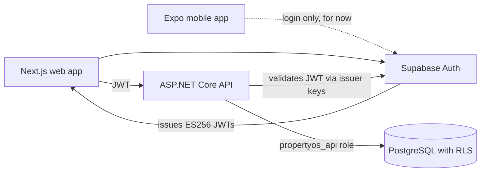

# PropertyOS

Multi-tenant property and lease management SaaS. A solo-built, spec-first project:
the product, schema and API were designed in `docs/` before the code, then delivered
in sprints (`docs/08-agile-sprints.md`).

**Status (2026-11-18):** Sprint 1 (Platform Foundation) is complete, released as
`v0.1.0-alpha`. Sprint 2 (organization, identity, and access) is in progress. The
staging API uses the least-privilege `propertyos_api` runtime role; remaining work is
tracked in `docs/08-agile-sprints.md`.

## What exists today

- **.NET 9 API** with Supabase JWT validation (ES256, signing keys discovered from the
  issuer), health checks, and an OpenAPI contract with a generated TypeScript client
- **PostgreSQL schema with row-level security** foundations, a least-privilege runtime
  role, and revoked default client privileges
- **Next.js web app** and **Expo mobile app** with Supabase login
- **CI** (GitHub Actions), Docker, a staging deployment, and ADRs in `docs/adr/`

## Architecture



## Prerequisites

- [.NET SDK 9.0](https://dotnet.microsoft.com/download/dotnet/9.0)
- [Node.js 20+](https://nodejs.org) (Next.js 16 requires Node 20.9+)
- A [Supabase](https://supabase.com) project (free tier is sufficient for local development)
- PostgreSQL is provided by Supabase; no local Postgres install is required
- For mobile: the [Expo](https://docs.expo.dev) tooling (`npx expo`), plus a simulator or the Expo Go app

## 1. Supabase project setup

1. Create a Supabase project.
2. From **Project Settings -> API**, note:
   - Project URL (`NEXT_PUBLIC_SUPABASE_URL` / `EXPO_PUBLIC_SUPABASE_URL`)
   - `anon` public key (`NEXT_PUBLIC_SUPABASE_ANON_KEY` / `EXPO_PUBLIC_SUPABASE_ANON_KEY`)
3. The JWT issuer follows the pattern `https://<project-ref>.supabase.co/auth/v1` and is set as the default in `src/PropertyOS.Api/appsettings.json` under `Supabase:JwtIssuer`. Update it if your project ref differs.
4. From **Project Settings -> Database**, copy the connection string (Session pooler or direct, depending on your setup).

The Supabase project signs access tokens with an asymmetric algorithm (ES256). The API validates them by discovering the signing keys from the configured issuer, so no JWT secret is configured or needed in the API.

Never put the `service_role` key, the database password, or a full connection string in the web or mobile apps, in committed files, or in logs.

## 2. Backend: `src/PropertyOS.Api`

```bash
# From the repository root
dotnet restore PropertyOS.sln

# Configure your local connection string (do not commit this)
cd src/PropertyOS.Api
dotnet user-secrets set "ConnectionStrings:DefaultConnection" "Host=...;Database=...;Username=...;Password=..."

# Run the API
dotnet run
```

The API listens on `http://localhost:5252` (see `Properties/launchSettings.json`). Verify it is up:

```bash
curl http://localhost:5252/api/v1/health
```

On Windows PowerShell, `curl` is an alias for `Invoke-WebRequest`; use `curl.exe` instead.

Two health endpoints exist: `/api/v1/health` (anonymous, no database access) and `/health` (anonymous, runs the database connectivity check).

### Running tests

```bash
dotnet test PropertyOS.sln
```

## 3. Database setup and migrations

There are two migration systems, and the order matters. EF Core creates the tables; the Supabase SQL then secures them.

| Order | What | How |
|---|---|---|
| 1 | EF Core migrations (tables) | `dotnet ef database update --project src/PropertyOS.Infrastructure --startup-project src/PropertyOS.Api` (run as the owner role, e.g. `postgres`) |
| 2 | `supabase/migrations/*.sql` (RLS policies, client privilege revokes, default privileges) | Run in timestamp order, via `supabase db push` or the SQL editor |
| 3 | `supabase/scripts/secure-ef-migrations-history.sql` | Run after any EF migration that creates tables. It is idempotent. |
| 4 | `supabase/scripts/bootstrap-api-role.sql` | Once per environment, as `postgres`. Creates the `propertyos_api` runtime role and its least-privilege grants. Set the role's password separately; never commit it. New tables get no grants automatically, so each migration that adds a table must grant it to `propertyos_api` explicitly. |

Why this order: the Supabase migrations reference tables that only EF creates, so they fail on a fresh database if run first.

### Database roles

| Role | Used for |
|---|---|
| `postgres` | Owner/migration identity. Runs EF migrations and the SQL above. Bypasses RLS and is not used by the request-serving API. |
| `propertyos_api` | Runtime role for the API. Not the owner and does not bypass RLS, so the row-level security policies apply to every request. |
| `anon`, `authenticated` | Supabase client roles. They must hold no privileges on `public` tables; the API is the only data path. |
| `service_role` | Server-side only. Bypasses RLS. Must never ship in a client app. |

### Tenant isolation

The API reads the `X-Organization-Id` header, verifies the caller's active membership in that organization, then sets `app.current_org_id` inside a per-request transaction. The RLS policies in `supabase/migrations/` read that setting. See `docs/adr/` (ADR-0001 and ADR-0002) for the decisions behind this.

## 4. Web: `apps/web`

```bash
cd apps/web
npm install
```

Create `apps/web/.env.local`:

```
NEXT_PUBLIC_SUPABASE_URL=https://<project-ref>.supabase.co
NEXT_PUBLIC_SUPABASE_ANON_KEY=<your-anon-key>
NEXT_PUBLIC_API_URL=http://localhost:5252
```

```bash
npm run dev
```

The app runs on `http://localhost:3000`. `NEXT_PUBLIC_API_URL` points the generated API client at the backend. To regenerate the typed client from a running local API:

```bash
npm run generate:api
```

Create a user under **Authentication -> Users** in the Supabase dashboard, then sign in at `http://localhost:3000/login`.

## 5. Mobile: `apps/mobile`

```bash
cd apps/mobile
npm install
```

Create `apps/mobile/.env`:

```
EXPO_PUBLIC_SUPABASE_URL=https://<project-ref>.supabase.co
EXPO_PUBLIC_SUPABASE_ANON_KEY=<your-anon-key>
```

```bash
npm start          # or: npm run ios / npm run android
```

The mobile app currently supports Supabase sign-in and sign-out only; it does not call the API yet.

## 6. Staging deployment

| Component | Where | Notes |
|---|---|---|
| API | Render (`render.yaml`, Docker) | Health check path: `/api/v1/health`. `ASPNETCORE_ENVIRONMENT=Staging`. |
| Web | Vercel | Set `NEXT_PUBLIC_*` variables in the project settings. Set `NEXT_PUBLIC_API_URL` to the Render service URL. |

Render environment variables (set in the dashboard; values marked secret are never committed):

| Variable | Notes |
|---|---|
| `ConnectionStrings__DefaultConnection` | Secret. The request-serving API must connect as `propertyos_api`, not `postgres`; keep the credential in the Render environment settings. |
| `Supabase__JwtIssuer` | `https://<project-ref>.supabase.co/auth/v1` |
| `Cors__AllowedOrigins__0` | The deployed web origin (for example the Vercel URL). |
| `ASPNETCORE_ENVIRONMENT` | `Staging` |

Staging checks:

```bash
curl https://<render-service>.onrender.com/api/v1/health
curl https://<render-service>.onrender.com/openapi/v1.json
```

The free Render plan spins the service down when idle, so the first request after a pause can be slow. Migrations are not applied automatically on deploy; see section 3.

## Known gaps (as of 2026-11-18)

- Organization provisioning is not yet exposed as a completed self-service API workflow. `GET /api/v1/organizations/current` exists; create/update organization and settings workflows remain Sprint 2 work.
- Full user management, invitations, sessions, login-attempt visibility, API-key lifecycle, and permission resolution remain incomplete.
- Database-backed integration tests now exist under `tests/PropertyOS.IntegrationTests/Database/` and use Testcontainers/PostgreSQL. Run the complete database test filter before treating the full suite as verified.
- The current tenant-selection contract is `X-Organization-Id` plus verified JWT `sub` membership, as documented in ADR-0002. The custom JWT claims flow in `docs/07-api-design.md` is target design, not current implementation.
- `packages/shared-types` does not exist, and the mobile app does not call the PropertyOS API yet.
- Only a staging environment exists; there is no per-PR preview deployment.
- CI runs backend build/tests and web lint/build; dedicated frontend typecheck/test and mobile CI checks are not yet configured.
- The standard API error envelope is implemented. Keep new controller, middleware, validation, and status-code errors on that shared contract.

## Solution structure

```
src/
  PropertyOS.Api/             ASP.NET Core Web API: controllers, middleware, composition root
  PropertyOS.Application/     Application layer: service interfaces, cross-cutting abstractions
  PropertyOS.Domain/          Domain entities, enums; zero external dependencies
  PropertyOS.Infrastructure/  EF Core DbContext, entity configurations, migrations
  PropertyOS.Contracts/       Request/response DTOs shared between Api and Application
tests/
  PropertyOS.UnitTests/
  PropertyOS.IntegrationTests/
apps/
  web/                        Next.js 16 (App Router) frontend
  mobile/                     Expo (React Native) app
supabase/
  migrations/                 SQL applied after EF migrations (RLS, privileges)
  scripts/                    One-off operational SQL (history table lockdown, API role bootstrap)
docs/                         Vision, requirements, stakeholders, use cases, user stories, system design, DBML schema, API design, roadmap, ADRs, diagrams
```

Dependency direction (Clean Architecture): `Domain` <- `Application` <- `Infrastructure`, with `Api` depending on `Application`, `Infrastructure`, and `Contracts`. `Domain` has no project references. Architecture decisions are recorded in `docs/adr/`.

## CI

Every PR runs `.github/workflows/ci.yml`: `dotnet build` and `dotnet test` for the backend, `npm run lint` and `npm run build` for the web app. Both must be green before merge.