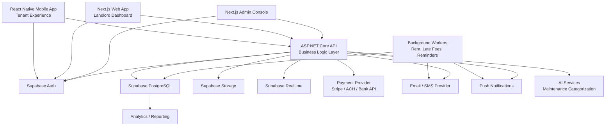

# PropertyOS System Design Document

## 1. System Overview

PropertyOS is a full-stack property management operating system for landlords, tenants, property managers, and platform administrators.

The platform provides tools for managing properties, units, leases, tenants, maintenance requests, rent tracking, documents, notifications, and future business automation.

PropertyOS is designed to support:

- A Next.js web application for landlords, property managers, and admins
- A React Native mobile application for tenants
- An ASP.NET Core backend for business logic
- Supabase for authentication, PostgreSQL database, file storage, and Row Level Security
- Future integrations with payment providers, email/SMS providers, push notifications, analytics, and AI services

The system should be designed as a real-world SaaS platform, with strong data isolation between users, scalable multi-property ownership, and a backend layer capable of handling complex business workflows.

---

## 2. Goals and Non-Goals

### Goals

- Support landlords managing multiple properties
- Support property managers with delegated access
- Support tenants assigned to units through leases
- Allow tenants to submit maintenance tickets
- Allow landlords/managers to update ticket status
- Track monthly rent obligations and payment state
- Store property, lease, receipt, inspection, and maintenance documents
- Provide strong authorization boundaries using Supabase RLS and backend checks
- Support future notification, analytics, audit logging, AI, and payment workflows

### Non-Goals

- Building a full accounting system in the first version
- Building vendor/work-order management in the first version
- Building complex rent proration and regional compliance rules in the first version
- Replacing a payment processor ledger with internal tables
- Using Supabase as the only business logic layer

---

## 3. High-Level Architecture

### Architecture Diagram



## Text-Based Architecture Explanation

PropertyOS uses a layered SaaS architecture.
The client layer contains the Next.js web app, the React Native mobile app, and the admin web interface. These clients authenticate users through Supabase Auth and interact primarily with the ASP.NET Core backend.
The ASP.NET Core backend is the central business logic layer. It validates permissions, enforces business rules, orchestrates workflows, talks to Supabase PostgreSQL, generates rent charges, applies late fees, processes payment webhooks, and triggers notifications.
Supabase PostgreSQL is the primary relational database. It stores users, roles, properties, units, leases, rent records, maintenance tickets, documents, notifications, and supporting data. Supabase RLS provides database-level isolation so tenants and landlords cannot access unrelated data.
Supabase Storage stores uploaded files such as lease agreements, receipts, inspection reports, and maintenance images. PostgreSQL stores the metadata and access relationships for those files.
Background workers handle scheduled and asynchronous jobs such as monthly rent generation, overdue rent detection, late fee calculation, lease expiry reminders, and notification delivery.
External services handle payments, email, SMS, push notifications, AI classification, and analytics.

---
## 4. Technology Stack

### Frontend Web
* Next.js
* TypeScript
* React Query or SWR
* Supabase client for auth/session handling
* Tailwind CSS or a design system such as shadcn/ui

### Mobile
* React Native
* Expo recommended for faster delivery
* Supabase auth session handling
* Push notification support through Expo Push or Firebase Cloud Messaging

### Backend
* ASP.NET Core
* C#
* Clean Architecture or modular monolith structure
* Entity Framework Core or Dapper
* Background jobs using Hangfire, Quartz.NET, or hosted workers
* OpenTelemetry for observability

### Database and Infrastructure
* Supabase PostgreSQL
* Supabase Auth
* Supabase Storage
* Supabase Row Level Security
* Supabase Realtime where useful

### External Integrations
* Stripe, ACH, or bank payment provider
* SendGrid, Postmark, or SES for email
* Twilio for SMS
* Expo Push or Firebase Cloud Messaging for push notifications
* Sentry for error tracking
* Grafana, Datadog, or Azure Monitor for metrics

---
## 5. Core Modules

## 5.1 Authentication and Authorization Module

### Responsibilities
* User registration
* Login and session management
* Role assignment
* Supabase Auth integration
* Backend token validation
* Database-level RLS enforcement
* Tenant, landlord, manager, and admin authorization

### User Types
PropertyOS supports the following platform roles:
* Tenant
* Landlord
* Property manager
* Admin

A user may have more than one role. For example, a landlord may also rent a unit from another landlord.

### Main Tables
* auth.users
* profiles
* user_roles
* property_users

### Design Notes
Supabase auth.users should remain the authentication source of truth. The application should store user profile information in profiles, linked to auth.users.id.

Application roles should be stored separately in user_roles, allowing one user to hold multiple roles.
Property-specific ownership and management should be stored in property_users, not directly on the user record. This allows a landlord or manager to be attached to multiple properties.

---
## 5.2 Property Management Module

### Responsibilities
* Create and update properties
* Manage property address and details
* Assign property owners and managers
* Manage units within properties
* Track unit status and rent amount

### Main Tables
* properties
* property_users
* units

### Key Workflows
1. Landlord creates a property.
2. System creates a property_users row assigning the landlord as owner.
3. Landlord adds units to the property.
4. Each unit has its own rent amount, occupancy status, and unit metadata.
5. Property managers can be added to help operate the property.

### Unit Statuses
* vacant
* occupied
* maintenance
* inactive

---
## 5.3 Lease and Tenant Module

### Responsibilities
* Connect tenants to units
* Track lease history
* Support multiple tenants on one lease
* Support active, ended, and terminated leases
* Provide the source of truth for tenant/unit relationships

### Main Tables
* leases
* lease_tenants
* profiles
* units

### Key Design Decision
Tenants should not be stored directly on the **units** table. A tenant belongs to a unit through a lease.
This allows the system to preserve historical occupancy, support roommate scenarios, and avoid overwriting tenancy data when a tenant moves out.

### Lease Statuses
* draft
* active
* ended
* terminated

### Key Workflows
1. Landlord creates a lease for a unit.
2. One or more tenants are attached to the lease.
3. Lease becomes active.
4. Unit status changes to occupied.
5. Rent charges are generated from lease terms.
6. When the lease ends, the unit can return to vacant.

---
## 5.4 Maintenance System

### Responsibilities
* Allow tenants to create maintenance tickets
* Allow landlords/managers to view and manage tickets
* Support priority and status tracking
* Support ticket comments
* Support image attachments
* Support future AI categorization and vendor dispatch

### Main Tables
* maintenance_tickets
* maintenance_comments
* documents
* notification_events

### Ticket Priorities
* low
* medium
* high
* urgent

### Ticket Statuses
* reported
* in_progress
* resolved

### Key Workflow
1. Tenant submits a ticket from the mobile app.
2. Backend verifies the tenant belongs to the unit.
3. Ticket is created in PostgreSQL.
4. Optional images are uploaded to Supabase Storage.
5. Document metadata rows are created.
6. Notification event is created.
7. Landlord or manager receives a notification.
8. Landlord updates ticket status.
9. Tenant receives status update.

## 5.5 Rent System

### Responsibilities
* Generate monthly rent charges
* Track due dates
* Track paid, unpaid, overdue, and partial statuses
* Support late fee calculation
* Support partial payments
* Support future payment provider integration
* Support backend financial automation

### Main Tables
* rent_charges
* rent_payments
* leases
* lease_tenants

### Payment Statuses
* unpaid
* partial
* paid
* overdue

### Key Design Decision

Rent charges and rent payments should be separate.
A rent charge represents the monthly obligation. A rent payment represents actual money received. This separation supports partial payments, failed payments, refunds, late fees, external payment references, and reconciliation.

### Key Workflow
1. Scheduled job runs monthly.
2. Active leases are queried.
3. Rent charge rows are generated.
4. Tenants are notified.
5. Tenant makes payment through payment provider.
6. Payment webhook is received by backend.
7. Backend records rent_payments.
8. Backend updates rent_charges.amount_paid and status.
9. Late fee job marks overdue rent and applies fees when required.

## 5.6 Documents Module
### Responsibilities
* Store document metadata
* Upload files to Supabase Storage
* Associate files with properties, units, leases, tickets, or rent charges
* Enforce file access through database relationships
* Support document categories

### Main Tables
* documents

### Document Types

* lease_agreement
* receipt
* inspection_report
* maintenance_attachment
* property_document
* other

### Storage Strategy
Files should be stored in Supabase Storage using structured paths:
properties/{property_id}/documents/{document_id}
units/{unit_id}/documents/{document_id}
leases/{lease_id}/{document_id}
tickets/{ticket_id}/attachments/{document_id}
rent/{rent_charge_id}/receipts/{document_id}

The database should store:
- storage_bucket
- storage_path
- mime_type
- file_size_bytes
- uploaded_by
- Related entity IDs

## 5.7 Notifications Module
### Responsibilities
* Store notification events
* Store user-facing notifications
* Support future push/email/SMS delivery
* Notify landlords and tenants about important events

### Main Tables
* notification_events
* notifications

### Example Events
* maintenance.ticket_created
* maintenance.ticket_updated
* maintenance.ticket_resolved
* rent.charge_created
* rent.payment_received
* rent.overdue
* document.uploaded
* lease.ending_soon

### Notification Channels
Initial support can be in-app only. Future channels may include:
* Email
* SMS
* Push notification
* Web push


### Database Principles

- Use UUID primary keys.
- Use foreign keys for all relationships.
- Use `created_at` and `updated_at` on all tables.
- Use enums for stable state machines.
- Use normalized relational modeling.
- Store files in Supabase Storage, not PostgreSQL.
- Store file metadata and access relationships in PostgreSQL.
- Use RLS for tenant and landlord isolation.
- Use indexes on foreign keys and common filters.

---

## 7. Security Model

### Authentication

Supabase Auth handles authentication. Clients receive JWTs after login.

The ASP.NET Core backend should validate:

- JWT signature
- Expiration
- User ID
- Role and permissions
- Resource ownership/access

### Authorization

Authorization should be enforced in two layers:

1. Backend application authorization
2. PostgreSQL Row Level Security

The backend should be the preferred write path for sensitive operations. RLS protects the database if clients query Supabase directly.

### Tenant Access

Tenants may access:

- Their own profile
- Their active leases
- Their assigned units
- Their rent charges
- Their payment history
- Their maintenance tickets
- Documents attached to their lease, unit, tickets, or rent records
- Their notifications

Tenants should not access:

- Other tenants
- Other units
- Landlord financial dashboards
- Property-wide data outside their tenancy

### Landlord and Manager Access

Landlords and managers may access:

- Properties assigned to them
- Units under those properties
- Leases under those properties
- Tenants attached to those leases
- Maintenance tickets for those properties
- Rent charges and payments for those properties
- Documents attached to those properties

Landlords and managers should not access properties they do not own or manage.

### Admin Access

Admins may access all records for platform support and operations.

---

## 8. Row Level Security Strategy

### Helper Functions

Recommended RLS helper functions:

```sql
public.is_admin()
public.manages_property(property_id uuid)
public.is_tenant_on_lease(lease_id uuid)
public.is_tenant_of_unit(unit_id uuid)
```

### Policy Examples

#### Properties

```sql
using (
  public.is_admin()
  or public.manages_property(id)
)
```

#### Units

```sql
using (
  public.is_admin()
  or public.manages_property(property_id)
  or public.is_tenant_of_unit(id)
)
```

#### Leases

```sql
using (
  public.is_admin()
  or public.manages_property(property_id)
  or public.is_tenant_on_lease(id)
)
```

#### Maintenance Tickets

```sql
using (
  public.is_admin()
  or public.manages_property(property_id)
  or reported_by = auth.uid()
  or public.is_tenant_of_unit(unit_id)
)
```

#### Rent Charges

```sql
using (
  public.is_admin()
  or public.manages_property(property_id)
  or tenant_id = auth.uid()
)
```

#### Documents

Document policies should check the related entity:

- Property documents: landlord/manager/admin
- Lease documents: tenant on lease or property manager/admin
- Ticket attachments: ticket reporter, tenant of unit, landlord/manager/admin
- Rent receipts: related tenant, landlord/manager/admin

---

## 9. Backend Architecture

### Recommended Solution Structure

```text
PropertyOS.Api
PropertyOS.Application
PropertyOS.Domain
PropertyOS.Infrastructure
PropertyOS.Jobs
PropertyOS.Tests
```

### Layer Responsibilities

#### PropertyOS.Api

- HTTP endpoints
- Request validation
- Auth token parsing
- Response formatting
- API versioning
- Rate limiting

#### PropertyOS.Application

- Use cases
- Commands and queries
- Workflow orchestration
- Permission-aware operations
- DTO mapping

#### PropertyOS.Domain

- Domain entities
- Business rules
- Rent calculation rules
- Lease status rules
- Maintenance status rules
- Domain events

#### PropertyOS.Infrastructure

- PostgreSQL access
- Supabase integration
- Storage integration
- Payment provider integration
- Notification provider integration
- Email/SMS/push clients

#### PropertyOS.Jobs

- Monthly rent generation
- Late fee calculation
- Overdue rent detection
- Lease expiry reminders
- Notification delivery
- Analytics snapshot generation

#### PropertyOS.Tests

- Unit tests
- Integration tests
- Authorization tests
- Rent calculation tests
- Webhook idempotency tests

---

## 10. API Design

### API Style

A REST API is sufficient for the first production version. GraphQL can be considered later if dashboard query complexity grows.

All endpoints should be authenticated unless explicitly public.

### Authentication/Profile

```http
GET /api/me
PATCH /api/me
GET /api/users/{userId}
PATCH /api/users/{userId}/roles
```

### Properties

```http
GET /api/properties
POST /api/properties
GET /api/properties/{propertyId}
PATCH /api/properties/{propertyId}
DELETE /api/properties/{propertyId}
POST /api/properties/{propertyId}/managers
DELETE /api/properties/{propertyId}/managers/{userId}
```

### Units

```http
GET /api/properties/{propertyId}/units
POST /api/properties/{propertyId}/units
GET /api/units/{unitId}
PATCH /api/units/{unitId}
DELETE /api/units/{unitId}
```

### Leases

```http
GET /api/properties/{propertyId}/leases
POST /api/leases
GET /api/leases/{leaseId}
PATCH /api/leases/{leaseId}
POST /api/leases/{leaseId}/tenants
DELETE /api/leases/{leaseId}/tenants/{tenantId}
POST /api/leases/{leaseId}/activate
POST /api/leases/{leaseId}/terminate
```

### Maintenance

```http
GET /api/maintenance-tickets
POST /api/maintenance-tickets
GET /api/maintenance-tickets/{ticketId}
PATCH /api/maintenance-tickets/{ticketId}
PATCH /api/maintenance-tickets/{ticketId}/status
POST /api/maintenance-tickets/{ticketId}/comments
POST /api/maintenance-tickets/{ticketId}/attachments
```

### Rent

```http
GET /api/rent-charges
GET /api/rent-charges/{rentChargeId}
POST /api/rent-charges/{rentChargeId}/payments
POST /api/rent/generate-monthly
POST /api/rent/apply-late-fees
GET /api/properties/{propertyId}/rent-summary
```

### Documents

```http
GET /api/documents
POST /api/documents/upload-url
POST /api/documents
GET /api/documents/{documentId}
DELETE /api/documents/{documentId}
```

### Notifications

```http
GET /api/notifications
PATCH /api/notifications/{notificationId}/read
PATCH /api/notifications/read-all
```

---

## 11. Data Flow Examples

### Tenant Creates Maintenance Ticket

```text
Tenant opens mobile app
-> Supabase Auth validates session
-> Tenant submits maintenance ticket
-> ASP.NET Core verifies tenant belongs to unit
-> Ticket is inserted into PostgreSQL
-> Optional images are uploaded to Supabase Storage
-> Document metadata rows are created
-> Notification event is created
-> Landlord/manager receives notification
```

### Landlord Updates Ticket

```text
Landlord opens dashboard
-> Backend verifies landlord manages property
-> Landlord changes ticket status
-> Ticket row is updated
-> Notification event is created
-> Tenant receives update
```

### Monthly Rent Generation

```text
Scheduled job starts
-> Query active leases
-> Generate rent charge for each tenant/lease/month
-> Prevent duplicates using unique constraint
-> Create notification events
-> Tenants receive rent due notifications
```

### Payment Processing

```text
Tenant starts payment
-> Backend creates payment session with payment provider
-> Tenant completes payment
-> Payment provider sends webhook
-> Backend validates webhook signature
-> Backend records rent payment
-> Backend updates rent charge status
-> Receipt document may be generated
-> Notification event is created
```

### Late Fee Processing

```text
Daily scheduled job runs
-> Find unpaid/partial rent charges past due date
-> Apply late fee rules
-> Update rent charge status to overdue
-> Create overdue notification
```

---

## 12. Background Jobs

### Required Jobs

#### Monthly Rent Generation

Runs monthly.

Responsibilities:

- Find active leases
- Generate rent charges
- Avoid duplicate charges
- Notify tenants

#### Overdue Rent Detection

Runs daily.

Responsibilities:

- Find unpaid rent past due date
- Mark as overdue
- Trigger notification

#### Late Fee Calculation

Runs daily or monthly depending on business rules.

Responsibilities:

- Apply configured late fee rules
- Update rent charge totals
- Log audit records

#### Lease Expiry Reminder

Runs daily.

Responsibilities:

- Find leases ending soon
- Notify landlords and tenants
- Support renewal workflow

#### Notification Dispatcher

Runs frequently.

Responsibilities:

- Find pending notification events
- Deliver email/SMS/push/in-app notifications
- Retry failed delivery
- Mark delivery status

---

## 13. Payment Architecture

### Recommended Approach

Use an external payment provider such as Stripe or an ACH/bank provider.

PropertyOS should not store raw card or bank details.

### Payment Provider Responsibilities

- Payment method storage
- PCI compliance
- Payment authorization
- Payment settlement
- Refunds
- Failed payment events

### PropertyOS Responsibilities

- Create payment intents/sessions
- Store payment provider references
- Validate webhooks
- Record payment status
- Reconcile rent charges
- Generate receipts
- Notify users

### Webhook Requirements

Payment webhooks must be:

- Signature validated
- Idempotent
- Logged
- Retried safely
- Linked to internal rent charge IDs

Recommended table:

```text
payment_webhook_events
```

Useful fields:

```text
id
provider
provider_event_id
event_type
payload
processed_at
created_at
```

---

## 14. File Storage Architecture

### Storage Location

Use Supabase Storage for uploaded documents and images.

### Database Metadata

PostgreSQL stores:

- File owner/uploader
- Related entity
- Storage bucket
- Storage path
- MIME type
- Size
- Document type
- Created timestamp

### Access Control

Storage access should be based on database relationships.

Examples:

- Tenant can access lease documents for their active lease.
- Tenant can access maintenance images for their own unit tickets.
- Landlord can access documents attached to their properties.
- Admin can access all documents.

### Upload Flow

```text
Client requests upload URL
-> Backend validates user access
-> Backend generates storage path
-> Client uploads file
-> Backend creates document metadata row
-> Document becomes visible through authorized queries
```

---

## 15. Observability and Logging

### Application Logs

Capture:

- API requests
- Auth failures
- Authorization failures
- Payment webhook processing
- Rent generation outcomes
- Late fee application
- Notification delivery
- Storage upload failures

### Metrics

Track:

- API latency
- Error rates
- Database query latency
- Failed login attempts
- Payment success/failure rates
- Ticket creation volume
- Average maintenance resolution time
- Rent collection rate

### Tracing

Use OpenTelemetry to trace:

- API requests
- Database calls
- External payment calls
- Notification provider calls
- Background job execution

### Recommended Tools

```text
Logging: Serilog
Tracing: OpenTelemetry
Errors: Sentry
Metrics: Grafana / Datadog / Azure Monitor
```

---

## 16. Scalability Considerations

### Database Scalability

- Add indexes on all foreign keys.
- Add indexes for high-use filters such as ticket status and rent due date.
- Paginate all large list views.
- Use materialized views or reporting snapshots for dashboards.
- Avoid expensive joins in tenant mobile app views.
- Keep transactional tables separate from analytics tables.

### Application Scalability

- Keep the backend stateless.
- Use background workers for long-running tasks.
- Use queues for notification delivery.
- Use idempotency keys for payment and rent jobs.
- Cache read-heavy dashboard summaries where appropriate.

### SaaS Scalability

PropertyOS should use shared-database multi-tenancy with strict authorization boundaries.

Tenant isolation is achieved using:

- `property_users`
- `lease_tenants`
- Backend authorization checks
- Supabase RLS policies

---

## 17. Performance Index Recommendations

Recommended indexes include:

```sql
create index idx_units_property_id on units(property_id);
create index idx_property_users_user_id on property_users(user_id);
create index idx_property_users_property_id on property_users(property_id);

create index idx_leases_property_id on leases(property_id);
create index idx_leases_unit_id on leases(unit_id);
create index idx_lease_tenants_tenant_id on lease_tenants(tenant_id);

create index idx_maintenance_tickets_property_id on maintenance_tickets(property_id);
create index idx_maintenance_tickets_unit_id on maintenance_tickets(unit_id);
create index idx_maintenance_tickets_reported_by on maintenance_tickets(reported_by);
create index idx_maintenance_tickets_status on maintenance_tickets(status);
create index idx_maintenance_tickets_status_priority on maintenance_tickets(status, priority);

create index idx_rent_charges_tenant_id on rent_charges(tenant_id);
create index idx_rent_charges_lease_id on rent_charges(lease_id);
create index idx_rent_charges_status on rent_charges(status);
create index idx_rent_charges_due_date on rent_charges(due_date);
create index idx_rent_charges_status_due_date on rent_charges(status, due_date);

create index idx_documents_property_id on documents(property_id);
create index idx_documents_unit_id on documents(unit_id);
create index idx_documents_lease_id on documents(lease_id);
create index idx_documents_ticket_id on documents(ticket_id);

create index idx_notifications_recipient_id on notifications(recipient_id);
create index idx_notifications_read_at on notifications(read_at);
```

---

## 18. Audit Logging

Audit logging should be introduced early for sensitive operations.

### Events to Audit

- User role changed
- Property created or deleted
- Unit rent changed
- Lease created, activated, ended, or terminated
- Tenant added or removed from lease
- Rent charge edited
- Payment recorded
- Maintenance ticket status changed
- Document uploaded or deleted

### Suggested Table

```text
audit_logs
```

### Suggested Fields

```text
id
actor_id
action
entity_type
entity_id
old_values
new_values
ip_address
user_agent
created_at
```

Audit logs should be append-only.

---

## 19. AI and Automation Extensions

### AI Maintenance Categorization

Future AI workflows can classify maintenance tickets by:

- Category
- Priority
- Required trade
- Estimated urgency
- Suggested landlord response
- Duplicate ticket detection

Suggested table:

```text
maintenance_ai_insights
```

### Example AI Workflow

```text
Tenant creates ticket
-> AI analyzes title, description, and images
-> AI suggests category and urgency
-> Backend stores insight
-> Landlord sees recommendation
```

### Analytics and Reporting

Future analytics can include:

- Occupancy rate
- Monthly rent collected
- Outstanding rent
- Maintenance cost trends
- Ticket volume by property
- Average resolution time
- Lease renewal rate
- Tenant payment reliability

Suggested table:

```text
property_metric_snapshots
```

---

## 20. Deployment Architecture

### Recommended Deployment

```text
Next.js Web App:       Vercel
React Native App:      App Store / Play Store / Expo EAS
ASP.NET Core API:      Azure App Service / AWS ECS / Fly.io / Render
Workers:               Same platform as backend or dedicated worker service
Database:              Supabase PostgreSQL
Auth:                  Supabase Auth
Storage:               Supabase Storage
Monitoring:            Sentry + OpenTelemetry
```

### Environments

Use separate environments:

- Development
- Staging
- Production

Each environment should have:

- Separate Supabase project
- Separate payment provider keys
- Separate storage buckets
- Separate environment variables
- Separate logging and monitoring configuration

---

## 21. Reliability and Data Integrity

### Important Practices

- Use database constraints for core invariants.
- Use idempotency keys for background jobs and webhooks.
- Use transactions for multi-step writes.
- Use optimistic concurrency where needed.
- Avoid deleting financial records.
- Prefer soft deletion for important operational records.
- Keep audit logs immutable.
- Validate permissions in backend and RLS.

### Critical Transaction Examples

Creating a lease should transactionally:

1. Create lease.
2. Attach tenants.
3. Update unit status.
4. Create initial documents if needed.
5. Write audit log.

Recording a payment should transactionally:

1. Insert payment.
2. Recalculate amount paid.
3. Update rent charge status.
4. Write audit log.
5. Create notification event.

---

## 22. Risk Areas

### Authorization Complexity

Because users can be tenants, landlords, managers, or admins, authorization must be carefully tested.

Mitigation:

- Centralize permission checks.
- Add RLS tests.
- Add backend authorization tests.
- Avoid duplicating permission logic across clients.

### Payment Reconciliation

Payment systems can produce delayed, failed, reversed, or duplicate events.

Mitigation:

- Use provider event IDs.
- Make webhooks idempotent.
- Store raw webhook payloads.
- Reconcile against provider reports.

### Rent Rules

Late fees, grace periods, proration, deposits, and local legal rules can become complex.

Mitigation:

- Keep rent logic in backend domain services.
- Store rule configuration separately.
- Avoid hardcoding region-specific rules in database triggers.

### Document Security

Documents may contain sensitive personal and financial information.

Mitigation:

- Use private storage buckets.
- Generate short-lived signed URLs.
- Enforce access through database relationships.
- Log document access where required.

---

## 23. Suggested Future Modules

### Vendor Management

Future tables:

```text
vendors
work_orders
vendor_assignments
vendor_invoices
```

### Inspections

Future tables:

```text
inspection_templates
inspection_reports
inspection_items
inspection_photos
```

### Messaging

Future tables:

```text
conversations
conversation_participants
messages
message_attachments
```

### Accounting

Future tables:

```text
ledger_accounts
ledger_entries
owner_disbursements
expense_categories
property_expenses
```

### Tenant Screening

Future tables:

```text
rental_applications
screening_reports
applicant_references
employment_history
```

---

## 24. Key Design Decisions

1. Supabase Auth owns authentication.
2. `profiles` stores application user data.
3. `user_roles` supports multiple roles per user.
4. `property_users` connects landlords and managers to properties.
5. Tenants connect to units through leases, not directly through units.
6. Rent charges and payments are separate tables.
7. Documents are stored in Supabase Storage, with metadata in PostgreSQL.
8. RLS protects direct database access.
9. ASP.NET Core owns business workflows.
10. Background jobs handle scheduled and asynchronous processes.
11. Audit logs should be append-only.
12. Payment webhooks must be idempotent.

---

## 25. Recommended MVP Scope

### MVP Should Include

- Supabase Auth
- Profiles and roles
- Property and unit management
- Lease and tenant assignment
- Maintenance ticket creation and status updates
- Basic document uploads
- Monthly rent charge tracking
- Manual payment recording
- Basic notifications
- RLS policies
- Admin access

### Defer Until Later

- Automated payment processing
- Vendor dispatch
- AI ticket classification
- Advanced analytics
- Full accounting ledger
- Tenant screening
- In-app chat
- Regional legal compliance automation

---

## 26. Summary

PropertyOS should be designed as a modular SaaS platform with strong data modeling, careful authorization, and a backend business layer that owns complex workflows.

The architecture supports:

- Multi-property landlords
- Tenant-specific mobile workflows
- Property manager delegation
- Lease-based tenancy history
- Maintenance operations
- Monthly rent tracking
- Secure document storage
- Future notifications, analytics, AI, payments, and automation

This design gives PropertyOS a production-ready foundation while leaving room to grow into a comprehensive property management operating system.
