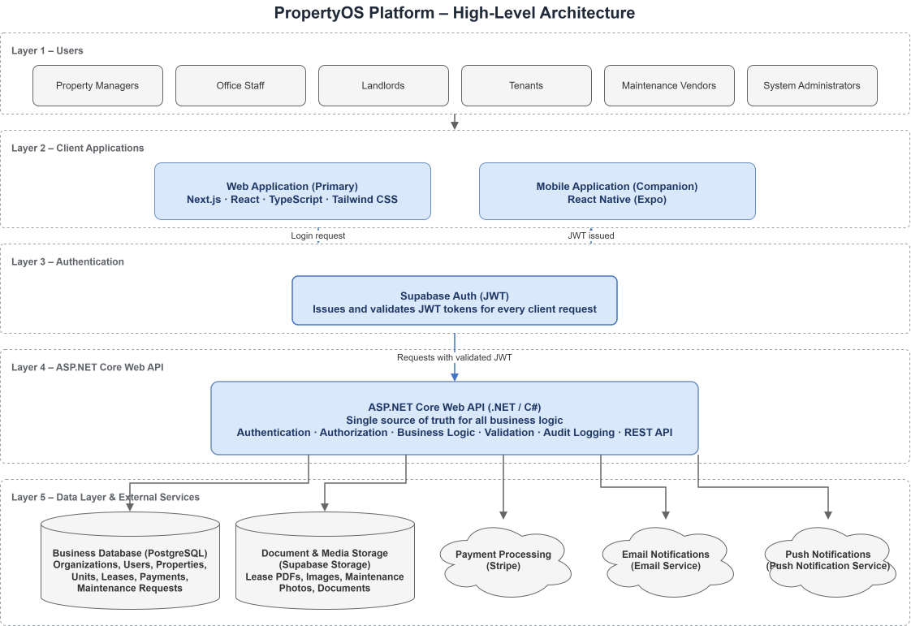
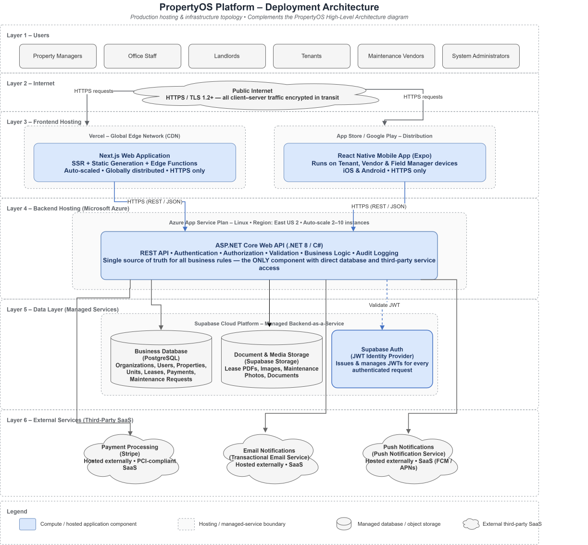

# PropertyOS — System Design

**Version:** 1.0   
**Author:** Andrew Evboifo  
**Date:** July 2026

---

# 1. Purpose

## Objective

This document describes the technical architecture of PropertyOS, including its overall structure, architectural principles, technology stack, major components, deployment model, and key design decisions.

It serves as the primary technical blueprint for developers and complements the Vision Document and Business Requirements Document by explaining **how** the system will be designed and implemented.

---

# 2. Scope

This document covers the complete technical architecture of PropertyOS, including:

- Web Application
- Mobile Application
- Backend Services
- Authentication & Authorization
- Database Design
- File Storage
- External Integrations
- Deployment Architecture
- Security
- Scalability Strategy

Detailed database schemas and API specifications are documented separately.

---

# 3. Architectural Goals

The architecture has been designed with the following goals:

- Support both independent landlords and enterprise property management companies.
- Provide a secure cloud-based SaaS platform.
- Centralize business logic within a single backend.
- Enable horizontal scalability.
- Maintain clear separation of responsibilities.
- Support desktop and mobile users.
- Minimize coupling between modules.
- Allow future expansion without major redesign.

---

# 4. High-Level Architecture

PropertyOS follows a **layered client-server architecture**.

The platform consists of five major layers:

1. Users
2. Client Applications
3. Authentication
4. Backend Services
5. Data & External Services

The ASP.NET Core Web API acts as the **single source of truth**, enforcing business rules and coordinating communication between clients, databases, storage, and third-party services.

## High-Level Architecture Diagram

**Figure 1.** High-Level Architecture of PropertyOS.

---

# 5. Architectural Style

PropertyOS adopts several architectural patterns to improve maintainability, scalability, and long-term flexibility.

## Layered Architecture

Presentation, business logic, and data access are separated into independent layers.

Benefits include:

- Better maintainability
- Separation of concerns
- Easier testing
- Improved scalability

---

## Clean Architecture

Business logic is isolated from frameworks and infrastructure.

The system follows four primary layers:

- Presentation
- Application
- Domain
- Infrastructure

This allows business rules to remain independent of databases, UI frameworks, and external services.

---

## Modular Monolith

The initial release of PropertyOS will be implemented as a **Modular Monolith**.

Each business domain is developed independently while sharing one deployment.

As the platform grows, individual modules can later be extracted into microservices if required.

---

# 6. Technology Stack

| Layer | Technology |
|----------|------------------------------|
| Web | Next.js, React, TypeScript |
| Mobile | React Native (Expo) |
| Backend | ASP.NET Core Web API (.NET) |
| ORM | Entity Framework Core |
| Database | PostgreSQL |
| Authentication | Supabase Auth |
| Storage | Supabase Storage |
| Payments | Stripe |
| Styling | Tailwind CSS |
| Hosting | Vercel + Azure + Supabase |

---

# 7. Architectural Principles

PropertyOS follows these engineering principles throughout the system.

- Separation of Concerns
- Single Responsibility Principle
- Clean Architecture
- Stateless APIs
- RESTful Design
- Role-Based Access Control
- Multi-Tenant SaaS Design
- Security by Default
- Scalability
- Maintainability
- Modularity

These principles guide every architectural and implementation decision.

---

# 8. Core System Modules

Each module represents a major business capability of PropertyOS.

---

## Authentication & User Management

### Responsibilities

- User Registration
- Login
- Logout
- Password Reset
- Role Management
- Session Validation

### Primary Entities

- User
- Role
- Permission

---

## Organization Management

### Responsibilities

- Create Organizations
- Manage Offices
- Assign Staff
- Configure Organization Settings

### Primary Entities

- Organization
- Office
- Staff

---

## Property Management

### Responsibilities

- Create Properties
- Manage Buildings
- Manage Units
- Assign Managers

### Primary Entities

- Property
- Building
- Unit

---

## Tenant Management

### Responsibilities

- Register Tenants
- Manage Profiles
- Assign Units
- Track Occupancy

### Primary Entities

- Tenant
- Occupancy

---

## Lease Management

### Responsibilities

- Create Leases
- Renew Leases
- Terminate Leases
- Store Lease Documents

### Primary Entities

- Lease
- LeaseDocument

---

## Rent Management

### Responsibilities

- Track Rent
- Record Payments
- Monitor Outstanding Balances
- Generate Payment History

### Primary Entities

- Payment
- Invoice

---

## Maintenance Management

### Responsibilities

- Submit Requests
- Assign Vendors
- Upload Photos
- Track Status
- Close Requests

### Primary Entities

- MaintenanceRequest
- Vendor
- WorkOrder

---

## Notifications

### Responsibilities

- Email Notifications
- Push Notifications
- In-App Notifications

---

## Reporting & Analytics

### Responsibilities

- Occupancy Reports
- Financial Reports
- Maintenance Reports
- Operational Dashboards

---

# 9. Authentication & Authorization

Authentication is provided using **Supabase Auth**.

Users authenticate using email/password credentials.

Supabase issues a JWT access token after successful authentication.

The ASP.NET Core Web API validates the token before processing any request.

Authorization is implemented using **Role-Based Access Control (RBAC)**.

Supported roles include:

- System Administrator
- Property Manager
- Landlord
- Office Staff
- Tenant
- Vendor

---

# 10. Data Layer

PropertyOS stores structured business data within PostgreSQL.

Core business entities include:

- Organizations
- Users
- Properties
- Buildings
- Units
- Tenants
- Leases
- Payments
- Maintenance Requests
- Notifications
- Documents

Large files such as images and lease PDFs are stored separately in Supabase Storage.

Refer to **Database Design** for the complete ERD.

---

# 11. External Services

PropertyOS integrates with several third-party services.

| Service | Purpose |
|---------|-----------------------------|
| Stripe | Payment Processing |
| Email Provider | Email Notifications |
| Push Notification Service | Mobile Notifications |
| Supabase Storage | Document Storage |

The ASP.NET Core Web API coordinates all communication with these services.

---

# 12. Key Architectural Decisions

## Why ASP.NET Core?

- High performance
- Mature ecosystem
- Excellent dependency injection
- Clean Architecture support
- Strong security features

---

## Why Next.js?

- Modern React framework
- Excellent developer experience
- TypeScript support
- SEO support
- Server-side rendering

---

## Why React Native?

- Shared TypeScript ecosystem
- Cross-platform mobile development
- Faster MVP delivery

---

## Why PostgreSQL?

- ACID compliance
- Excellent relational capabilities
- Mature indexing
- Strong scalability

---

## Why Supabase?

- Managed PostgreSQL
- Authentication
- Object Storage
- Realtime capabilities

---

# 13. Non-Functional Requirements

## Security

- HTTPS-only communication
- JWT Authentication
- Role-Based Authorization
- Secure Password Hashing
- Environment Secret Management

---

## Performance

- Database Indexing
- Query Optimization
- Pagination
- Lazy Loading
- Efficient API Responses

---

## Scalability

- Modular Architecture
- Stateless Backend
- Horizontal Scaling
- Cloud-Native Deployment

---

## Reliability

- Automatic Backups
- Logging
- Retry Policies
- Error Handling

---

## Maintainability

- Modular Codebase
- Clean Architecture
- Automated Testing
- Documentation-First Development

---

# 14. Deployment Architecture

PropertyOS is designed as a cloud-native application.

Deployment consists of:

- Next.js Web Application
- React Native Mobile Application
- ASP.NET Core Web API
- PostgreSQL Database
- Supabase Storage

## Deployment Diagram

**Figure 2.** Deployment Architecture.

---

# 15. Security Architecture

Security considerations include:

- HTTPS Enforcement
- JWT Authentication
- Role-Based Authorization
- Input Validation
- SQL Injection Prevention
- Cross-Site Scripting (XSS) Mitigation
- Cross-Site Request Forgery (CSRF) Protection
- Audit Logging
- Secure File Access

---

# 16. Future Architecture

Future versions of PropertyOS may introduce:

- AI-assisted maintenance prioritization
- Intelligent reporting
- Predictive analytics
- Real-time messaging
- IoT integrations
- Accounting software integrations
- Workflow automation
- Microservice extraction
- Multi-region deployments

---

# 17. Related Documents

This document should be read alongside:

- 00-vision.md
- 01-business-requirements.md
- 02-stakeholders-personas.md
- 03-use-cases.md
- 04-user-stories.md
- 06-database-design.md
- 07-api-design.md

---

# Revision History

| Version | Date | Description |
|----------|------|-------------|
| 1.0 | July 2026 | Initial System Design Document |

---

# End of Document
