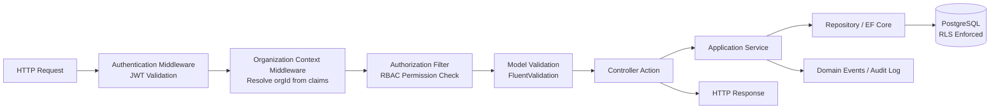
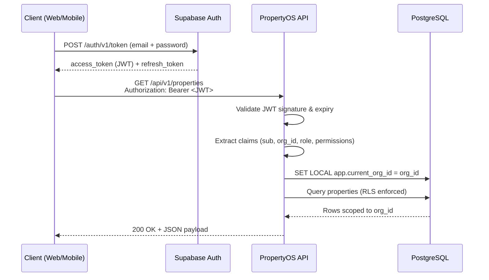
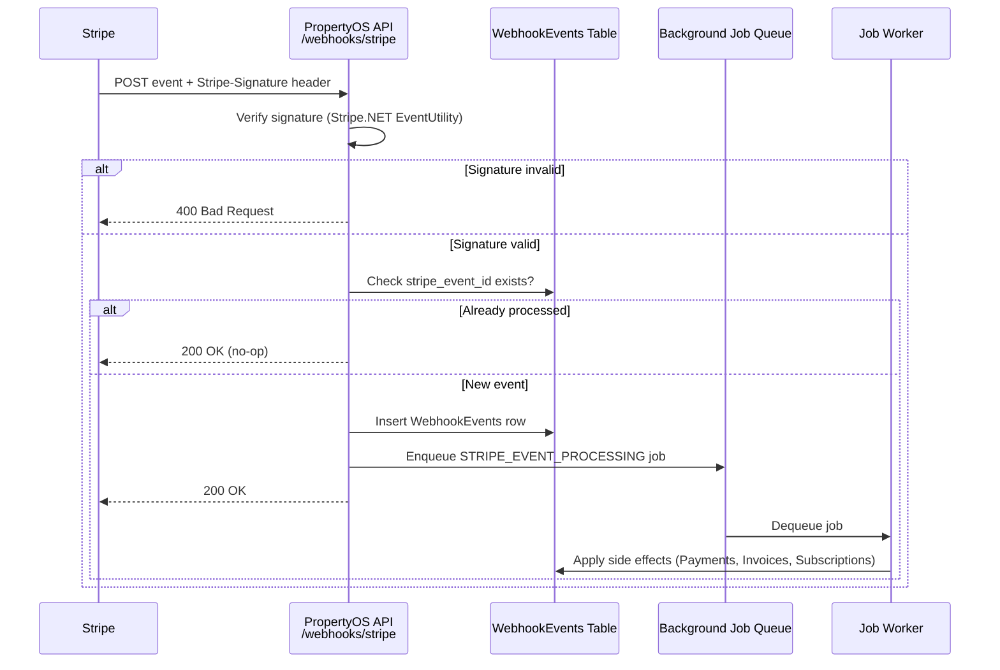
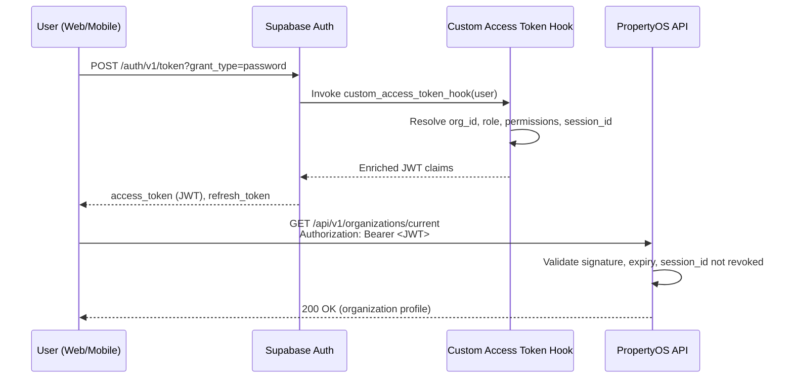
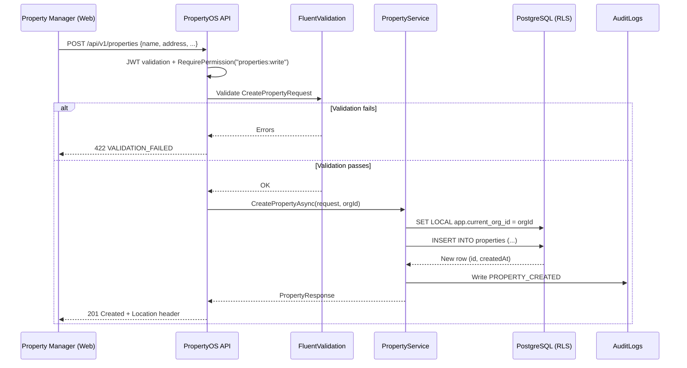
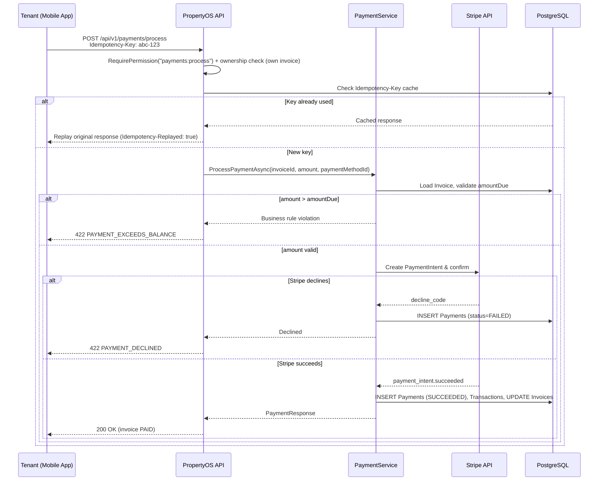
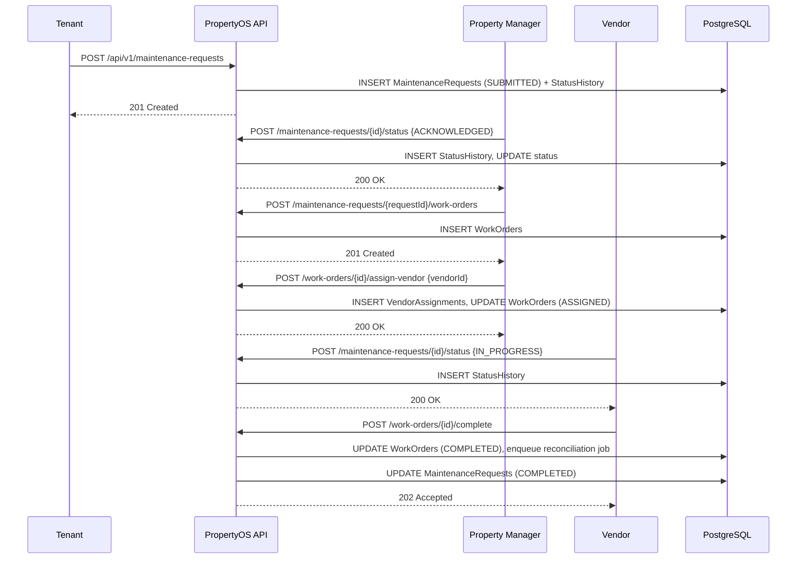
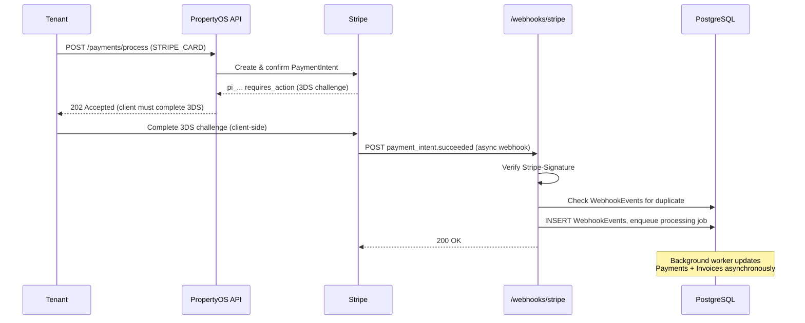
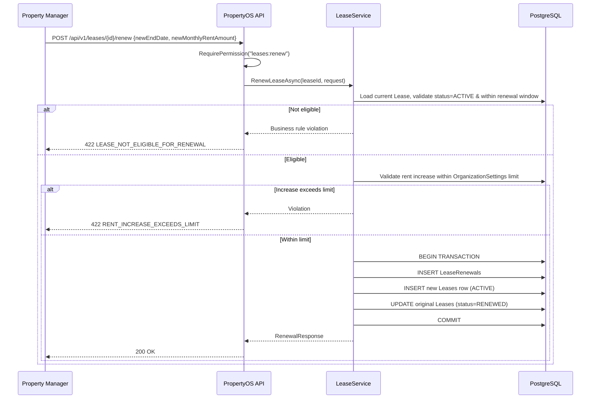

# PropertyOS — API Design Specification

**Document Version:** 1.0   
**Author:** Andrew Evboifo  
**Last Updated:** July 2026

---
## Document Purpose

This document is the authoritative API design specification for **PropertyOS**. It defines every REST resource, endpoint, contract, validation rule, business rule, and security control exposed by the ASP.NET Core 8 Web API layer. It is derived directly from the PropertyOS relational schema (`docs/06-database-design.dbml` — the canonical source of truth for entities and relationships) and is intended to be read alongside that document.

This specification does not introduce any capability that is not backed by an existing table, column, or relationship in the schema. Every endpoint maps to a persisted entity, a persisted join/history table, or a well-defined orchestration across persisted entities (e.g., "Process Payment" reads/writes `Payments`, `Transactions`, `Invoices`, and `InvoiceLineItems`).

### Intended Audience

- Backend engineers implementing controllers, services, and repositories
- Frontend and mobile engineers integrating against the API
- QA engineers writing contract and integration tests
- Technical reviewers (instructors, hiring managers, architecture reviewers) evaluating system design maturity

---

## Table of Contents

1. Architectural Context
2. Multi-Tenancy & Row Level Security
3. Authentication & Authorization
4. API Standards & Conventions
5. HTTP Status Code Semantics
6. Standardized Error Response Format
7. Domain APIs
   1. Organizations & Organization Settings
   2. Identity & Access (Users, Roles, Permissions, Invitations, Sessions, Login Attempts, API Keys)
   3. Properties, Buildings, Floors, Units, Amenities
   4. Tenants & Emergency Contacts
   5. Occupancies
   6. Leases, Lease Renewals, Lease Amendments, Security Deposits
   7. Rent Schedules, Invoices, Invoice Line Items
   8. Payments, Payment Methods, Transactions, Late Fees
   9. Maintenance, Maintenance Status History, Maintenance Images
   10. Vendors, Work Orders, Vendor Assignments
   11. Documents, Folders, Attachments
   12. Notifications, Messages, Announcements
   13. Audit Logs & Activity Logs
   14. Billing Plans, Organization Subscriptions, Platform Invoices
   15. Feature Flags
   16. Background Jobs
   17. Webhook Events & Stripe Webhook Endpoint
   18. System Settings
8. Security Controls
9. OpenAPI Integration
10. Sequence Diagrams
11. Appendix A — Permission Matrix
12. Appendix B — Enumerations
13. Appendix C — Changelog

---

## 1. Architectural Context

PropertyOS exposes a single ASP.NET Core 8 Web API following **Clean Architecture**:

```
PropertyOS.Api            → Controllers, middleware, filters, DTOs (presentation)
PropertyOS.Application    → Services, use cases, validators, mapping profiles
PropertyOS.Domain         → Entities, value objects, domain events, enums
PropertyOS.Infrastructure → EF Core DbContext, repositories, Supabase/Stripe clients
```

Every controller action follows the same pipeline:



Controllers are intentionally thin. All business logic lives in the Application layer (`IOrganizationService`, `ILeaseService`, `IPaymentService`, etc.), and all data access is mediated through repository interfaces so that EF Core is fully substitutable in unit tests.

---

## 2. Multi-Tenancy & Row Level Security

PropertyOS is a **single-database, shared-schema multi-tenant** system. Every tenant-owned table carries an `organization_id UUID NOT NULL` column, and PostgreSQL **Row Level Security (RLS)** is enabled on every tenant-owned table.

### 2.1 Tenant Resolution

1. The client authenticates via Supabase Auth and receives a JWT.
2. The JWT's custom claims include `org_id` (the organization the authenticated user is currently acting within) and `role`.
3. Every API request must carry `Authorization: Bearer <token>`.
4. `OrganizationContextMiddleware` extracts `org_id` from the validated JWT and sets it into an `IOrganizationContext` (scoped DI service) for the lifetime of the request.
5. `PropertyOsDbContext` applies a global EF Core query filter: `HasQueryFilter(e => e.OrganizationId == _organizationContext.OrganizationId)` on every tenant-scoped entity.
6. In addition to the EF Core filter (defense at the application layer), PostgreSQL RLS policies enforce the same isolation at the database layer, using `current_setting('app.current_org_id')`, which is set via `SET LOCAL` at the start of every transaction by the `TenantConnectionInterceptor`.

```sql
-- Example RLS policy (Properties table)
ALTER TABLE properties ENABLE ROW LEVEL SECURITY;

CREATE POLICY tenant_isolation_properties ON properties
    USING (organization_id = current_setting('app.current_org_id')::uuid)
    WITH CHECK (organization_id = current_setting('app.current_org_id')::uuid);
```

This gives PropertyOS **defense in depth**: even if an application-layer bug omitted the `WHERE organization_id = @orgId` predicate, the database itself would refuse to return or mutate rows belonging to another tenant.

### 2.2 Guarantees

- No controller accepts `organizationId` as a client-supplied parameter for scoping reads/writes. It is always derived from the JWT, never from the request body, query string, or route.
- Cross-tenant references (e.g., a `unitId` that does not belong to the caller's organization) resolve as `404 Not Found`, never `403 Forbidden` — this avoids leaking the existence of another tenant's data.
- Platform-level endpoints (billing plans, platform invoices, system settings) are the only endpoints that operate outside the standard organization scope, and they require the elevated `platform_admin` role, itself still subject to its own row-level restrictions.
- Bulk/report endpoints that aggregate across an organization (e.g., `GET /api/v1/properties/{id}/financial-summary`) still execute inside the tenant-scoped connection and cannot escape the RLS boundary.

### 2.3 Superadmin / Support Access

Internal Anthropic-style "impersonate tenant for support" access is **not** implicitly granted. A platform support engineer must explicitly issue a scoped, time-boxed support session token (`support_session`, max TTL 30 minutes) which is itself audit-logged in `AuditLogs` with `action = 'SUPPORT_IMPERSONATION_START'`.

---

## 3. Authentication & Authorization

### 3.1 Identity Provider

PropertyOS delegates identity to **Supabase Authentication**. Supabase issues short-lived JWTs (default TTL 3600s) signed with the project's JWT secret (HS256) or, in projects using asymmetric signing, ES256 via Supabase's JWKS endpoint.



### 3.2 JWT Validation

`JwtBearerMiddleware` is configured with:

- `Authority`: the Supabase project's issuer URL, used to fetch signing keys (JWKS) with caching.
- `ValidateIssuer`, `ValidateAudience`, `ValidateLifetime`: all `true`.
- `ClockSkew`: 60 seconds.
- On failure, the middleware short-circuits with `401 Unauthorized` using the standard error envelope (Section 6), and never leaks whether the failure was due to expiry, signature mismatch, or malformed token.

### 3.3 Claims Schema

| Claim | Description |
|---|---|
| `sub` | Supabase user UUID — maps to `Users.id` |
| `email` | User's email address |
| `org_id` | Active organization UUID — maps to `Organizations.id` |
| `role` | Primary role slug, e.g. `org_admin`, `property_manager`, `tenant`, `vendor`, `platform_admin` |
| `permissions` | Array of fine-grained permission strings resolved at token-issue time, e.g. `["leases:read", "leases:write", "invoices:void"]` |
| `session_id` | Maps to `UserSessions.id`, used for session revocation checks |
| `iat` / `exp` | Standard issued-at / expiry timestamps |

Custom claims (`org_id`, `role`, `permissions`, `session_id`) are populated by a Postgres function wired into Supabase's **Auth Hooks** (`custom_access_token_hook`), which reads from `Users`, `UserOrganizationRoles`, and `RolePermissions` at token-mint time.

### 3.4 Authorization Middleware & RBAC

Authorization is enforced with a custom `[RequirePermission("resource:action")]` attribute applied at the controller-action level:

```csharp
[HttpPost]
[RequirePermission("properties:write")]
public async Task<IActionResult> CreateProperty([FromBody] CreatePropertyRequest request)
{
    var result = await _propertyService.CreateAsync(request, _organizationContext.OrganizationId);
    return CreatedAtAction(nameof(GetById), new { id = result.Id }, result);
}
```

`PermissionAuthorizationFilter` runs after authentication and:

1. Reads the `permissions` claim array from the validated principal.
2. Checks membership of the required permission string.
3. If the session has been revoked (checked against `UserSessions.revoked_at IS NOT NULL` via a lightweight cache-backed lookup), returns `401 Unauthorized`.
4. If the permission is absent, returns `403 Forbidden` with an error code of `INSUFFICIENT_PERMISSION`.

### 3.5 Role Resolution

Roles are organization-scoped (a user may hold different roles in different organizations, modeled via `UserOrganizationRoles`). `Users` rows are platform-level identities with no `organization_id` column of their own; every user-to-org relationship — including a user's *first* organization — is a row in `UserOrganizationRoles` (DB table: `user_organization_roles`), keyed on `(user_id, organization_id, role_id)`. A JWT's `org_id` claim (§3.3) reflects the user's *active* organization for that session, not their only one. Built-in roles:

| Role | Description |
|---|---|
| `platform_admin` | PropertyOS platform operator; manages billing plans, feature flags, platform invoices |
| `org_admin` | Full control within a single organization |
| `property_manager` | Manages properties, units, leases, maintenance, vendors |
| `accountant` | Manages invoices, payments, rent schedules, financial reporting |
| `maintenance_staff` | Manages work orders and maintenance status updates |
| `vendor` | External vendor with restricted access to assigned work orders only |
| `tenant` | Restricted self-service access (own lease, own invoices, own maintenance requests) |

### 3.6 Permission Evaluation

Permissions follow a `resource:action` convention (see Appendix A for the full matrix), e.g.:

- `properties:read`, `properties:write`, `properties:delete`
- `leases:read`, `leases:write`, `leases:renew`, `leases:terminate`
- `invoices:read`, `invoices:write`, `invoices:void`
- `payments:process`, `payments:refund`
- `apikeys:manage`

Permissions are additive per role via `RolePermissions`, and an organization admin may customize role-permission assignments per organization (stored in `RolePermissions.organization_id`, nullable for system-default roles vs. non-null for org-specific overrides).

---

## 4. API Standards & Conventions

### 4.1 REST Principles

- Resources are nouns, always **plural** (`/properties`, `/leases`, `/invoices`), never verbs, except for well-defined **action sub-resources** (Section 7.19 lists these) which use a verb suffix on an existing resource path, e.g. `POST /api/v1/leases/{id}/renew`.
- Nesting is limited to two levels to avoid deeply coupled URLs, e.g. `/api/v1/properties/{propertyId}/units` is allowed; `/api/v1/properties/{propertyId}/units/{unitId}/leases/{leaseId}/amendments/{amendmentId}/history` is not — deeper relationships are addressed via flat resource lookups with filter query parameters instead (`/api/v1/lease-amendments?leaseId={leaseId}`).

### 4.2 Versioning

All routes are prefixed `/api/v1/`. Versioning strategy is **URL segment versioning**, chosen over header-based versioning for cache-friendliness and discoverability in tooling like Postman/Swagger. Breaking changes are shipped under `/api/v2/` with the prior version supported for a minimum deprecation window of 12 months, communicated via the `Sunset` HTTP header on `/api/v1/` responses once a v2 exists.

### 4.3 Naming Conventions

| Concern | Convention | Example |
|---|---|---|
| Resource path segments | plural, kebab-case for multi-word resources | `/lease-amendments`, `/work-orders` |
| JSON property names | camelCase | `unitId`, `leaseStartDate`, `monthlyRentAmount` |
| Enum values (JSON) | UPPER_SNAKE_CASE string | `"status": "PENDING_APPROVAL"` |
| Timestamps | ISO-8601, UTC, `Z` suffix | `"createdAt": "2026-07-31T14:02:31.000Z"` |
| Identifiers | UUID v4/v7 strings | `"id": "9c858f3e-8f2a-4a2f-9b8b-9b9c3e8a1a11"` |
| Monetary amounts | Decimal (never float) serialized as JSON number with fixed 2 decimal places, currency accompanied by an explicit `currency` field (ISO 4217) | `"amount": 1450.00, "currency": "CAD"` |

### 4.4 UUIDs

All primary keys are `UUID` (`uuid_generate_v7()` at the database layer for time-ordered insert locality). UUIDs are never sequential integers, preventing enumeration attacks and simplifying multi-tenant merges/imports.

### 4.5 Idempotency

State-changing `POST` operations that trigger financial or external-system side effects (`Process Payment`, `Void Invoice`, `Generate Monthly Rent`, `Process Stripe Webhook`) require an `Idempotency-Key` request header (a client-generated UUID). The API persists `(idempotency_key, organization_id, response_hash, response_body, status_code)` in an `IdempotencyKeys` table (DB: `idempotency_keys`) for 24 hours, uniquely keyed on `(idempotency_key, organization_id)`. A repeated request with the same key returns the original cached response with header `Idempotency-Replayed: true` rather than re-executing the operation.

### 4.6 PATCH vs. PUT

- **PATCH** is used exclusively for partial updates and is the standard update verb across the API. Request bodies follow a "merge" semantic — only supplied fields are updated; omitted fields are left untouched. PropertyOS does **not** implement JSON Patch (RFC 6902); it uses simple partial-object PATCH for developer ergonomics, documented per-endpoint.
- **PUT** is not used anywhere in the API surface, to avoid ambiguity between full-replace and partial-update semantics across 40+ resources. This is a deliberate convention documented here to prevent inconsistent adoption by future contributors.

### 4.7 Soft Delete

Domain entities central to financial and legal history (`Leases`, `Invoices`, `Payments`, `Tenants`, `Properties`, `Units`, `Documents`) are **never hard-deleted**. `DELETE` endpoints on these resources set `deleted_at = now()` and `deleted_by_user_id`, and the EF Core global query filter automatically excludes soft-deleted rows (`WHERE deleted_at IS NULL`) from all standard queries. Hard delete is reserved for genuinely ephemeral or non-authoritative data (e.g., `LoginAttempts` older than the retention window, purged via a scheduled background job, not via the public API).

Soft-deleted resources return `404 Not Found` on subsequent `GET` requests (not `410 Gone`), consistent with the tenant-isolation "don't reveal what you can't access" posture, except for `org_admin`/`platform_admin` roles hitting an explicit `?includeDeleted=true` query parameter on list endpoints, used for audit/recovery workflows.

### 4.8 Pagination

All collection (`GET` list) endpoints are paginated using **cursor-based pagination** for stability under concurrent writes, with an offset-based fallback for simple admin screens.

Query parameters:

| Parameter | Type | Default | Description |
|---|---|---|---|
| `pageSize` | int | 25 | Max 100 |
| `cursor` | string | null | Opaque, base64-encoded cursor from a prior response's `nextCursor` |
| `page` | int | 1 | Optional offset-mode alternative to `cursor`, primarily used by admin data grids that need "jump to page N" |

Standard paginated envelope:

```json
{
  "data": [ { "...": "..." } ],
  "pagination": {
    "pageSize": 25,
    "totalCount": 341,
    "nextCursor": "eyJpZCI6IjY0ZjcuLi4ifQ==",
    "hasMore": true
  }
}
```

### 4.9 Filtering, Sorting, Searching

- **Filtering**: `?status=ACTIVE&propertyId={uuid}` — exact-match filters on indexed columns, documented per-endpoint.
- **Range filtering**: `?createdAfter=2026-01-01T00:00:00Z&createdBefore=2026-06-01T00:00:00Z`.
- **Sorting**: `?sort=-createdAt,unitNumber` — comma-separated, `-` prefix denotes descending.
- **Searching**: `?q=<term>` — full-text search against a curated set of columns per resource (documented per-endpoint), backed by PostgreSQL `tsvector` generated columns and GIN indexes for resources with free-text search requirements (Properties, Tenants, Vendors, Documents).

### 4.10 Rate Limiting

Enforced via ASP.NET Core's built-in `Microsoft.AspNetCore.RateLimiting` middleware using a sliding-window limiter, keyed by `organization_id` (not by IP, since PropertyOS is B2B and many users share office NAT egress):

| Tier | Limit |
|---|---|
| Standard authenticated request | 600 requests / minute / organization |
| Write-heavy financial endpoints (`payments`, `invoices`) | 120 requests / minute / organization |
| Webhook endpoint (`/webhooks/stripe`) | Exempt from per-org limiting; limited instead by source IP allowlist (Stripe's published egress ranges) |
| Unauthenticated endpoints (`/auth/*` proxy helpers) | 20 requests / minute / IP |

Exceeding a limit returns `429 Too Many Requests` with a `Retry-After` header (seconds) and standard error envelope, `errorCode: RATE_LIMIT_EXCEEDED`.

### 4.11 Caching

- `GET` endpoints for largely-static reference data (`Amenities`, `FeatureFlags`, `BillingPlans`) emit `Cache-Control: private, max-age=60` and `ETag` headers; conditional requests with `If-None-Match` return `304 Not Modified`.
- Financial and frequently-mutated resources (`Invoices`, `Payments`, `WorkOrders`) are marked `Cache-Control: no-store` to avoid stale-state bugs in clients.

### 4.12 Correlation IDs & Request IDs

- Every response includes an `X-Request-Id` header (a server-generated UUID, unique per HTTP request), logged in structured application logs (Serilog) and included in every `AuditLogs` row written during that request.
- Clients may supply `X-Correlation-Id` on the request to thread a single logical operation across multiple HTTP calls (e.g., mobile app onboarding flow); if absent, the server generates one and echoes it back. Correlation IDs propagate to downstream calls (Stripe, Supabase Storage) via their respective idempotency/metadata fields where supported.


---

## 5. HTTP Status Code Semantics

| Code | Name | Usage in PropertyOS |
|---|---|---|
| **200** | OK | Successful `GET`, successful `PATCH` returning the updated resource, successful action endpoints that return a result body (e.g., `POST /leases/{id}/renew`). |
| **201** | Created | Successful `POST` that creates a new resource. Response includes `Location` header pointing to the new resource and the created resource body. |
| **202** | Accepted | Long-running or asynchronous operations accepted for background processing but not yet complete, e.g. `POST /work-orders/{id}/complete` when it triggers async vendor invoice reconciliation, or `POST /background-jobs/{id}/retry`. Response body includes a `jobId` for status polling. |
| **204** | No Content | Successful `DELETE` (soft delete), and actions with no meaningful response body (e.g., `POST /notifications/{id}/mark-read`). |
| **400** | Bad Request | Malformed request syntax: invalid JSON, missing required query parameter, invalid UUID format in a path segment. |
| **401** | Unauthorized | Missing, malformed, expired, or signature-invalid JWT; revoked session. |
| **403** | Forbidden | Valid, authenticated principal lacking the required permission for the action, or an authenticated tenant/vendor attempting to access a resource outside their explicit scope (their own lease, their own assigned work order). |
| **404** | Not Found | Resource does not exist, is soft-deleted, or belongs to a different organization (tenant isolation — never disclosed as 403). |
| **409** | Conflict | Business-state conflicts: attempting to renew a lease that is already terminated; attempting to void an invoice that already has payments applied; duplicate unique constraint (e.g., creating a second active `OrganizationSubscription` for a plan that only allows one active subscription). |
| **412** | Precondition Failed | Optimistic concurrency conflict — `If-Match` header (entity `ETag`/`rowVersion`) does not match current server-side version, used on `PATCH` for high-contention resources like `WorkOrders` and `Invoices` edited concurrently by multiple staff. |
| **422** | Unprocessable Entity | Syntactically valid request that fails semantic/business validation: a lease `endDate` before `startDate`; a payment `amount` exceeding the invoice's `amountDue`; an invalid state transition. |
| **429** | Too Many Requests | Rate limit exceeded (Section 4.10). |
| **500** | Internal Server Error | Unhandled exception. Never leaks stack traces or internal exception messages to the client; logs full detail server-side keyed by `X-Request-Id`. |

Distinction between **400**, **422**, and **409** is enforced consistently: 400 = "I can't parse this," 422 = "I understood this, but it violates a business rule," 409 = "This conflicts with the current state of another resource."

---

## 6. Standardized Error Response Format

Every non-2xx response uses the following envelope:

```json
{
  "error": {
    "code": "VALIDATION_FAILED",
    "message": "The request contains one or more validation errors.",
    "requestId": "b3f1a2d4-9e21-4a30-8f10-52a6c1d9e001",
    "timestamp": "2026-07-31T14:02:31.114Z",
    "details": [
      {
        "field": "leaseEndDate",
        "issue": "leaseEndDate must be after leaseStartDate"
      }
    ]
  }
}
```

### 6.1 Validation Error (422 / 400)

```json
{
  "error": {
    "code": "VALIDATION_FAILED",
    "message": "The request contains one or more validation errors.",
    "requestId": "b3f1a2d4-9e21-4a30-8f10-52a6c1d9e001",
    "timestamp": "2026-07-31T14:02:31.114Z",
    "details": [
      { "field": "unitId", "issue": "unitId is required" },
      { "field": "monthlyRentAmount", "issue": "monthlyRentAmount must be greater than 0" }
    ]
  }
}
```

### 6.2 Business Rule Error (422 / 409)

```json
{
  "error": {
    "code": "LEASE_ALREADY_TERMINATED",
    "message": "Lease 4f2a9c3e-... has already been terminated and cannot be renewed.",
    "requestId": "9a2f1c4e-7712-4a90-8bcb-01e3f9a2b410",
    "timestamp": "2026-07-31T14:05:12.881Z"
  }
}
```

### 6.3 Permission Error (403)

```json
{
  "error": {
    "code": "INSUFFICIENT_PERMISSION",
    "message": "Your role does not have permission to perform this action.",
    "requestId": "1e77c2aa-3344-4b10-9a0e-9dccf2a11009",
    "timestamp": "2026-07-31T14:06:03.220Z",
    "details": [
      { "field": "requiredPermission", "issue": "invoices:void" }
    ]
  }
}
```

### 6.4 Unexpected Error (500)

```json
{
  "error": {
    "code": "INTERNAL_SERVER_ERROR",
    "message": "An unexpected error occurred. Please contact support with the requestId below.",
    "requestId": "70a1cbe4-114f-4e2a-9c2b-6cf1a9d20033",
    "timestamp": "2026-07-31T14:07:44.552Z"
  }
}
```

### 6.5 Error Code Registry (excerpt)

| Code | HTTP Status | Meaning |
|---|---|---|
| `VALIDATION_FAILED` | 400/422 | Field-level validation failure |
| `RESOURCE_NOT_FOUND` | 404 | Resource missing, deleted, or out of tenant scope |
| `INSUFFICIENT_PERMISSION` | 403 | RBAC permission missing |
| `UNAUTHORIZED` | 401 | Invalid/expired/missing token |
| `CONFLICT` | 409 | Generic state conflict |
| `CONCURRENCY_CONFLICT` | 412 | `If-Match` mismatch |
| `RATE_LIMIT_EXCEEDED` | 429 | Too many requests |
| `LEASE_ALREADY_TERMINATED` | 409/422 | Lease state conflict |
| `INVOICE_ALREADY_VOID` | 409 | Invoice already voided |
| `INVOICE_HAS_PAYMENTS` | 409 | Cannot void an invoice with applied payments |
| `PAYMENT_EXCEEDS_BALANCE` | 422 | Payment amount exceeds `amountDue` |
| `STRIPE_SIGNATURE_INVALID` | 400 | Webhook signature verification failed |
| `IDEMPOTENCY_KEY_REUSED_WITH_DIFFERENT_PAYLOAD` | 409 | Same key, different request body |
| `INTERNAL_SERVER_ERROR` | 500 | Unhandled exception |


---

## 7. Domain APIs

Each domain section documents its resource model, endpoint summary table, and full endpoint contracts. Unless otherwise stated, **all endpoints require a valid Bearer JWT** and are **organization-scoped** per Section 2.

### 7.1 Organizations & Organization Settings

**Backing tables:** `Organizations`, `OrganizationSettings`

#### Endpoint Summary

| Method | Path | Permission | Purpose |
|---|---|---|---|
| GET | `/api/v1/organizations/current` | `organizations:read` | Fetch the caller's active organization |
| PATCH | `/api/v1/organizations/current` | `organizations:write` | Update organization profile |
| GET | `/api/v1/organizations/current/settings` | `organizations:read` | Fetch org-level settings |
| PATCH | `/api/v1/organizations/current/settings` | `organizations:write` | Update org-level settings |

#### `GET /api/v1/organizations/current`

- **Purpose:** Returns the organization identified by the caller's JWT `org_id` claim.
- **Auth:** Required. **Permission:** `organizations:read`.
- **Path/Query Parameters:** None.
- **Response 200:**

```json
{
  "id": "6b1e6b0a-2e6a-4b8e-9a2e-8c9f7a2b1000",
  "name": "Harborview Property Group",
  "legalName": "Harborview Property Group Inc.",
  "billingEmail": "billing@harborview.example",
  "timeZone": "America/Toronto",
  "currency": "CAD",
  "createdAt": "2024-03-11T09:00:00.000Z",
  "updatedAt": "2026-06-02T17:21:04.000Z"
}
```

- **Possible Responses:** `200`, `401`.

#### `PATCH /api/v1/organizations/current`

- **Purpose:** Updates organization profile fields.
- **Permission:** `organizations:write` (typically `org_admin` only).
- **Request Body:**

```json
{ "name": "Harborview Property Group", "billingEmail": "ap@harborview.example", "timeZone": "America/Toronto" }
```

- **Validation Rules:** `name` 2–200 chars if present; `billingEmail` valid email format; `timeZone` must be a valid IANA time zone identifier; `currency` immutable after first `OrganizationSubscription` is created (returns `422 ORGANIZATION_CURRENCY_LOCKED`).
- **Business Rules:** Only one active organization profile per tenant; changes are written to `AuditLogs` with before/after diff.
- **Responses:** `200`, `400`, `403`, `422`.

#### `GET` / `PATCH /api/v1/organizations/current/settings`

- **Purpose:** Manages `OrganizationSettings` (e.g., late fee grace period days, default lease term months, notification preferences, invoice numbering prefix).
- **Example response body:**

```json
{
  "lateFeeGraceDays": 5,
  "lateFeeFlatAmount": 50.00,
  "defaultLeaseTermMonths": 12,
  "invoiceNumberPrefix": "HPG-INV-",
  "autoGenerateMonthlyRent": true,
  "notifyTenantsOnMaintenanceStatusChange": true
}
```

- **Business Rules:** `lateFeeFlatAmount` and `lateFeeGraceDays` used by the `Generate Monthly Rent` and `Late Fees` orchestration (Section 7.8). Changing `invoiceNumberPrefix` only affects invoices generated after the change; historical invoice numbers are immutable.

---

### 7.2 Identity & Access

**Backing tables:** `Users`, `UserOrganizationRoles` (DB: `user_organization_roles`), `Roles`, `Permissions`, `RolePermissions`, `UserSessions`, `LoginAttempts`, `ApiKeys`

#### Endpoint Summary

| Method | Path | Permission | Purpose |
|---|---|---|---|
| GET | `/api/v1/users` | `users:read` | List organization members |
| GET | `/api/v1/users/{id}` | `users:read` | Get a user |
| POST | `/api/v1/users/invite` | `users:invite` | **Action:** Invite a user to the organization |
| PATCH | `/api/v1/users/{id}` | `users:write` | Update a user's profile/role |
| DELETE | `/api/v1/users/{id}` | `users:write` | Deactivate (soft-delete) a user's org membership |
| POST | `/api/v1/auth/reset-password` | none (public, rate-limited) | **Action:** Trigger password reset email |
| GET | `/api/v1/users/{id}/sessions` | `users:read` | List active sessions |
| DELETE | `/api/v1/users/{id}/sessions/{sessionId}` | `users:write` | Revoke a session |
| GET | `/api/v1/login-attempts` | `users:read` (org_admin only) | Audit view of login attempts |
| GET | `/api/v1/api-keys` | `apikeys:manage` | List organization API keys |
| POST | `/api/v1/api-keys` | `apikeys:manage` | **Action:** Generate a new API key |
| POST | `/api/v1/api-keys/{id}/rotate` | `apikeys:manage` | **Action:** Rotate an API key |
| DELETE | `/api/v1/api-keys/{id}` | `apikeys:manage` | Revoke an API key |

#### `POST /api/v1/users/invite` (Action)

- **Purpose:** Creates a pending `Users` record (if the email is new to the platform) or attaches an existing Supabase-authenticated user to this organization via `UserOrganizationRoles`, and sends an invitation email through Supabase Auth's invite link mechanism.
- **Permission:** `users:invite`.
- **Request Body:**

```json
{ "email": "new.manager@harborview.example", "role": "property_manager" }
```

- **Validation:** `email` required, valid format; `role` must be one of the organization's configured roles.
- **Business Rules:** If the email already belongs to a user in a *different* organization, a new `UserOrganizationRoles` row is created linking them to this organization without affecting their access elsewhere (supports contractors/property managers working across multiple client organizations). Duplicate active invitations to the same email within the same organization return `409 CONFLICT` (`code: INVITATION_ALREADY_PENDING`).
- **Response 202:** `{ "invitationId": "...", "email": "...", "status": "PENDING", "expiresAt": "2026-08-07T00:00:00.000Z" }`
- **Responses:** `202`, `400`, `403`, `409`.

#### `POST /api/v1/auth/reset-password` (Action, public)

- **Purpose:** Triggers Supabase Auth's password-reset email flow.
- **Auth:** None required (must remain accessible to locked-out users); strictly rate-limited (Section 4.10, unauthenticated tier) and does not reveal whether the email exists (`202 Accepted` regardless).
- **Request Body:** `{ "email": "user@example.com" }`
- **Response:** `202 Accepted`, empty-ish body: `{ "message": "If an account exists for this email, a reset link has been sent." }`
- **Security Note:** Every attempt is written to `LoginAttempts` with `attempt_type = 'PASSWORD_RESET_REQUEST'` for anomaly detection.

#### `POST /api/v1/api-keys` (Action)

- **Purpose:** Generates a new organization-scoped API key for machine-to-machine integrations (e.g., accounting system sync).
- **Permission:** `apikeys:manage` (`org_admin` only).
- **Request Body:** `{ "name": "QuickBooks Sync", "scopes": ["invoices:read", "payments:read"], "expiresAt": "2027-07-31T00:00:00.000Z" }`
- **Business Rules:** The raw key is returned **exactly once** in the creation response; only its bcrypt hash and a display prefix (`pk_live_8f2a...`) are persisted in `ApiKeys`. `scopes` must be a subset of permissions the requesting admin holds.
- **Response 201:**

```json
{
  "id": "b7e2f9a0-...",
  "name": "QuickBooks Sync",
  "keyPrefix": "pk_live_8f2a",
  "apiKey": "pk_live_8f2a91cd0e3b4f2a8e9d1c7b6a5f4e3d2c1b0a9f8e7d6c5b4a3f2e1d0c9b8a7",
  "scopes": ["invoices:read", "payments:read"],
  "expiresAt": "2027-07-31T00:00:00.000Z",
  "createdAt": "2026-07-31T14:10:00.000Z"
}
```

- **Responses:** `201`, `400`, `403`.

#### `POST /api/v1/api-keys/{id}/rotate` (Action)

- **Purpose:** Invalidates the current key material and issues a new secret while preserving the `ApiKeys` row's id, name, and scopes — avoiding the need to reconfigure downstream integrations' key *identity*, only their secret.
- **Business Rules:** Old key remains valid for a 24-hour grace window (`grace_expires_at`) to allow zero-downtime rotation in downstream systems, then is hard-invalidated by a background job.
- **Response 200:** Same shape as creation, with a fresh `apiKey` value.
- **Responses:** `200`, `403`, `404`.


---

### 7.3 Properties, Buildings, Floors, Units, Amenities

**Backing tables:** `Properties`, `Buildings`, `Floors`, `Units`, `Amenities`, `UnitAmenities`

This domain models the physical hierarchy: an **Organization** owns **Properties** → each Property has one or more **Buildings** → each Building has **Floors** → each Floor has **Units** → each Unit may have many **Amenities** (through a join table).

#### Endpoint Summary

| Method | Path | Permission | Purpose |
|---|---|---|---|
| GET | `/api/v1/properties` | `properties:read` | List properties (paginated, filterable, searchable) |
| GET | `/api/v1/properties/{id}` | `properties:read` | Get a property |
| POST | `/api/v1/properties` | `properties:write` | Create a property |
| PATCH | `/api/v1/properties/{id}` | `properties:write` | Update a property |
| DELETE | `/api/v1/properties/{id}` | `properties:delete` | Soft-delete a property |
| GET | `/api/v1/properties/{propertyId}/buildings` | `properties:read` | List buildings for a property |
| POST | `/api/v1/properties/{propertyId}/buildings` | `properties:write` | Create a building |
| PATCH | `/api/v1/buildings/{id}` | `properties:write` | Update a building |
| DELETE | `/api/v1/buildings/{id}` | `properties:delete` | Soft-delete a building |
| GET | `/api/v1/buildings/{buildingId}/floors` | `properties:read` | List floors |
| POST | `/api/v1/buildings/{buildingId}/floors` | `properties:write` | Create a floor |
| GET | `/api/v1/units` | `units:read` | List units (org-wide, filterable by property/building/floor/status) |
| GET | `/api/v1/units/{id}` | `units:read` | Get a unit |
| POST | `/api/v1/floors/{floorId}/units` | `units:write` | Create a unit |
| PATCH | `/api/v1/units/{id}` | `units:write` | Update a unit |
| DELETE | `/api/v1/units/{id}` | `units:delete` | Soft-delete a unit |
| GET | `/api/v1/amenities` | `properties:read` | List the organization's amenity catalog |
| POST | `/api/v1/amenities` | `properties:write` | Create an amenity catalog entry |
| POST | `/api/v1/units/{unitId}/amenities` | `units:write` | Attach amenities to a unit |
| DELETE | `/api/v1/units/{unitId}/amenities/{amenityId}` | `units:write` | Remove an amenity from a unit |

#### `GET /api/v1/properties`

- **Purpose:** Returns a paginated list of properties for the caller's organization.
- **Auth:** Required. **Permission:** `properties:read`.
- **Query Parameters:**

| Param | Type | Description |
|---|---|---|
| `q` | string | Full-text search across `name`, `addressLine1`, `city` |
| `city` | string | Exact-match filter |
| `propertyType` | enum | `RESIDENTIAL`, `COMMERCIAL`, `MIXED_USE` |
| `sort` | string | e.g. `-createdAt`, `name` |
| `pageSize`, `cursor` | — | Standard pagination (Section 4.8) |

- **Response 200:**

```json
{
  "data": [
    {
      "id": "e1a2b3c4-...",
      "name": "Harborview Towers",
      "propertyType": "RESIDENTIAL",
      "addressLine1": "220 Harbor St",
      "city": "Hamilton",
      "province": "ON",
      "postalCode": "L8P 1H2",
      "country": "CA",
      "unitCount": 84,
      "createdAt": "2024-04-01T12:00:00.000Z",
      "updatedAt": "2026-05-14T09:22:00.000Z"
    }
  ],
  "pagination": { "pageSize": 25, "totalCount": 6, "nextCursor": null, "hasMore": false }
}
```

- **Responses:** `200`, `401`, `403`.

#### `POST /api/v1/properties`

- **Purpose:** Creates a new property owned by the caller's organization.
- **Permission:** `properties:write`.
- **Request Body:**

```json
{
  "name": "Harborview Towers",
  "propertyType": "RESIDENTIAL",
  "addressLine1": "220 Harbor St",
  "addressLine2": null,
  "city": "Hamilton",
  "province": "ON",
  "postalCode": "L8P 1H2",
  "country": "CA",
  "yearBuilt": 1998
}
```

- **Validation Rules:** `name` required, 2–200 chars; `propertyType` must be a valid enum value; `postalCode` validated against Canadian/US postal formats based on `country`; `yearBuilt` between 1800 and current year.
- **Business Rules:** `organizationId` is injected server-side from the JWT context, never accepted from the body (a supplied `organizationId` field, if present, is ignored and logged as a potential tampering signal). New properties are automatically written to `AuditLogs` with `action = 'PROPERTY_CREATED'`.
- **Response 201:** Full property object, `Location: /api/v1/properties/{id}`.
- **Responses:** `201`, `400`, `403`, `422`.

#### `PATCH /api/v1/properties/{id}`

- **Purpose:** Partially updates a property.
- **Path Parameters:** `id` (UUID).
- **Request Body (any subset):** `{ "name": "Harborview Towers North" }`
- **Responses:** `200`, `400`, `403`, `404`, `412` (if `If-Match` supplied and stale), `422`.

#### `DELETE /api/v1/properties/{id}`

- **Purpose:** Soft-deletes a property.
- **Permission:** `properties:delete` (typically `org_admin` only, distinct from `properties:write`).
- **Business Rules:** A property with any **active** (non-terminated) lease under any of its units cannot be deleted; returns `409 CONFLICT` with `code: PROPERTY_HAS_ACTIVE_LEASES`. Cascading soft-delete is **not** automatic — buildings/floors/units must be individually deleted or reassigned first, preventing accidental mass data loss.
- **Responses:** `204`, `403`, `404`, `409`.

#### `POST /api/v1/floors/{floorId}/units`

- **Purpose:** Creates a unit on a floor.
- **Request Body:**

```json
{
  "unitNumber": "1204",
  "unitType": "1BR_1BA",
  "squareFootage": 640,
  "baseRentAmount": 1850.00,
  "status": "VACANT"
}
```

- **Validation:** `unitNumber` unique within the parent building (`409 CONFLICT`, `code: UNIT_NUMBER_ALREADY_EXISTS` otherwise); `baseRentAmount` > 0; `status` one of `VACANT`, `OCCUPIED`, `UNDER_MAINTENANCE`, `OFFLINE`.
- **Business Rules:** `status` cannot be directly set to `OCCUPIED` via this endpoint — that transition is derived automatically from an active `Occupancies` row and any client-supplied `OCCUPIED` value on create/patch is rejected with `422 INVALID_UNIT_STATUS_TRANSITION`.
- **Responses:** `201`, `400`, `403`, `404` (floor not found), `409`, `422`.

#### `GET /api/v1/units`

- **Query Parameters:** `propertyId`, `buildingId`, `floorId`, `status`, `unitType`, `minRent`, `maxRent`, `q`, `sort`, pagination.
- **Response 200 (excerpt):**

```json
{
  "data": [
    { "id": "f0a1...", "unitNumber": "1204", "unitType": "1BR_1BA", "status": "OCCUPIED", "baseRentAmount": 1850.00, "propertyId": "e1a2...", "buildingId": "d9c8...", "floorId": "c7b6..." }
  ],
  "pagination": { "pageSize": 25, "totalCount": 84, "nextCursor": "eyJ...", "hasMore": true }
}
```

#### `POST /api/v1/units/{unitId}/amenities`

- **Purpose:** Attaches one or more catalog amenities to a unit (writes `UnitAmenities` join rows).
- **Request Body:** `{ "amenityIds": ["a1...", "a2..."] }`
- **Business Rules:** Duplicate attachment attempts are idempotent (no error; unaffected rows are simply skipped).
- **Responses:** `200` (returns the unit's full amenity list), `400`, `403`, `404`.


---

### 7.4 Tenants & Emergency Contacts

**Backing tables:** `Tenants`, `EmergencyContacts`

#### Endpoint Summary

| Method | Path | Permission | Purpose |
|---|---|---|---|
| GET | `/api/v1/tenants` | `tenants:read` | List tenants |
| GET | `/api/v1/tenants/{id}` | `tenants:read` | Get a tenant |
| POST | `/api/v1/tenants` | `tenants:write` | Create a tenant profile |
| PATCH | `/api/v1/tenants/{id}` | `tenants:write` | Update a tenant profile |
| DELETE | `/api/v1/tenants/{id}` | `tenants:delete` | Soft-delete a tenant profile |
| GET | `/api/v1/tenants/{tenantId}/emergency-contacts` | `tenants:read` | List emergency contacts |
| POST | `/api/v1/tenants/{tenantId}/emergency-contacts` | `tenants:write` | Add an emergency contact |
| PATCH | `/api/v1/emergency-contacts/{id}` | `tenants:write` | Update an emergency contact |
| DELETE | `/api/v1/emergency-contacts/{id}` | `tenants:write` | Remove an emergency contact |

#### `POST /api/v1/tenants`

- **Purpose:** Creates a tenant record independent of any lease (a tenant may exist in the system, e.g. as a prospect, before being attached to an occupancy/lease).
- **Request Body:**

```json
{
  "firstName": "Priya",
  "lastName": "Nair",
  "email": "priya.nair@example.com",
  "phone": "+1-905-555-0110",
  "dateOfBirth": "1994-02-18"
}
```

- **Validation:** `email` unique per organization (`409 CONFLICT`, `code: TENANT_EMAIL_ALREADY_EXISTS`); `phone` E.164 format; `dateOfBirth` must represent an age ≥ 18 (`422 TENANT_UNDERAGE`, since a Tenant record on a lease implies a signatory).
- **Responses:** `201`, `400`, `403`, `409`, `422`.

#### `POST /api/v1/tenants/{tenantId}/emergency-contacts`

- **Request Body:** `{ "name": "Anil Nair", "relationship": "Spouse", "phone": "+1-905-555-0199" }`
- **Business Rules:** Max 5 emergency contacts per tenant (`422 EMERGENCY_CONTACT_LIMIT_REACHED`).
- **Responses:** `201`, `400`, `403`, `404`, `422`.

---

### 7.5 Occupancies

**Backing table:** `Occupancies` (associates one or more `Tenants` with a `Unit` for a period of physical residency, distinct from the legal `Lease` record — supports co-tenants and roommate changes mid-lease without rewriting the lease itself).

#### Endpoint Summary

| Method | Path | Permission | Purpose |
|---|---|---|---|
| GET | `/api/v1/occupancies` | `occupancies:read` | List occupancies (filter by `unitId`, `tenantId`, `leaseId`, `isCurrent`) |
| GET | `/api/v1/occupancies/{id}` | `occupancies:read` | Get an occupancy |
| POST | `/api/v1/occupancies` | `occupancies:write` | Create an occupancy (move-in) |
| PATCH | `/api/v1/occupancies/{id}` | `occupancies:write` | Update an occupancy (e.g., record move-out date) |

#### `POST /api/v1/occupancies`

- **Request Body:**

```json
{ "unitId": "f0a1...", "leaseId": "9c85...", "tenantId": "8b7a...", "isPrimaryTenant": true, "moveInDate": "2026-08-01" }
```

- **Business Rules:** `moveInDate` must fall within `[Lease.startDate, Lease.endDate]`; creating an occupancy with `status = ACTIVE` on a unit that already has a different active lease's occupancy triggers `409 UNIT_ALREADY_OCCUPIED`; the associated `Units.status` is transitioned to `OCCUPIED` transactionally.
- **Responses:** `201`, `400`, `403`, `404`, `409`, `422`.

---

### 7.6 Leases, Lease Renewals, Lease Amendments, Security Deposits

**Backing tables:** `Leases`, `LeaseRenewals`, `LeaseAmendments`, `SecurityDeposits`

#### Endpoint Summary

| Method | Path | Permission | Purpose |
|---|---|---|---|
| GET | `/api/v1/leases` | `leases:read` | List leases |
| GET | `/api/v1/leases/{id}` | `leases:read` | Get a lease |
| POST | `/api/v1/leases` | `leases:write` | Create a new lease |
| PATCH | `/api/v1/leases/{id}` | `leases:write` | Update a lease (pre-execution fields only) |
| DELETE | `/api/v1/leases/{id}` | `leases:delete` | Soft-delete a draft (never-executed) lease |
| POST | `/api/v1/leases/{id}/renew` | `leases:renew` | **Action:** Renew a lease |
| POST | `/api/v1/leases/{id}/terminate` | `leases:terminate` | **Action:** Terminate a lease |
| GET | `/api/v1/lease-amendments` | `leases:read` | List amendments (filter by `leaseId`) |
| POST | `/api/v1/leases/{leaseId}/amendments` | `leases:write` | **Action:** Create an amendment |
| GET | `/api/v1/security-deposits` | `leases:read` | List security deposits |
| POST | `/api/v1/leases/{leaseId}/security-deposit` | `leases:write` | Record a security deposit |
| POST | `/api/v1/security-deposits/{id}/refund` | `leases:write` | **Action:** Refund a security deposit (move-out) |

#### `POST /api/v1/leases`

- **Purpose:** Creates a new lease agreement for a unit.
- **Permission:** `leases:write`.
- **Request Body:**

```json
{
  "unitId": "f0a1...",
  "primaryTenantId": "8b7a...",
  "startDate": "2026-08-01",
  "endDate": "2027-07-31",
  "monthlyRentAmount": 1850.00,
  "currency": "CAD",
  "rentDueDayOfMonth": 1,
  "leaseType": "FIXED_TERM"
}
```

- **Validation Rules:** `endDate` > `startDate`; `monthlyRentAmount` > 0; `rentDueDayOfMonth` in `[1,28]`; `leaseType` in `{FIXED_TERM, MONTH_TO_MONTH}` — `endDate` optional/null only when `leaseType = MONTH_TO_MONTH`.
- **Business Rules:** A unit cannot have two overlapping `ACTIVE`/`PENDING` leases for the same date range (`409 CONFLICT`, `code: OVERLAPPING_LEASE_PERIOD`); on creation, `Leases.status = DRAFT` until explicitly activated (activation modeled as the initial `PATCH` transitioning `status` to `ACTIVE`, which requires all signatory tenants and an initial security deposit record to exist, or returns `422 LEASE_ACTIVATION_PRECONDITIONS_NOT_MET`).
- **Response 201:** Full lease object including computed `termMonths`.
- **Responses:** `201`, `400`, `403`, `409`, `422`.

#### `POST /api/v1/leases/{id}/renew` (Action)

- **Purpose:** Creates a new `LeaseRenewals` record and a follow-on `Leases` row that continues occupancy without a gap, preserving full audit trail of the original lease.
- **Permission:** `leases:renew`.
- **Path Parameters:** `id` — the lease being renewed.
- **Request Body:**

```json
{
  "newEndDate": "2028-07-31",
  "newMonthlyRentAmount": 1925.00,
  "effectiveDate": "2027-08-01"
}
```

- **Validation:** `effectiveDate` must equal the current lease's `endDate + 1 day` (no gap, no overlap); `newMonthlyRentAmount` must respect any organization-configured maximum annual rent-increase percentage (`OrganizationSettings.maxAnnualRentIncreasePercent`), otherwise `422 RENT_INCREASE_EXCEEDS_LIMIT`.
- **Business Rules:** Only a lease in `ACTIVE` status within 90 days of its `endDate` is renewable (`422 LEASE_NOT_ELIGIBLE_FOR_RENEWAL` outside that window, `409 LEASE_ALREADY_TERMINATED` if terminated). Creates: (1) a `LeaseRenewals` row linking old→new lease, (2) a new `Leases` row with `status = ACTIVE`, (3) marks the original lease `status = RENEWED`.
- **Response 200:**

```json
{
  "renewalId": "3e9a...",
  "originalLeaseId": "9c85...",
  "newLeaseId": "7f1e...",
  "newMonthlyRentAmount": 1925.00,
  "effectiveDate": "2027-08-01"
}
```

- **Responses:** `200`, `400`, `403`, `404`, `409`, `422`.

#### `POST /api/v1/leases/{id}/terminate` (Action)

- **Request Body:** `{ "terminationDate": "2026-10-31", "reason": "TENANT_REQUEST", "noticeReceivedDate": "2026-09-15" }`
- **Business Rules:** Requires minimum notice period per `OrganizationSettings` (default 30/60 days depending on jurisdiction config) unless `reason = MUTUAL_AGREEMENT` or `reason = LEASE_VIOLATION`, which bypass the notice-period check but require a `notes` field explaining the violation. Terminating a lease automatically closes the associated `Occupancies` row (`moveOutDate` set) and generates a final prorated invoice via the same code path as `Generate Monthly Rent` (Section 7.8), scoped to the partial month.
- **Responses:** `200`, `400`, `403`, `404`, `409` (`LEASE_ALREADY_TERMINATED`), `422` (`INSUFFICIENT_NOTICE_PERIOD`).

#### `POST /api/v1/leases/{leaseId}/amendments` (Action)

- **Purpose:** Records a mid-term change to lease terms (e.g., adding a pet addendum, changing rent due day) without altering the original signed lease document, preserving legal history.
- **Request Body:** `{ "amendmentType": "RENT_ADJUSTMENT", "effectiveDate": "2026-11-01", "details": { "newMonthlyRentAmount": 1900.00 }, "reason": "Utility inclusion added" }`
- **Business Rules:** `effectiveDate` must be within the lease's active period; amendments are immutable once created (corrections require a new, offsetting amendment, never an edit) — this endpoint has no corresponding `PATCH`.
- **Responses:** `201`, `400`, `403`, `404`, `422`.

#### `POST /api/v1/leases/{leaseId}/security-deposit`

- **Request Body:** `{ "amount": 1850.00, "currency": "CAD", "heldInTrustAccount": true, "receivedDate": "2026-07-28" }`
- **Business Rules:** One active security deposit per lease (`409 SECURITY_DEPOSIT_ALREADY_EXISTS`); `amount` capped at the organization's configured maximum-months-equivalent per jurisdiction rules (`422 SECURITY_DEPOSIT_EXCEEDS_LIMIT`).
- **Responses:** `201`, `400`, `403`, `409`, `422`.

#### `POST /api/v1/security-deposits/{id}/refund` (Action)

- **Purpose:** Processes the return of a security deposit at move-out, optionally net of deductions.
- **Request Body:** `{ "refundAmount": 1700.00, "deductions": [ { "reason": "Carpet cleaning", "amount": 150.00 } ], "refundMethod": "STRIPE_TRANSFER" }`
- **Validation:** `refundAmount + sum(deductions.amount)` must equal the original deposit `amount` (`422 DEPOSIT_RECONCILIATION_MISMATCH`).
- **Business Rules:** Sets `SecurityDeposits.status = REFUNDED`; creates an offsetting `Transactions` row; only permitted after the associated lease's `Occupancies.moveOutDate` is recorded.
- **Responses:** `200`, `400`, `403`, `404`, `409`, `422`.


---

### 7.7 Rent Schedules, Invoices, Invoice Line Items

**Backing tables:** `RentSchedules`, `Invoices`, `InvoiceLineItems`

#### Endpoint Summary

| Method | Path | Permission | Purpose |
|---|---|---|---|
| GET | `/api/v1/rent-schedules` | `invoices:read` | List rent schedules (filter by `leaseId`) |
| POST | `/api/v1/leases/{leaseId}/rent-schedule` | `invoices:write` | Create/replace a lease's rent schedule |
| POST | `/api/v1/rent-schedules/generate-monthly` | `invoices:write` | **Action:** Generate monthly rent invoices (batch) |
| GET | `/api/v1/invoices` | `invoices:read` | List invoices |
| GET | `/api/v1/invoices/{id}` | `invoices:read` | Get an invoice with line items |
| POST | `/api/v1/invoices` | `invoices:write` | Create an ad-hoc invoice |
| PATCH | `/api/v1/invoices/{id}` | `invoices:write` | Update a draft invoice |
| POST | `/api/v1/invoices/{id}/void` | `invoices:void` | **Action:** Void an invoice |
| GET | `/api/v1/invoices/{invoiceId}/line-items` | `invoices:read` | List line items |
| POST | `/api/v1/invoices/{invoiceId}/line-items` | `invoices:write` | Add a line item to a draft invoice |

#### `POST /api/v1/rent-schedules/generate-monthly` (Action — "Generate Monthly Rent")

- **Purpose:** Batch-generates `Invoices` (plus `InvoiceLineItems`) for all active leases whose `RentSchedules` entry indicates rent is due in the target billing period. Typically invoked by a scheduled `BackgroundJobs` task on the 1st of each month, but exposed as an on-demand API action for manual/catch-up runs.
- **Permission:** `invoices:write` (`accountant` or `org_admin`).
- **Request Body:** `{ "billingPeriod": "2026-09", "propertyId": null }` — `propertyId` optional filter to scope generation to one property.
- **Idempotency:** Requires `Idempotency-Key` header (Section 4.5) — re-running for the same `billingPeriod` and organization does not duplicate invoices; the service checks `Invoices.billing_period` + `Invoices.lease_id` uniqueness before insert and skips leases already invoiced for that period, returning a summary of skipped vs. created.
- **Response 202:**

```json
{
  "jobId": "d4a1e9b2-...",
  "billingPeriod": "2026-09",
  "leasesEvaluated": 84,
  "invoicesQueued": 81,
  "leasesSkipped": 3,
  "skippedReasons": [ { "leaseId": "...", "reason": "ALREADY_INVOICED_FOR_PERIOD" } ]
}
```

- **Business Rules:** Each generated invoice includes a base rent line item plus any recurring charges configured on the lease (parking, pet rent) and applies outstanding `LateFees` from the prior period as a separate line item.
- **Responses:** `202`, `400`, `403`, `422`.

#### `GET /api/v1/invoices`

- **Query Parameters:** `leaseId`, `tenantId`, `propertyId`, `status` (`DRAFT`, `SENT`, `PARTIALLY_PAID`, `PAID`, `OVERDUE`, `VOID`), `billingPeriod`, `dueBefore`, `dueAfter`, `sort`, pagination.
- **Response 200 (excerpt):**

```json
{
  "data": [
    {
      "id": "1a2b3c4d-...",
      "invoiceNumber": "HPG-INV-2026-004821",
      "leaseId": "9c85...",
      "status": "SENT",
      "billingPeriod": "2026-09",
      "issueDate": "2026-09-01",
      "dueDate": "2026-09-05",
      "subtotal": 1850.00,
      "taxAmount": 0.00,
      "amountDue": 1850.00,
      "amountPaid": 0.00,
      "currency": "CAD"
    }
  ],
  "pagination": { "pageSize": 25, "totalCount": 81, "nextCursor": "eyJ...", "hasMore": true }
}
```

#### `POST /api/v1/invoices/{id}/void` (Action)

- **Purpose:** Voids an invoice that was issued in error.
- **Permission:** `invoices:void` (distinct, higher-trust permission than `invoices:write`).
- **Request Body:** `{ "reason": "Duplicate generation for billing period" }`
- **Business Rules:** An invoice with `amountPaid > 0` cannot be voided directly — must first process a refund of associated payments (`409 INVOICE_HAS_PAYMENTS`). Voiding sets `status = VOID`, is irreversible via API, and is logged to `AuditLogs` with the supplied reason.
- **Responses:** `200`, `403`, `404`, `409` (`INVOICE_ALREADY_VOID`, `INVOICE_HAS_PAYMENTS`).

---

### 7.8 Payments, Payment Methods, Transactions, Late Fees

**Backing tables:** `Payments`, `PaymentMethods`, `Transactions`, `LateFees`

#### Endpoint Summary

| Method | Path | Permission | Purpose |
|---|---|---|---|
| GET | `/api/v1/payment-methods` | `payments:read` | List a tenant's saved payment methods |
| POST | `/api/v1/payment-methods` | `payments:write` | Attach a Stripe payment method |
| DELETE | `/api/v1/payment-methods/{id}` | `payments:write` | Remove a payment method |
| GET | `/api/v1/payments` | `payments:read` | List payments |
| GET | `/api/v1/payments/{id}` | `payments:read` | Get a payment |
| POST | `/api/v1/payments/process` | `payments:process` | **Action:** Process a payment against an invoice |
| POST | `/api/v1/payments/{id}/refund` | `payments:refund` | **Action:** Refund a payment |
| GET | `/api/v1/transactions` | `payments:read` | List ledger transactions |
| GET | `/api/v1/late-fees` | `invoices:read` | List assessed late fees |
| POST | `/api/v1/invoices/{invoiceId}/late-fees/assess` | `invoices:write` | **Action:** Assess a late fee |

#### `POST /api/v1/payments/process` (Action — "Process Payment")

- **Purpose:** Charges a tenant's saved Stripe payment method (or records a manual/offline payment — cash, cheque, e-transfer) against an invoice, and updates invoice balances atomically.
- **Permission:** `payments:process`.
- **Request Body (card/Stripe payment):**

```json
{
  "invoiceId": "1a2b3c4d-...",
  "amount": 1850.00,
  "currency": "CAD",
  "paymentMethodId": "pm_2f9a...",
  "paymentType": "STRIPE_CARD"
}
```

- **Request Body (manual payment):**

```json
{ "invoiceId": "1a2b3c4d-...", "amount": 1850.00, "currency": "CAD", "paymentType": "MANUAL_ETRANSFER", "referenceNumber": "ET-8892011" }
```

- **Idempotency:** Requires `Idempotency-Key` header — critical since retried network calls to Stripe must not double-charge.
- **Validation:** `amount` > 0; for `STRIPE_CARD`, `paymentMethodId` must belong to the tenant on the invoice's lease (`403` otherwise); `amount` cannot exceed `invoice.amountDue` (`422 PAYMENT_EXCEEDS_BALANCE`) — partial payments are allowed and leave the invoice `PARTIALLY_PAID`.
- **Business Rules:** For `STRIPE_CARD`, the service calls Stripe's PaymentIntents API synchronously; on success, writes a `Payments` row (`status = SUCCEEDED`), a corresponding `Transactions` ledger row, and updates `Invoices.amountPaid`/`status`. On Stripe decline, writes `Payments.status = FAILED` and returns `422 PAYMENT_DECLINED` with the Stripe decline code surfaced in `details`.
- **Response 200 (success):**

```json
{
  "paymentId": "7e2f...",
  "invoiceId": "1a2b3c4d-...",
  "amount": 1850.00,
  "status": "SUCCEEDED",
  "stripePaymentIntentId": "pi_3Pz...",
  "invoiceStatusAfter": "PAID"
}
```

- **Responses:** `200`, `400`, `403`, `404`, `422` (`PAYMENT_EXCEEDS_BALANCE`, `PAYMENT_DECLINED`).

#### `POST /api/v1/payments/{id}/refund` (Action)

- **Request Body:** `{ "amount": 1850.00, "reason": "Overpayment correction" }`
- **Business Rules:** `amount` cannot exceed the original payment's `amount` minus any prior refunds (`422 REFUND_EXCEEDS_PAYMENT`); for Stripe-originated payments, calls Stripe's Refunds API and awaits confirmation before writing the `Transactions` reversal row; reflects back onto the originating `Invoices.amountPaid`/`status`.
- **Responses:** `200`, `403`, `404`, `409` (`REFUND_ALREADY_PROCESSED`), `422`.

#### `POST /api/v1/invoices/{invoiceId}/late-fees/assess` (Action)

- **Purpose:** Assesses a late fee on an overdue invoice per `OrganizationSettings.lateFeeGraceDays`/`lateFeeFlatAmount` (or percentage-based configuration).
- **Business Rules:** Only invoices past `dueDate + graceDays` and still `amountDue > 0` are eligible (`422 INVOICE_NOT_ELIGIBLE_FOR_LATE_FEE`); one late fee per invoice per billing period unless the organization's settings explicitly allow recurring late fees (`compoundingLateFees: true`).
- **Responses:** `201`, `403`, `404`, `422`.


---

### 7.9 Maintenance, Maintenance Status History, Maintenance Images

**Backing tables:** `MaintenanceRequests`, `MaintenanceStatusHistory`, `MaintenanceImages`

#### Endpoint Summary

| Method | Path | Permission | Purpose |
|---|---|---|---|
| GET | `/api/v1/maintenance-requests` | `maintenance:read` | List maintenance requests |
| GET | `/api/v1/maintenance-requests/{id}` | `maintenance:read` | Get a maintenance request with status history |
| POST | `/api/v1/maintenance-requests` | `maintenance:write` | Create a maintenance request |
| PATCH | `/api/v1/maintenance-requests/{id}` | `maintenance:write` | Update request details (before assignment) |
| POST | `/api/v1/maintenance-requests/{id}/status` | `maintenance:write` | **Action:** Transition status (writes history row) |
| POST | `/api/v1/maintenance-requests/{id}/images` | `maintenance:write` | **Action:** Upload a maintenance image |
| DELETE | `/api/v1/maintenance-images/{id}` | `maintenance:write` | Remove an image |

#### `POST /api/v1/maintenance-requests`

- **Request Body:**

```json
{
  "unitId": "f0a1...",
  "category": "PLUMBING",
  "priority": "HIGH",
  "title": "Kitchen sink leaking",
  "description": "Water pooling under the sink cabinet since this morning."
}
```

- **Business Rules:** Callers with the `tenant` role may only create requests for units tied to their own active lease (enforced via a service-layer check comparing `_currentUser.tenantId` against the unit's current occupancy, in addition to standard org scoping). Initial `status = SUBMITTED`; a `MaintenanceStatusHistory` row is written automatically on creation.
- **Responses:** `201`, `400`, `403`, `404`, `422`.

#### `POST /api/v1/maintenance-requests/{id}/status` (Action)

- **Purpose:** Transitions a maintenance request through its lifecycle (`SUBMITTED → ACKNOWLEDGED → SCHEDULED → IN_PROGRESS → COMPLETED → CLOSED`, with `CANCELLED` reachable from any non-terminal state).
- **Request Body:** `{ "newStatus": "SCHEDULED", "notes": "Vendor scheduled for Aug 3, 10am" }`
- **Validation:** Enforces the state machine above — an invalid transition (e.g., `SUBMITTED → COMPLETED` skipping intermediate states) returns `422 INVALID_STATUS_TRANSITION`.
- **Business Rules:** Every transition appends an immutable `MaintenanceStatusHistory` row (`fromStatus`, `toStatus`, `changedByUserId`, `notes`, `changedAt`); transitioning to `COMPLETED` or `CLOSED` optionally triggers a tenant notification per `OrganizationSettings.notifyTenantsOnMaintenanceStatusChange`.
- **Responses:** `200`, `400`, `403`, `404`, `422`.

#### `POST /api/v1/maintenance-requests/{id}/images` (Action — "Upload Document"-pattern for images)

- **Purpose:** Uploads a photo (before/after, diagnostic) associated with a maintenance request to Supabase Storage.
- **Request Body:** `multipart/form-data` with fields `file` (binary, max 10MB, `image/jpeg|image/png|image/heic`) and `caption` (optional string).
- **Validation:** MIME-type sniffing on the actual byte content (not just the declared `Content-Type` header) to prevent spoofed uploads; rejects executables/scripts disguised with an image extension (`422 UNSUPPORTED_FILE_TYPE`).
- **Business Rules:** File is streamed to a tenant-isolated Supabase Storage bucket path (`{organizationId}/maintenance/{requestId}/{uuid}.{ext}`); a signed, time-limited URL (default 15 minutes) is returned rather than a permanent public URL, since maintenance photos may contain sensitive interior views.
- **Response 201:** `{ "id": "...", "signedUrl": "https://...", "expiresAt": "2026-07-31T14:25:00.000Z", "caption": "Leak under cabinet" }`
- **Responses:** `201`, `400`, `403`, `404`, `413` (payload too large, handled by Kestrel's `MaxRequestBodySize` before reaching the controller), `422`.

---

### 7.10 Vendors, Work Orders, Vendor Assignments

**Backing tables:** `Vendors`, `WorkOrders`, `VendorAssignments`

#### Endpoint Summary

| Method | Path | Permission | Purpose |
|---|---|---|---|
| GET | `/api/v1/vendors` | `vendors:read` | List vendors |
| POST | `/api/v1/vendors` | `vendors:write` | Create a vendor |
| PATCH | `/api/v1/vendors/{id}` | `vendors:write` | Update a vendor |
| GET | `/api/v1/work-orders` | `maintenance:read` | List work orders |
| POST | `/api/v1/maintenance-requests/{requestId}/work-orders` | `maintenance:write` | Create a work order from a request |
| POST | `/api/v1/work-orders/{id}/assign-vendor` | `maintenance:write` | **Action:** Assign a vendor |
| POST | `/api/v1/work-orders/{id}/complete` | `maintenance:write` | **Action:** Mark a work order complete |
| GET | `/api/v1/vendor-assignments` | `maintenance:read` | List vendor assignments |

#### `POST /api/v1/work-orders/{id}/assign-vendor` (Action — "Assign Vendor")

- **Request Body:** `{ "vendorId": "b1c2...", "scheduledDate": "2026-08-03T14:00:00.000Z", "estimatedCost": 220.00 }`
- **Business Rules:** Writes a `VendorAssignments` row and transitions `WorkOrders.status` to `ASSIGNED`; if the vendor is already assigned to more than the organization's configured concurrent-job limit for that day, returns `422 VENDOR_OVER_CAPACITY` (soft warning, overridable by `org_admin` via `?override=true`). Vendor users (`role = vendor`) authenticate with restricted JWT permissions and can only ever see `WorkOrders` where a `VendorAssignments` row links them — enforced by an additional predicate beyond standard org scoping.
- **Responses:** `200`, `400`, `403`, `404`, `422`.

#### `POST /api/v1/work-orders/{id}/complete` (Action — "Complete Work Order")

- **Request Body:** `{ "completionNotes": "Replaced P-trap and resealed sink base.", "actualCost": 195.00, "invoiceRequired": true }`
- **Business Rules:** Sets `WorkOrders.status = COMPLETED`, `completedAt = now()`; if `invoiceRequired = true`, asynchronously queues a `BackgroundJobs` task (`type: VENDOR_INVOICE_RECONCILIATION`) to reconcile the vendor's actual cost against the assignment's `estimatedCost` and flag variances beyond a configurable threshold for `accountant` review. Also triggers the parent `MaintenanceRequests.status → COMPLETED` transition (Section 7.9) if this is the work order's terminal action.
- **Response 202:** `{ "workOrderId": "...", "status": "COMPLETED", "reconciliationJobId": "..." }`
- **Responses:** `202`, `400`, `403`, `404`, `409` (`WORK_ORDER_ALREADY_COMPLETED`), `422`.

---

### 7.11 Documents, Folders, Attachments

**Backing tables:** `Documents`, `Folders`, `Attachments` — a general-purpose file management subsystem usable across leases, properties, tenants, and vendors (polymorphic association via `entity_type` + `entity_id` columns on `Documents`).

#### Endpoint Summary

| Method | Path | Permission | Purpose |
|---|---|---|---|
| GET | `/api/v1/folders` | `documents:read` | List folders (tree, filter by `parentFolderId`) |
| POST | `/api/v1/folders` | `documents:write` | Create a folder |
| GET | `/api/v1/documents` | `documents:read` | List documents (filter by `folderId`, `entityType`, `entityId`) |
| POST | `/api/v1/documents/upload` | `documents:write` | **Action:** Upload a document |
| GET | `/api/v1/documents/{id}/download` | `documents:read` | **Action:** Get a signed download URL |
| DELETE | `/api/v1/documents/{id}` | `documents:delete` | Soft-delete a document |

#### `POST /api/v1/documents/upload` (Action — "Upload Document")

- **Request Body:** `multipart/form-data`: `file` (binary, max 25MB, allowlisted MIME types: PDF, DOCX, XLSX, PNG, JPEG), `folderId` (optional), `entityType` (`LEASE`, `PROPERTY`, `TENANT`, `VENDOR`, `MAINTENANCE_REQUEST`), `entityId`, `title`.
- **Validation:** Byte-level MIME sniffing (as in 7.9); `entityId` must belong to the caller's organization (standard tenant isolation) — a mismatched `entityType`/`entityId` pair returns `404`.
- **Business Rules:** Stored in Supabase Storage under `{organizationId}/documents/{entityType}/{entityId}/{uuid}-{sanitizedFileName}`; virus/malware scanning hook (ClamAV sidecar) runs asynchronously post-upload — documents are held in `status = SCANNING` and are not downloadable until `status = CLEAN` (a `PENDING_SCAN` document returns `409 DOCUMENT_NOT_YET_AVAILABLE` on download attempts).
- **Responses:** `201`, `400`, `403`, `404`, `413`, `422`.

#### `GET /api/v1/documents/{id}/download` (Action — "Download Document")

- **Purpose:** Returns a short-lived signed URL (5-minute TTL) rather than proxying file bytes through the API, minimizing API server load for large files.
- **Response 200:** `{ "signedUrl": "https://...supabase.co/storage/v1/object/sign/...", "expiresAt": "2026-07-31T14:15:00.000Z", "fileName": "Lease-Agreement-2026.pdf" }`
- **Responses:** `200`, `403`, `404`, `409` (still scanning), `410` (file quarantined due to malware detection).


---

### 7.12 Notifications, Messages, Announcements

**Backing tables:** `Notifications`, `Messages`, `Announcements`

#### Endpoint Summary

| Method | Path | Permission | Purpose |
|---|---|---|---|
| GET | `/api/v1/notifications` | `notifications:read` | List the caller's notifications |
| POST | `/api/v1/notifications/{id}/mark-read` | `notifications:read` | **Action:** Mark a notification read |
| POST | `/api/v1/notifications/mark-all-read` | `notifications:read` | **Action:** Mark all read |
| GET | `/api/v1/messages` | `messages:read` | List messages (a thread/conversation) |
| POST | `/api/v1/messages` | `messages:write` | Send a direct message |
| GET | `/api/v1/announcements` | `announcements:read` | List announcements |
| POST | `/api/v1/announcements` | `announcements:write` | Create an announcement |
| POST | `/api/v1/announcements/{id}/send` | `announcements:send` | **Action:** Send an announcement |

#### `POST /api/v1/notifications/{id}/mark-read` (Action)

- **Response:** `204 No Content`.
- **Business Rules:** A user may only mark their own notifications read (`Notifications.user_id = _currentUser.id`); attempting another user's notification returns `404` (not `403`, to avoid confirming the notification's existence).
- **Responses:** `204`, `403` (n/a — see above, effectively `404`), `404`.

#### `POST /api/v1/announcements` then `POST /api/v1/announcements/{id}/send` (Action — "Send Announcement")

- **Purpose:** Announcements are authored as `DRAFT` then explicitly sent, decoupling composition from fan-out delivery.
- **`POST /announcements` Request Body:** `{ "title": "Elevator Maintenance Aug 5", "body": "The east elevator will be offline...", "audience": "PROPERTY", "propertyId": "e1a2..." }`
- **`POST /announcements/{id}/send` Request Body:** `{ "channels": ["EMAIL", "PUSH", "SMS"] }`
- **Validation:** `audience` in `{ORGANIZATION, PROPERTY, BUILDING, UNIT_TENANTS}`; `channels` must be a non-empty subset of `{EMAIL, PUSH, SMS}`.
- **Business Rules:** Sending fans out to the `Notifications` table (one row per recipient per channel) and enqueues delivery via the configured providers (SendGrid/SES for email, FCM/APNs for push, Twilio for SMS); the send operation is asynchronous — the endpoint returns `202` immediately with a `deliveryJobId`, and per-recipient delivery status is queryable via `GET /api/v1/announcements/{id}/delivery-status`.
- **Responses (send):** `202`, `400`, `403`, `404`, `409` (`ANNOUNCEMENT_ALREADY_SENT`).

---

### 7.13 Audit Logs & Activity Logs

**Backing tables:** `AuditLogs` (security/compliance-grade record of state-changing operations), `ActivityLogs` (lighter-weight, user-facing "recent activity" feed).

#### Endpoint Summary

| Method | Path | Permission | Purpose |
|---|---|---|---|
| GET | `/api/v1/audit-logs` | `audit:read` (`org_admin` only) | Query audit logs |
| GET | `/api/v1/activity-logs` | `activity:read` | Query the user-facing activity feed |

#### `GET /api/v1/audit-logs`

- **Query Parameters:** `entityType`, `entityId`, `action`, `userId`, `dateFrom`, `dateTo`, pagination.
- **Response 200 (excerpt):**

```json
{
  "data": [
    {
      "id": "ab12...",
      "action": "INVOICE_VOIDED",
      "entityType": "Invoice",
      "entityId": "1a2b3c4d-...",
      "userId": "8b7a...",
      "requestId": "b3f1a2d4-...",
      "before": { "status": "SENT" },
      "after": { "status": "VOID" },
      "createdAt": "2026-07-31T14:02:31.114Z"
    }
  ],
  "pagination": { "pageSize": 25, "totalCount": 12043, "nextCursor": "eyJ...", "hasMore": true }
}
```

- **Business Rules:** `AuditLogs` rows are **append-only** — there is no `PATCH`/`DELETE` endpoint for this resource anywhere in the API surface; the underlying table additionally has a database trigger rejecting `UPDATE`/`DELETE` statements outright, even from a compromised application-layer credential, as a last line of defense for regulatory tamper-evidence.

---

### 7.14 Billing Plans, Organization Subscriptions, Platform Invoices

**Backing tables:** `BillingPlans`, `OrganizationSubscriptions`, `PlatformInvoices` — these model PropertyOS's **own SaaS billing of its tenant organizations** (distinct from `Invoices`, which are tenant-to-tenant's-own-tenants rent invoices). Access here requires the `platform_admin` role for write operations; `org_admin` has read-only access to their own organization's subscription and platform invoices.

#### Endpoint Summary

| Method | Path | Permission | Purpose |
|---|---|---|---|
| GET | `/api/v1/billing-plans` | public (authenticated) | List available PropertyOS subscription plans |
| POST | `/api/v1/billing-plans` | `platform:manage` | Create a billing plan (platform admin) |
| GET | `/api/v1/organizations/current/subscription` | `organizations:read` | Get the caller's organization's active subscription |
| POST | `/api/v1/organizations/current/subscription` | `organizations:write` | Subscribe to / change a plan |
| GET | `/api/v1/platform-invoices` | `organizations:read` | List the caller's organization's PropertyOS invoices |

#### `POST /api/v1/organizations/current/subscription`

- **Request Body:** `{ "billingPlanId": "plan_growth_monthly", "paymentMethodId": "pm_2f9a..." }`
- **Business Rules:** Creates/updates a Stripe Subscription via the Stripe API; writes/updates `OrganizationSubscriptions`; plan downgrades that would exceed the new plan's unit/user limits (e.g., organization currently manages 90 units, downgrading to a plan capped at 50) are rejected with `422 PLAN_LIMIT_EXCEEDED_BY_CURRENT_USAGE`.
- **Responses:** `200`, `400`, `403`, `422`.

---

### 7.15 Feature Flags

**Backing table:** `FeatureFlags`

#### Endpoint Summary

| Method | Path | Permission | Purpose |
|---|---|---|---|
| GET | `/api/v1/feature-flags` | `organizations:read` | List flags visible to the caller's organization |
| POST | `/api/v1/feature-flags/{key}/enable` | `platform:manage` or `organizations:write` (org-scoped flags) | **Action:** Enable a feature flag |
| POST | `/api/v1/feature-flags/{key}/disable` | same | **Action:** Disable a feature flag |

#### `POST /api/v1/feature-flags/{key}/enable` (Action)

- **Request Body:** `{ "scope": "ORGANIZATION" }` (platform-level flags use `scope: "GLOBAL"` and require `platform:manage`).
- **Business Rules:** Global flags (e.g., a new payments provider rollout) are platform-admin controlled and are checked at request time via a cached `IFeatureFlagService.IsEnabled(key, organizationId)` call, consulted by controllers/services wherever conditional behavior is required. Organization-scoped flags allow gradual, self-service opt-in to beta functionality (e.g., `BETA_LEASE_ESIGNATURE`).
- **Responses:** `200`, `403`, `404`.

---

### 7.16 Background Jobs

**Backing table:** `BackgroundJobs`

#### Endpoint Summary

| Method | Path | Permission | Purpose |
|---|---|---|---|
| GET | `/api/v1/background-jobs` | `organizations:read` | List jobs triggered for/by the organization |
| GET | `/api/v1/background-jobs/{id}` | `organizations:read` | Get job status/result |
| POST | `/api/v1/background-jobs/{id}/retry` | `organizations:write` | **Action:** Retry a failed job |

#### `POST /api/v1/background-jobs/{id}/retry` (Action — "Retry Background Job")

- **Business Rules:** Only jobs in `status = FAILED` are retryable (`409 JOB_NOT_IN_FAILED_STATE` otherwise); retry count is capped at 3 attempts per job (`422 MAX_RETRIES_EXCEEDED`), after which manual platform-admin intervention is required. Retrying re-enqueues the original job payload unchanged, preserving the original `idempotencyKey` so downstream side effects (e.g., a `Generate Monthly Rent` run) are not duplicated.
- **Responses:** `202`, `403`, `404`, `409`, `422`.


---

### 7.17 Webhook Events & Stripe Webhook Endpoint

**Backing table:** `WebhookEvents` (durable log of every inbound webhook payload, used for replay-safety and debugging).

#### Endpoint Summary

| Method | Path | Permission | Purpose |
|---|---|---|---|
| POST | `/api/v1/webhooks/stripe` | none (Stripe-signature verified) | **Action:** Receive and process Stripe webhook events |
| GET | `/api/v1/webhook-events` | `organizations:read` | List received webhook events (org-scoped, for support/debugging) |

#### `POST /api/v1/webhooks/stripe` (Action — "Process Stripe Webhook")

- **Purpose:** The single ingress point for all asynchronous Stripe events relevant to PropertyOS (payment confirmations, disputes, subscription lifecycle events).
- **Auth:** Not a bearer-token endpoint. Authenticity is instead established via **Stripe signature verification**.
- **Signature Verification:** The raw request body (must be read as the unparsed byte stream — model binding is bypassed via `[DisableFormValueModelBinding]` and manual stream reading, since any re-serialization would break signature matching) plus the `Stripe-Signature` header are passed to Stripe.NET's `EventUtility.ConstructEvent(payload, signatureHeader, webhookSecret)`. A verification failure returns `400 Bad Request` with `code: STRIPE_SIGNATURE_INVALID` and the event is **not** persisted or processed.
- **Idempotency:** Every verified event's Stripe `event.id` is checked against `WebhookEvents.stripe_event_id` (unique constraint) before processing. A duplicate delivery (Stripe retries on non-2xx or timeout) is acknowledged with `200 OK` immediately without re-executing side effects.
- **Supported Stripe Events:**

| Event Type | Handling |
|---|---|
| `payment_intent.succeeded` | Marks the corresponding `Payments` row `SUCCEEDED`, updates `Invoices` balance |
| `payment_intent.payment_failed` | Marks `Payments` row `FAILED`, notifies tenant |
| `charge.refunded` | Reconciles a `Transactions` refund row created out-of-band (e.g., refund issued directly in Stripe Dashboard) |
| `charge.dispute.created` | Creates an internal `MaintenanceRequests`-style flagged record for `accountant` review, freezes further auto-charges to that payment method |
| `customer.subscription.updated` | Syncs `OrganizationSubscriptions.status`/`currentPeriodEnd` |
| `customer.subscription.deleted` | Sets `OrganizationSubscriptions.status = CANCELLED`, may trigger feature-flag-gated downgrade of organization capabilities |
| `invoice.payment_succeeded` (platform-level, Stripe Billing) | Marks the corresponding `PlatformInvoices` row `PAID` |
| `invoice.payment_failed` (platform-level) | Marks `PlatformInvoices` row `PAST_DUE`, triggers dunning notification to `billingEmail` |

- **Processing Model:** The endpoint performs minimal synchronous work (signature check, idempotency check, persist raw event to `WebhookEvents`) and then enqueues a `BackgroundJobs` task of `type: STRIPE_EVENT_PROCESSING` for the actual side-effecting logic, returning `200 OK` well within Stripe's timeout window regardless of downstream processing latency.
- **Response 200:** `{ "received": true }`
- **Responses:** `200`, `400` (`STRIPE_SIGNATURE_INVALID`).



---

### 7.18 System Settings

**Backing table:** `SystemSettings` — platform-wide configuration, distinct from `OrganizationSettings` (Section 7.1). Read/write restricted to `platform_admin`.

#### Endpoint Summary

| Method | Path | Permission | Purpose |
|---|---|---|---|
| GET | `/api/v1/system-settings` | `platform:manage` | Get platform-wide settings |
| PATCH | `/api/v1/system-settings` | `platform:manage` | Update platform-wide settings |

- **Example fields:** `maintenanceModeEnabled`, `defaultRateLimitPerOrg`, `supportedCurrencies`, `platformSupportEmail`, `maxFileUploadSizeMb`.
- **Business Rules:** `maintenanceModeEnabled = true` causes all non-`platform_admin` requests to receive `503 Service Unavailable` with a standardized maintenance-window error payload (an intentional, documented exception to the status codes enumerated in Section 5, scoped solely to this global switch).
- **Responses:** `200`, `403`.

---

### 7.19 Consolidated Action-Endpoint Index

The following table consolidates every non-CRUD "action" endpoint referenced across Section 7 for quick reference:

| Action | Endpoint | Section |
|---|---|---|
| Invite User | `POST /api/v1/users/invite` | 7.2 |
| Reset Password | `POST /api/v1/auth/reset-password` | 7.2 |
| Generate API Key | `POST /api/v1/api-keys` | 7.2 |
| Rotate API Key | `POST /api/v1/api-keys/{id}/rotate` | 7.2 |
| Renew Lease | `POST /api/v1/leases/{id}/renew` | 7.6 |
| Terminate Lease | `POST /api/v1/leases/{id}/terminate` | 7.6 |
| Create Lease Amendment | `POST /api/v1/leases/{leaseId}/amendments` | 7.6 |
| Refund Security Deposit | `POST /api/v1/security-deposits/{id}/refund` | 7.6 |
| Generate Monthly Rent | `POST /api/v1/rent-schedules/generate-monthly` | 7.7 |
| Void Invoice | `POST /api/v1/invoices/{id}/void` | 7.7 |
| Assess Late Fee | `POST /api/v1/invoices/{invoiceId}/late-fees/assess` | 7.8 |
| Process Payment | `POST /api/v1/payments/process` | 7.8 |
| Refund Payment | `POST /api/v1/payments/{id}/refund` | 7.8 |
| Transition Maintenance Status | `POST /api/v1/maintenance-requests/{id}/status` | 7.9 |
| Upload Maintenance Image | `POST /api/v1/maintenance-requests/{id}/images` | 7.9 |
| Assign Vendor | `POST /api/v1/work-orders/{id}/assign-vendor` | 7.10 |
| Complete Work Order | `POST /api/v1/work-orders/{id}/complete` | 7.10 |
| Upload Document | `POST /api/v1/documents/upload` | 7.11 |
| Download Document | `GET /api/v1/documents/{id}/download` | 7.11 |
| Mark Notification Read | `POST /api/v1/notifications/{id}/mark-read` | 7.12 |
| Send Announcement | `POST /api/v1/announcements/{id}/send` | 7.12 |
| Enable Feature Flag | `POST /api/v1/feature-flags/{key}/enable` | 7.15 |
| Retry Background Job | `POST /api/v1/background-jobs/{id}/retry` | 7.16 |
| Process Stripe Webhook | `POST /api/v1/webhooks/stripe` | 7.17 |


---

## 8. Security Controls

| Control | Implementation |
|---|---|
| **JWT** | All authenticated endpoints validate Supabase-issued JWTs (Section 3.2); no endpoint accepts long-lived static tokens except `ApiKeys`, which are scoped, hashed at rest, and independently revocable/rotatable. |
| **HTTPS** | Enforced at the load balancer and re-asserted at the application via `UseHttpsRedirection()` + HSTS (`max-age=31536000; includeSubDomains`); plaintext HTTP requests are redirected, never processed. |
| **CORS** | A named policy allowlists only the production and staging origins of the Next.js web app and configured mobile deep-link schemes; `AllowAnyOrigin` is never combined with `AllowCredentials`. Preflight caching (`Access-Control-Max-Age`) set to 600s. |
| **SQL Injection Prevention** | All data access goes through EF Core parameterized LINQ queries; no raw SQL string concatenation exists in the codebase. The few raw-SQL cases (complex reporting queries) use `FromSqlInterpolated` exclusively, which parameterizes interpolated values. |
| **CSRF** | Not applicable in the traditional cookie-session sense — the API is a stateless, Bearer-token API consumed by SPA/mobile clients with no ambient cookie-based session; CSRF tokens are therefore not issued. Where a browser-based OAuth-style redirect flow exists (Supabase Auth's hosted pages), `state` parameter validation is enforced by Supabase itself. |
| **Rate Limiting** | Section 4.10. |
| **Audit Logging** | Section 7.13; append-only, trigger-protected. |
| **Input Validation** | FluentValidation validators registered per-request DTO, executed before any controller/service logic runs; validation failures never reach the domain/service layer. |
| **Output Encoding** | All API responses are `application/json`; no endpoint renders raw HTML/user input into a browser context server-side, eliminating stored-XSS-via-API-response as an attack surface (the Next.js frontend is separately responsible for encoding on render). |
| **File Upload Validation** | Byte-level MIME sniffing, extension allowlisting, size limits enforced at both Kestrel and application layers, and asynchronous malware scanning before a file becomes downloadable (Sections 7.9, 7.11). |
| **Permission Checks** | Declarative `[RequirePermission]` attributes (Section 3.4) plus defense-in-depth service-layer checks for resource-level ownership beyond simple RBAC (e.g., tenant-can-only-see-own-lease). |
| **Organization Isolation** | Section 2 — EF Core global query filters plus PostgreSQL RLS, applied at every layer independently. |
| **Secrets Management** | Stripe keys, Supabase service-role keys, and JWT signing secrets are stored in the hosting platform's secret manager and injected via environment variables — never committed to source control or logged, including in exception messages (a custom `Serilog` destructuring policy redacts fields named `*secret*`, `*key*`, `*token*`, `*password*`). |
| **Least Privilege for Service-Role Key** | The Supabase service-role key (which bypasses RLS) is used exclusively by a narrow set of trusted background-job contexts (e.g., cross-tenant billing reconciliation) and is never exposed to, or reachable from, standard request-scoped controller code paths. |

---

## 9. OpenAPI Integration

PropertyOS generates its OpenAPI 3.0 specification directly from the ASP.NET Core Web API project using ASP.NET core's native OpenAPI support (`Microsoft.AspNetCore.OpenApi`), wired up via `builder.Services.AddOpenApi()` and exposed through `app.MapOpenApi()`.

### 9.1 XML Documentation Comments

Every controller action, request DTO, and response DTO carries `///` XML doc comments (`<summary>`, `<remarks>`, `<param>`, `<returns>`), and the project file enables `<GenerateDocumentationFile>true</GenerateDocumentationFile>` so the native OpenAPI generator can surface these directly in the generated spec:
```csharp
/// <summary>
/// Creates a new property owned by the caller's organization.
/// </summary>
/// <remarks>
/// Requires the <c>properties:write</c> permission. The organization is
/// always inferred from the authenticated JWT and cannot be overridden
/// by the request body.
/// </remarks>
/// <param name="request">Property creation payload.</param>
/// <response code="201">Property created successfully.</response>
/// <response code="422">Validation failed.</response>
[HttpPost]
[RequirePermission("properties:write")]
[ProducesResponseType(typeof(PropertyResponse), StatusCodes.Status201Created)]
[ProducesResponseType(typeof(ApiErrorResponse), StatusCodes.Status422UnprocessableEntity)]
public async Task<IActionResult> Create([FromBody] CreatePropertyRequest request) { /* ... */ }
```

### 9.2 Example Generation

Request/response examples in the generated OpenAPI document are attached via custom `IOpenApiSchemaTransformer` implementations registered with `AddOpenApi()`, one per DTO — ensuring the same realistic example values shown in this document (Section 7) are what a developer sees when inspecting the schema at `/openapi/v1.json` or through any OpenAPI-aware client (Postman, Insomnia, or the generated TypeScript client).

### 9.3 JWT Bearer Security Scheme


The generated OpenAPI document is configured with a bearer security scheme, added via a custom `IOpenApiDocumentTransformer`, so any OpenAPI-aware client can authenticate and exercise protected endpoints:

```csharp
internal sealed class BearerSecuritySchemeTransformer : IOpenApiDocumentTransformer
{
    public Task TransformAsync(
        OpenApiDocument document,
        OpenApiDocumentTransformerContext context,
        CancellationToken cancellationToken)
    {
        var bearerScheme = new OpenApiSecurityScheme
        {
            Name = "Authorization",
            Type = SecuritySchemeType.Http,
            Scheme = "bearer",
            BearerFormat = "JWT",
            In = ParameterLocation.Header,
            Description = "Paste a Supabase-issued JWT (without the 'Bearer ' prefix)."
        };

        document.Components ??= new OpenApiComponents();
        document.Components.SecuritySchemes["Bearer"] = bearerScheme;

        foreach (var operation in document.Paths.Values.SelectMany(p => p.Operations.Values))
        {
            operation.Security.Add(new OpenApiSecurityRequirement
            {
                [bearerScheme] = Array.Empty<string>()
            });
        }

        return Task.CompletedTask;
    }
}

// Program.cs
builder.Services.AddOpenApi(options =>
{
    options.AddDocumentTransformer<BearerSecuritySchemeTransformer>();
});
```

With the bearer scheme declared in the OpenAPI document, any client that reads the spec — the generated TypeScript client, Postman, or an optional interactive UI such as Scalar — can prompt for a token and attach the `Authorization: Bearer <token>` header automatically, exercising the full authentication/authorization pipeline described in Section 3 exactly as a real client would.

### 9.4 Spec Publishing

The generated OpenAPI document is published at `/openapi/v1.json` (via `app.MapOpenApi()`) in non-production environments and is used to generate the strongly-typed TypeScript API client consumed by the Next.js frontend (via `openapi-typescript-codegen`) and the React Native mobile app, guaranteeing the frontend, mobile, and backend never drift out of contract sync.


---

## 10. Sequence Diagrams

### 10.1 Login Flow



### 10.2 Create Property



### 10.3 Tenant Pays Rent



### 10.4 Maintenance Request Lifecycle



### 10.5 Stripe Payment (Async Webhook Reconciliation)



### 10.6 Lease Renewal




---

## Appendix A — Permission Matrix

| Permission | org_admin | property_manager | accountant | maintenance_staff | vendor | tenant | platform_admin |
|---|:---:|:---:|:---:|:---:|:---:|:---:|:---:|
| `organizations:read` | ✅ | ✅ | ✅ | ✅ | — | — | ✅ |
| `organizations:write` | ✅ | — | — | — | — | — | ✅ |
| `users:read` / `users:invite` / `users:write` | ✅ | — | — | — | — | — | ✅ |
| `properties:read` | ✅ | ✅ | ✅ | ✅ | — | — | ✅ |
| `properties:write` / `properties:delete` | ✅ | ✅ | — | — | — | — | ✅ |
| `units:read` / `units:write` | ✅ | ✅ | — | — | — | own unit only | ✅ |
| `tenants:read` / `tenants:write` | ✅ | ✅ | ✅ | — | — | self only | ✅ |
| `leases:read` | ✅ | ✅ | ✅ | — | — | own lease only | ✅ |
| `leases:write` / `leases:renew` / `leases:terminate` | ✅ | ✅ | — | — | — | — | ✅ |
| `invoices:read` | ✅ | ✅ | ✅ | — | — | own invoices only | ✅ |
| `invoices:write` | ✅ | — | ✅ | — | — | — | ✅ |
| `invoices:void` | ✅ | — | ✅ (org policy dependent) | — | — | — | ✅ |
| `payments:read` / `payments:process` | ✅ | — | ✅ | — | — | own payments only | ✅ |
| `payments:refund` | ✅ | — | ✅ | — | — | — | ✅ |
| `maintenance:read` / `maintenance:write` | ✅ | ✅ | — | ✅ | assigned only | own requests only | ✅ |
| `vendors:read` / `vendors:write` | ✅ | ✅ | — | — | self-profile only | — | ✅ |
| `documents:read` / `documents:write` | ✅ | ✅ | ✅ | — | scoped | scoped | ✅ |
| `notifications:read` | ✅ | ✅ | ✅ | ✅ | ✅ | ✅ | ✅ |
| `announcements:write` / `announcements:send` | ✅ | ✅ | — | — | — | — | ✅ |
| `audit:read` | ✅ | — | — | — | — | — | ✅ |
| `apikeys:manage` | ✅ | — | — | — | — | — | ✅ |
| `platform:manage` | — | — | — | — | — | — | ✅ |

---

## Appendix B — Enumerations

| Enum | Values |
|---|---|
| `PropertyType` | `RESIDENTIAL`, `COMMERCIAL`, `MIXED_USE` |
| `UnitStatus` | `VACANT`, `OCCUPIED`, `UNDER_MAINTENANCE`, `RESERVED`, `OFFLINE` |
| `LeaseType` | `FIXED_TERM`, `MONTH_TO_MONTH` |
| `LeaseStatus` | `DRAFT`, `PENDING_SIGNATURE`, `ACTIVE`, `PENDING_RENEWAL`, `RENEWED`, `EXPIRED`, `TERMINATED` |
| `InvoiceStatus` | `DRAFT`, `ISSUED`, `PAID`, `PARTIALLY_PAID`, , `OVERDUE`, `VOID` |
| `PaymentStatus` | `PENDING`, `COMPLETED`, `FAILED`, `REFUNDED`, `DISPUTED` |
| `PaymentType` | `STRIPE_CARD`, `STRIPE_ACH`, `MANUAL_CASH`, `MANUAL_CHEQUE`, `MANUAL_ETRANSFER` |
| `MaintenancePriority` | `LOW`, `MEDIUM`, `HIGH`, `EMERGENCY` |
| `MaintenanceStatus` | `OPEN`, `TRIAGED`, `ASSIGNED`, `IN_PROGRESS`, `ON_HOLD`, `COMPLETED`, `CANCELLED` |
| `WorkOrderStatus` | `PENDING`, `ASSIGNED`, `IN_PROGRESS`, `COMPLETED`, `CANCELLED` |
| `AnnouncementAudience` | `ORGANIZATION`, `PROPERTY`, `BUILDING`, `UNIT_TENANTS` |
| `NotificationChannel` | `EMAIL`, `PUSH`, `SMS` |
| `SecurityDepositStatus` | `HELD`, `PARTIALLY_REFUNDED`, `REFUNDED`, `FORFEITED` |
| `BackgroundJobStatus` | `QUEUED`, `PROCESSING`, `COMPLETED`, `FAILED`, `RETRYING`, `CANCELLED` |
| `OrganizationSubscriptionStatus` | `TRIALING`, `ACTIVE`, `PAST_DUE`, `CANCELLED`, `PAUSED` |

---

## Appendix C — Changelog

| Version | Date | Change |
|---|---|---|
| 1.0.0 | 2026-07-31 | Initial published API design specification covering all 40+ schema domains, authentication/authorization model, standards, error format, security controls, OpenAPI integration, and sequence diagrams. |

---

*End of document —*
