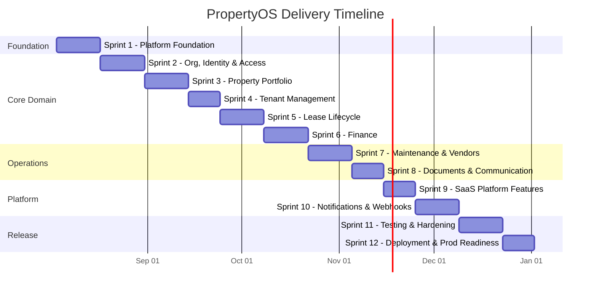
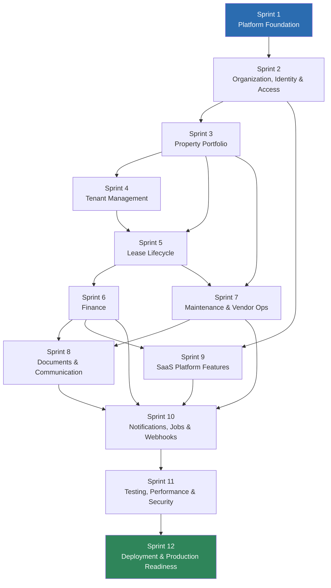
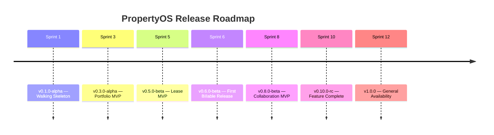
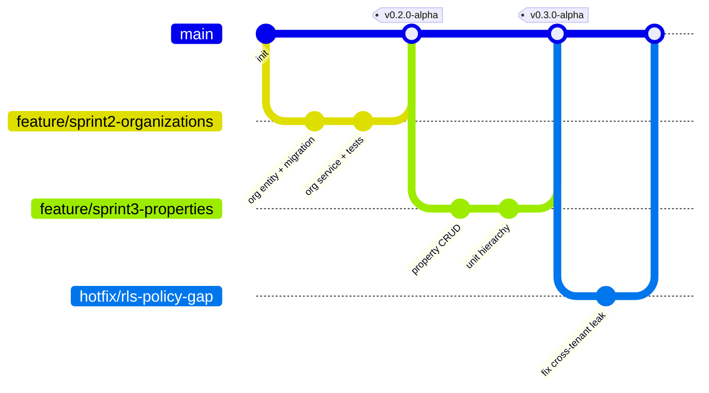
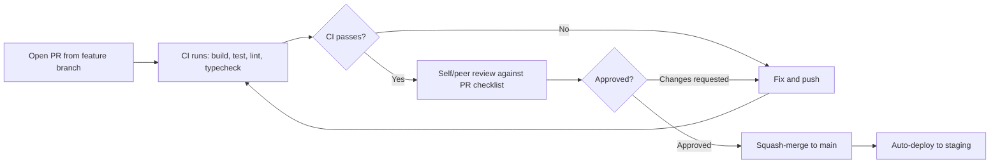
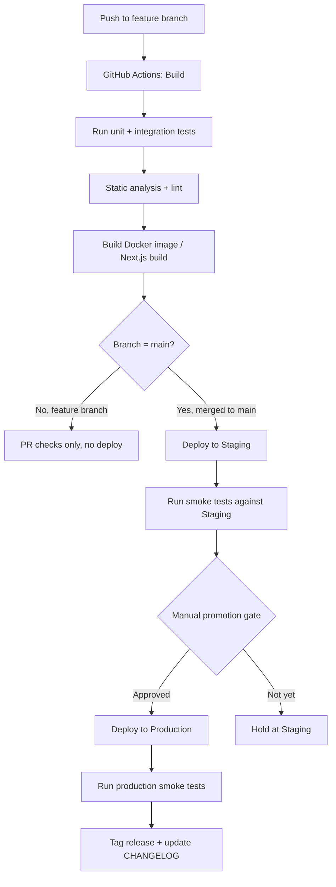

# 08 — Agile Sprint Roadmap

**Project:** PropertyOS — Multi-Tenant Property & Lease Management SaaS
**Author:** Andrew Evboifo
**Methodology:** Scrum (1–2 week sprints), single full-stack developer/team
**Last Updated:** July 2026

---

## Document Purpose

This document is the authoritative Agile delivery roadmap for **PropertyOS**. It decomposes the full product — as defined in `docs/00-vision.md`, `docs/01-business-requirements.md`, `docs/06-database-design.dbml`, and `docs/07-api-design.md` — into a sequenced series of Scrum sprints that build the system incrementally, from empty repository to production-ready SaaS.

No feature in this roadmap is invented. Every sprint delivers functionality that is already fully specified in the database schema and API design documents. This roadmap answers a different question than those documents: not *what* the system does, but *in what order, and how,* a disciplined engineering team builds it.

### Related Documents

| Document | Relationship to this roadmap |
|---|---|
| `docs/06-database-design.md` | Defines the ~40 entities each sprint incrementally implements |
| `docs/07-api-design.md` | Defines the endpoint contracts each sprint's backend work delivers |
| `docs/05-multi-tenancy.md` | RLS model implemented in Sprint 1 and enforced throughout |
| `docs/06-authentication-design.md` | Supabase Auth/JWT model implemented in Sprint 1–2 |
| `docs/09-testing-strategy.md` (referenced) | Detailed test-plan companion to Section 13 of this document |

---

## Table of Contents

1. Agile Methodology & Team Operating Model
2. Sprint Overview
3. Project Timeline
4. Sprint Dependency Diagram
5. Release Roadmap & Milestones
6. Critical Path
7. Sprint 1 — Platform Foundation
8. Sprint 2 — Organization, Identity & Access
9. Sprint 3 — Property Portfolio
10. Sprint 4 — Tenant Management
11. Sprint 5 — Lease Lifecycle
12. Sprint 6 — Finance (Rent, Invoicing, Payments)
13. Sprint 7 — Maintenance & Vendor Operations
14. Sprint 8 — Documents & Communication
15. Sprint 9 — SaaS Platform Features
16. Sprint 10 — Notifications, Background Jobs & Webhooks
17. Sprint 11 — Testing, Performance & Security Hardening
18. Sprint 12 — Deployment & Production Readiness
19. Git Branching Strategy
20. Commit Strategy
21. Code Review Workflow
22. Testing Strategy
23. CI/CD Workflow
24. Definition of Ready (Global)
25. Definition of Done (Global)
26. Risk Register
27. Technical Debt Register
28. Appendix — Story Point Reference & Velocity Assumptions

---

## 1. Agile Methodology & Team Operating Model

PropertyOS is delivered using **Scrum** with the following conventions:

| Parameter | Value |
|---|---|
| Sprint length | 2 weeks (10 working days) — Sprints 1 and 11 run slightly longer due to foundational/hardening scope |
| Team composition assumed | 1 full-stack engineer acting as all Scrum roles (realistic for a portfolio/PLAR build), with role-based ceremonies documented as if scaling to a 3–5 person team |
| Ceremonies | Sprint Planning (start), Daily Standup (async log if solo), Sprint Review/Demo (end), Sprint Retrospective (end) |
| Estimation | Story points, Fibonacci scale (1, 2, 3, 5, 8, 13) |
| Definition of Ready / Done | Sections 24–25, applied uniformly across all 12 sprints |
| Backlog tool | GitHub Projects (Kanban board mapped to sprint milestones) |
| Source control | GitHub, trunk-based feature branching (Section 19) |

### 1.1 Why This Sprint Order

The sequencing follows three engineering principles, in priority order:

1. **Foundation before features.** Nothing is buildable without Clean Architecture scaffolding, a working database, and authentication — Sprint 1 exists purely to make every later sprint possible.
2. **Data dependency order.** Entities are built in the order their foreign keys require: an Organization must exist before Users can belong to it; a Unit must exist before a Lease can reference it; a Lease must exist before an Invoice can be generated against it; an Invoice must exist before a Payment can be processed. This is the backbone of Sprints 2 through 7.
3. **Cross-cutting concerns last.** Notifications, background jobs, and webhooks (Sprint 10) intentionally come *after* the domains they serve (Leases, Invoices, Maintenance) rather than before, since building a notification system with nothing to notify about produces unusable, untestable code. Hardening and deployment close the roadmap because they harden and deploy a *complete* system rather than a partial one.


---

## 2. Sprint Overview

| # | Sprint Name | Duration | Story Points | Primary Domains (from schema) |
|---|---|---|---|---|
| 1 | Platform Foundation | 2 weeks | 34 | Solution structure, EF Core, Supabase Auth, RLS scaffolding, Swagger, CI/CD |
| 2 | Organization, Identity & Access | 2 weeks | 29 | Organizations, OrganizationSettings, Users, Roles, Permissions, UserSessions, LoginAttempts, ApiKeys |
| 3 | Property Portfolio | 2 weeks | 31 | Properties, Buildings, Floors, Units, Amenities |
| 4 | Tenant Management | 1.5 weeks | 21 | Tenants, EmergencyContacts, Occupancies |
| 5 | Lease Lifecycle | 2 weeks | 34 | Leases, LeaseRenewals, LeaseAmendments, SecurityDeposits |
| 6 | Finance | 2 weeks | 38 | RentSchedules, Invoices, InvoiceLineItems, Payments, PaymentMethods, Transactions, LateFees |
| 7 | Maintenance & Vendor Operations | 2 weeks | 33 | MaintenanceRequests, MaintenanceStatusHistory, MaintenanceImages, Vendors, WorkOrders, VendorAssignments |
| 8 | Documents & Communication | 1.5 weeks | 24 | Documents, Folders, Attachments, Notifications (data model), Messages, Announcements |
| 9 | SaaS Platform Features | 1.5 weeks | 23 | BillingPlans, OrganizationSubscriptions, PlatformInvoices, FeatureFlags |
| 10 | Notifications, Background Jobs & Webhooks | 2 weeks | 29 | Notifications (delivery), BackgroundJobs, WebhookEvents, Stripe webhook, AuditLogs, ActivityLogs |
| 11 | Testing, Performance & Security Hardening | 2 weeks | 26 | Cross-cutting: test coverage, load testing, security review |
| 12 | Deployment & Production Readiness | 1.5 weeks | 20 | CI/CD hardening, observability, SystemSettings, launch |

**Total estimated:** ~22 weeks (≈ 5 months) at a sustainable solo-developer pace; a 3–5 person team could compress this to roughly 10–12 weeks by parallelizing frontend/mobile/backend work within each sprint (noted per-sprint under "Dependencies").

---

## 3. Project Timeline



---

## 4. Sprint Dependency Diagram



**Reading this diagram:** Sprint 5 (Leases) cannot start until both Properties (Sprint 3, for `unitId` foreign keys) and Tenants (Sprint 4, for `primaryTenantId`) exist. Sprint 6 (Finance) depends on Leases because every `Invoice` and `RentSchedule` row is anchored to a `leaseId`. Sprint 7 (Maintenance) depends on both Properties (a `MaintenanceRequest` references a `unitId`) and, less strictly, on Leases (tenant-initiated requests are scoped to an active occupancy) — it is shown depending on Sprint 5 for that reason even though its core entities could theoretically be built earlier. Sprint 10 is deliberately the convergence point for three prior sprints, since notifications, background jobs, and webhooks are cross-cutting infrastructure consumed by Finance, Maintenance, and Documents alike.

---

## 5. Release Roadmap & Milestones

| Milestone | After Sprint | Release Name | What Ships |
|---|---|---|---|
| **M1 — Walking Skeleton** | 1 | `v0.1.0-alpha` | Authenticated API, empty domain, Swagger live, CI green |
| **M2 — Tenant-Ready Org Shell** | 2 | `v0.2.0-alpha` | An organization can be created and staffed with role-based users |
| **M3 — Portfolio MVP** | 3 | `v0.3.0-alpha` | Properties/Units manageable end-to-end in the web app |
| **M4 — Occupancy MVP** | 4 | `v0.4.0-alpha` | Tenants can be onboarded and linked to units |
| **M5 — Lease MVP** | 5 | `v0.5.0-beta` | Full lease lifecycle: create, renew, terminate, amend |
| **M6 — Revenue MVP (First Billable Release)** | 6 | `v0.6.0-beta` | Rent generation, invoicing, and Stripe payments functional — **this is the first release with genuine business value** |
| **M7 — Operations MVP** | 7 | `v0.7.0-beta` | Maintenance requests, vendor assignment, work orders |
| **M8 — Collaboration MVP** | 8 | `v0.8.0-beta` | Document management and tenant/staff communication |
| **M9 — Platform MVP** | 9 | `v0.9.0-beta` | PropertyOS's own subscription billing of tenant organizations is live |
| **M10 — Feature Complete** | 10 | `v0.10.0-rc` | All notification channels, async job processing, and Stripe webhooks live |
| **M11 — Release Candidate** | 11 | `v1.0.0-rc1` | Full test coverage, load-tested, security-reviewed |
| **M12 — General Availability** | 12 | `v1.0.0` | Production deployment, monitoring, on-call runbook |

### Release Roadmap (visual)



---

## 6. Critical Path

The **critical path** — the sequence of sprints that directly gates the go-live date, where any slip delays launch day-for-day — is:

```
Sprint 1 → Sprint 2 → Sprint 3 → Sprint 5 → Sprint 6 → Sprint 10 → Sprint 11 → Sprint 12
```

Sprint 4 (Tenant Management) and Sprint 7 (Maintenance) are **not** on the critical path in a multi-person team context — they could run in parallel with Sprint 5/6 respectively if a second engineer were available, since Tenant Management only weakly gates Leases (a lease needs *a* tenant, not the full emergency-contact/occupancy feature set) and Maintenance has no downstream dependents until Sprint 10. Sprint 9 (SaaS Platform Features) is similarly parallelizable alongside Sprint 7/8. This is called out explicitly per-sprint in each "Dependencies" subsection below, since it is the single highest-leverage schedule compression opportunity if the team scales beyond one engineer.


---

## 7. Sprint 1 — Platform Foundation

### Sprint Goal
Stand up a fully working, empty, authenticated, deployable skeleton of PropertyOS — Clean Architecture solution, database connectivity, Supabase-backed authentication, and a CI/CD pipeline — so that every subsequent sprint can add features to a system that already runs, deploys, and is observable.

**Duration:** 2 weeks | **Story Points:** 34

### Business Value
De-risks the entire project. Without this sprint, every later estimate is unreliable — the team would be discovering infrastructure problems (build config, auth wiring, deployment) while also trying to ship domain features. Delivering a "walking skeleton" first is the single highest-leverage risk-reduction activity in the whole roadmap.

### Features Included
- Solution scaffolding across `PropertyOS.Api`, `.Application`, `.Domain`, `.Infrastructure` projects
- Supabase project provisioned; PostgreSQL connectivity via EF Core
- Supabase Auth JWT validation middleware
- Empty but real `/api/v1/health` and `/api/v1/organizations/current` (stub) endpoints
- Swagger/OpenAPI live with JWT bearer auth wired
- GitHub Actions CI pipeline (build, test, lint)
- Structured logging (Serilog) and configuration (`appsettings`, environment variables, secrets)

### Technical Tasks
- Create solution + 4 projects following Clean Architecture dependency rules (Domain has zero dependencies; Infrastructure depends on Domain + Application; Api depends on all)
- Configure `Directory.Build.props` for shared analyzers/nullable reference types/warnings-as-errors
- Set up `IOrganizationContext` scoped service and `OrganizationContextMiddleware` stub (real tenant resolution lands in Sprint 2 once Organizations exist)
- Configure Serilog sinks (console + file, structured JSON) and correlation ID middleware

### Database Work
- Provision Supabase PostgreSQL instance (dev, staging, prod projects)
- Initialize EF Core `PropertyOsDbContext`, first migration (empty — just `__EFMigrationsHistory`)
- Enable `uuid-ossp`/`pgcrypto` extensions for UUID generation
- Author baseline RLS policy template to be applied per-table starting Sprint 2

### Backend Work
- Implement JWT bearer authentication middleware validating Supabase-issued tokens (Section 3.2 of `07-api-design.md`)
- Implement global exception-handling middleware producing the standardized error envelope (Section 6 of `07-api-design.md`)
- Implement `[RequirePermission]` attribute + `PermissionAuthorizationFilter` (logic complete, but with no real permissions to check yet — unit tested against fake claims)
- Configure Swashbuckle with XML doc comments and bearer security scheme

### Frontend Work
- Scaffold Next.js 14 (App Router) + TypeScript + Tailwind project
- Configure Supabase Auth client SDK, login page, protected route wrapper
- Generate the TypeScript API client from the (currently near-empty) OpenAPI spec, wiring up the codegen pipeline itself as reusable tooling for all future sprints

### Mobile Work
- Scaffold Expo/React Native project with the same Supabase Auth client and a shared TypeScript types package (`packages/shared-types`) consumed by both web and mobile
- Implement login screen against Supabase Auth

### Testing Tasks
- Unit tests for JWT validation middleware (valid, expired, malformed, tampered tokens)
- Unit tests for the exception-handling middleware's error envelope shape
- Integration test harness using `WebApplicationFactory` + Testcontainers (Postgres) established for all future sprints to build on
- CI pipeline runs `dotnet test`, `npm test`, `npm run lint`, `npm run typecheck` on every PR

### Documentation Tasks
- `README.md` with local dev setup instructions
- `docs/01-architecture-overview.md` finalized to match the actual scaffolded structure
- ADR (Architecture Decision Record) template established; first ADR written: "Why Clean Architecture + Repository Pattern"

### Definition of Done
- [ ] Solution builds with zero warnings under `TreatWarningsAsErrors`
- [ ] `dotnet test` passes in CI
- [ ] A user can log in via Supabase Auth from the Next.js app and the Expo app
- [ ] An authenticated request to `/api/v1/health` returns `200` locally, in staging, and in a deployed preview environment
- [ ] Swagger UI at `/swagger` allows pasting a JWT and calling the health endpoint
- [ ] CI pipeline is green on `main`

### Dependencies
None — this is the first sprint. All later sprints depend on this one.

### Deliverables
- Deployed skeleton (staging environment) at a public URL
- CI/CD pipeline operational
- `v0.1.0-alpha` tagged release

### Risks
| Risk | Likelihood | Impact | Mitigation |
|---|---|---|---|
| Supabase Auth custom claims (org_id, permissions) require a Postgres function/hook not yet fully understood | Medium | High | Timebox a spike (max 2 days) early in the sprint; fall back to claims populated via a lightweight middleware DB lookup if the native hook proves too complex for Sprint 1 |
| Clean Architecture over-engineering for a small team | Low | Medium | Keep abstractions minimal in Sprint 1 (no premature CQRS/MediatR); add only what Sprint 2+ actually needs |

### Acceptance Criteria
Given a fresh clone of the repository, a developer can run one documented setup command sequence, log in through the web app, and see an authenticated API response — with CI passing on the resulting PR.

---

## 8. Sprint 2 — Organization, Identity & Access

### Sprint Goal
Implement the full multi-tenant identity backbone: Organizations, org-scoped Users, Roles, Permissions, Sessions, and API Keys — the foundation every other domain's tenant isolation depends on.

**Duration:** 2 weeks | **Story Points:** 29

### Business Value
This is the sprint that makes PropertyOS *actually multi-tenant*. Every feature built afterward assumes an authenticated user with a resolved organization and permission set — this sprint is what makes that assumption true and safe (RLS-enforced).

### Features Included
- `POST /organizations` (initial org creation on signup), `GET/PATCH /organizations/current`, `GET/PATCH /organizations/current/settings`
- `GET /users`, `POST /users/invite`, `PATCH/DELETE /users/{id}`
- `GET/DELETE /users/{id}/sessions`, `GET /login-attempts`
- `POST /auth/reset-password`
- `GET/POST /api-keys`, `POST /api-keys/{id}/rotate`

### Technical Tasks
- Implement the Supabase `custom_access_token_hook` Postgres function populating `org_id`, `role`, `permissions`, `session_id` claims (resolves the Sprint 1 spike)
- Wire `OrganizationContextMiddleware` to real claims (replacing the Sprint 1 stub)
- Implement `IPermissionResolver` service computing effective permissions from `RolePermissions`

### Database Work
- Migrations: `Organizations`, `OrganizationSettings`, `Users`, `Roles`, `Permissions`, `RolePermissions`, `UserOrganizationRoles`, `UserSessions`, `LoginAttempts`, `ApiKeys`
- Enable RLS on every tenant-scoped table above; write and test policies per Section 2.1 of `07-api-design.md`
- Seed migration for the 7 built-in system roles and their default permission grants (Appendix A of `07-api-design.md`)

### Backend Work
- `OrganizationService`, `UserService`, `ApiKeyService` (Application layer) + corresponding repositories
- Invitation flow integrating Supabase Auth's invite-link API
- API key generation with bcrypt hashing at rest, scoped-permission validation on creation
- Session revocation check integrated into the authorization pipeline (cached lookup against `UserSessions.revoked_at`)

### Frontend Work
- Organization settings page (name, billing email, time zone, currency)
- User management screen: invite user, assign role, deactivate user, view active sessions with revoke action
- API key management screen (create, rotate, revoke) with the one-time-reveal UX pattern for the raw key

### Mobile Work
- Organization switcher (for users belonging to multiple organizations, e.g., contracted property managers)
- Basic profile screen showing role and permissions (read-only)

### Testing Tasks
- Integration tests proving cross-tenant isolation: user in Org A cannot read/write Org B's `Users`/`Organizations` rows even via crafted requests
- Unit tests for permission resolution (role → permissions → effective claims)
- Contract tests for `/api-keys` one-time-reveal behavior

### Documentation Tasks
- `docs/06-authentication-design.md` finalized with the actual custom claims hook implementation
- Appendix A permission matrix in `07-api-design.md` validated against seeded role data

### Definition of Done
- [ ] A brand-new organization can be created, staffed with 3+ users across different roles, and each user's JWT carries correct claims
- [ ] RLS integration tests pass (cross-tenant read/write attempts return empty/404, never another tenant's data)
- [ ] API key creation, rotation, and revocation work end-to-end including the 24-hour grace window
- [ ] All endpoints listed above pass their documented contract tests

### Dependencies
Requires Sprint 1 (auth middleware, DbContext, CI). Blocks Sprints 3–10 (every later domain requires `organizationId` scoping and permission checks).

### Deliverables
`v0.2.0-alpha` — a self-service-signup-capable organization shell.

### Risks
| Risk | Likelihood | Impact | Mitigation |
|---|---|---|---|
| RLS policies subtly allow cross-tenant leakage on a join-heavy query | Medium | High | Dedicated "tenant isolation" integration test suite run on every PR touching any repository query, not just this sprint's |
| Custom claims hook adds latency to every login | Low | Low | Benchmark hook execution time; cache role/permission lookups |

### Acceptance Criteria
Given two organizations each with their own users, a user authenticated against Organization A receives `404` (not `403`) when directly requesting a resource ID known to belong to Organization B.


---

## 9. Sprint 3 — Property Portfolio

### Sprint Goal
Deliver full CRUD management of the physical property hierarchy — Properties → Buildings → Floors → Units → Amenities — as a usable portfolio management screen in the web app.

**Duration:** 2 weeks | **Story Points:** 31

### Business Value
This is the first sprint that produces something a property manager would recognize as "the product." A demo at this milestone is meaningful to a non-technical stakeholder: they can see their actual buildings represented in the system.

### Features Included
All endpoints in Section 7.3 of `07-api-design.md`: Properties, Buildings, Floors, Units, Amenities CRUD, plus unit-amenity attachment.

### Technical Tasks
- Implement full-text search (`tsvector` + GIN index) for Properties (`q` param)
- Implement cursor-based pagination helper shared across all future list endpoints

### Database Work
- Migrations: `Properties`, `Buildings`, `Floors`, `Units`, `Amenities`, `UnitAmenities`
- RLS policies on all five tenant-scoped tables
- Seed data script for local dev (sample property with 2 buildings, 4 floors, 20 units)

### Backend Work
- `PropertyService`, `BuildingService`, `FloorService`, `UnitService`, `AmenityService`
- Business rule: unit status cannot be directly set to `OCCUPIED` (validated, tested against Section 7.3's documented rule)
- Business rule: property deletion blocked while active leases exist (stub check now, fully enforced once Sprint 5 leases exist — implemented as a forward-compatible guard clause)

### Frontend Work
- Property list/detail pages with search, filter, sort
- Building/Floor/Unit nested management UI (tree navigation)
- Unit detail page with amenity tagging
- Property/unit creation and edit forms with client-side validation mirroring backend rules

### Mobile Work
- Read-only property/unit browsing (property managers checking portfolio status in the field)
- Photo capture stub for future unit condition documentation (data model deferred to Sprint 8 Documents)

### Testing Tasks
- Unit tests for unit-number uniqueness-per-building constraint
- Integration tests for the full Property → Building → Floor → Unit creation chain
- E2E test (Playwright): create a property end-to-end through the web UI

### Documentation Tasks
- Update `03-database-design.md` ERD diagram links if any schema deltas were discovered during implementation
- API contract tests documented as living examples for onboarding new engineers

### Definition of Done
- [ ] A property manager can create a property, add buildings/floors/units, and tag amenities entirely through the web UI
- [ ] Search, filter, and pagination work correctly against seeded data of 100+ units
- [ ] Soft delete behavior verified (deleted units disappear from default queries but are recoverable via `?includeDeleted=true` for admins)

### Dependencies
Requires Sprint 2 (organization scoping, permissions). Sprint 4 and Sprint 5 both depend on Units existing.

### Deliverables
`v0.3.0-alpha` — Portfolio MVP.

### Risks
| Risk | Likelihood | Impact | Mitigation |
|---|---|---|---|
| Deep nesting (Property→Building→Floor→Unit) creates a clunky UI | Medium | Medium | User-test the tree navigation early; consider a flattened "Units" table view with property/building/floor as filters (already the design in `GET /units`, per Section 4.1's flat-resource guidance) |

### Acceptance Criteria
Given a seeded organization, a user can locate a specific unit by searching a partial address or unit number in under 2 seconds and view its full amenity list.

---

## 10. Sprint 4 — Tenant Management

### Sprint Goal
Enable tenant profile creation, emergency contact management, and occupancy tracking — the "who lives where" layer that sits between the physical portfolio (Sprint 3) and legal leases (Sprint 5).

**Duration:** 1.5 weeks | **Story Points:** 21

### Business Value
Tenants are the other half of every lease relationship. This sprint lets property managers start building a tenant roster — including for prospects not yet on a lease — ahead of full lease functionality.

### Features Included
Section 7.4 (Tenants, Emergency Contacts) and 7.5 (Occupancies) of `07-api-design.md`.

### Technical Tasks
- Email-uniqueness-per-organization constraint with a clear conflict error (`TENANT_EMAIL_ALREADY_EXISTS`)
- Age validation (≥18) at both API and UI layers

### Database Work
- Migrations: `Tenants`, `EmergencyContacts`, `Occupancies`
- RLS policies; occupancy foreign keys nullable-safe for the not-yet-leased case

### Backend Work
- `TenantService`, `OccupancyService`
- Business rule: max 5 emergency contacts per tenant
- Business rule: occupancy move-in date must fall within the (future) lease's date range — implemented as a soft validation now, made strict once Sprint 5 lands (documented as intentional forward dependency)

### Frontend Work
- Tenant directory (list/search/filter)
- Tenant profile page with emergency contacts sub-section
- "Prospect" tenant creation flow independent of any lease

### Mobile Work
- Tenant self-service profile view (read/update own contact info, add emergency contacts) — first mobile screen built for the `tenant` role rather than staff roles

### Testing Tasks
- Unit tests for age and email-uniqueness validation
- Integration test: tenant created as a prospect, later successfully attached to an occupancy (forward-compatibility check for Sprint 5)

### Documentation Tasks
- Persona alignment check: confirm this sprint's screens match the "Tenant" and "Property Manager" personas in `docs/02-personas.md`

### Definition of Done
- [ ] A tenant profile with 2+ emergency contacts can be created, edited, and viewed by both staff and the tenant themself (with appropriately scoped fields)
- [ ] Duplicate email creation attempts are rejected with a clear error

### Dependencies
Requires Sprint 3 (Units, for eventual occupancy linkage). Parallelizable with Sprint 5 in a multi-person team since Tenant CRUD itself has no hard dependency on Leases existing yet.

### Deliverables
`v0.4.0-alpha` — Occupancy MVP.

### Risks
| Risk | Likelihood | Impact | Mitigation |
|---|---|---|---|
| Tenant self-service portal scope creep (tempting to add more tenant features than the schema defines) | Medium | Low | Strictly bound this sprint's tenant-facing UI to fields that exist in `Tenants`/`EmergencyContacts` today |

### Acceptance Criteria
A property manager can add a walk-in prospect as a tenant profile without needing a unit or lease to exist yet, and later reuse that same profile once a lease is created in Sprint 5.


---

## 11. Sprint 5 — Lease Lifecycle

### Sprint Goal
Implement the full legal lease lifecycle — creation, activation, renewal, termination, amendments, and security deposits — the most business-rule-dense domain in the system.

**Duration:** 2 weeks | **Story Points:** 34

### Business Value
The lease is the core legal/financial contract of the entire product. This sprint delivers the functionality that most directly justifies PropertyOS's existence as a leasing system rather than a generic asset tracker.

### Features Included
Section 7.6 of `07-api-design.md` in full: Leases CRUD, `renew`, `terminate`, amendments, security deposits and refunds.

### Technical Tasks
- Implement the lease state machine (`DRAFT → ACTIVE → RENEWED/TERMINATED/EXPIRED`) as an explicit, unit-tested domain service rather than scattered `if` checks in controllers
- Implement overlapping-lease-period conflict detection (PostgreSQL exclusion constraint using `daterange` + `EXCLUDE USING gist`, backing the `409 OVERLAPPING_LEASE_PERIOD` rule)

### Database Work
- Migrations: `Leases`, `LeaseRenewals`, `LeaseAmendments`, `SecurityDeposits`
- `EXCLUDE` constraint on `(unit_id, daterange(start_date, end_date))` for overlap prevention at the database layer (defense in depth alongside the application-layer check)
- RLS policies; foreign-key backfill validation against Sprint 4's `Tenants`/`Occupancies`

### Backend Work
- `LeaseService` implementing: creation with activation preconditions, renewal (with rent-increase-limit validation against `OrganizationSettings`), termination (with notice-period validation and automatic final prorated invoice trigger — stubbed until Sprint 6, tracked as a cross-sprint integration task), amendments (immutable, append-only), security deposit hold/refund with deduction reconciliation
- Transactional integrity for renewal (old lease closed + new lease created + renewal record, all in one DB transaction)

### Frontend Work
- Lease creation wizard (unit selection → tenant selection → terms → deposit)
- Lease detail page showing full history: original terms, amendments timeline, renewal chain
- Renewal and termination action flows with clear confirmation and validation-error surfacing (notice period, rent increase limits)

### Mobile Work
- Tenant-facing lease summary view (read-only: term, rent, renewal eligibility date)
- Push notification stub for renewal-eligibility-window entry (data wiring only; actual delivery lands in Sprint 10)

### Testing Tasks
- Exhaustive state-machine unit tests (every valid and invalid transition)
- Integration test: attempt to create two overlapping active leases on the same unit → expect `409`
- Integration test: renewal beyond the allowed rent-increase percentage → expect `422`
- E2E test: full lease lifecycle from creation through renewal through termination

### Documentation Tasks
- Document the lease state machine as a diagram in `docs/03-database-design.md` if not already present
- Cross-reference this sprint's business rules against `docs/business-requirements.md` to confirm no rule was invented beyond spec

### Definition of Done
- [ ] A lease can be created, activated, renewed, and terminated entirely through the API and web UI, each transition producing the correct database state and audit trail
- [ ] Overlapping lease periods are rejected at both application and database layers
- [ ] Security deposit refund reconciliation math is verified against the documented rule (`refundAmount + deductions == originalAmount`)

### Dependencies
Requires Sprint 3 (Units) and Sprint 4 (Tenants). Blocks Sprint 6 (Finance) entirely — no invoice can exist without a lease.

### Deliverables
`v0.5.0-beta` — Lease MVP. First "beta" tag, reflecting that core legal functionality is now considered stable enough for pilot organizations.

### Risks
| Risk | Likelihood | Impact | Mitigation |
|---|---|---|---|
| Lease business rules (notice periods, rent-increase caps) vary by jurisdiction and may be under-specified | High | High | Confirm `OrganizationSettings`-driven configurability (already in schema) is sufficient; flag any jurisdiction-specific legal nuance as an explicit out-of-scope note rather than guessing |
| State machine complexity leads to untested edge cases (e.g., terminating a lease mid-renewal) | Medium | High | Property-based testing (generate random valid/invalid transition sequences) in addition to example-based unit tests |

### Acceptance Criteria
Given an active lease within its renewal-eligible window, a property manager can renew it with a rent increase at exactly the organization's configured maximum percentage (boundary case) and the system accepts it; one cent above the limit is rejected.

---

## 12. Sprint 6 — Finance

### Sprint Goal
Implement rent scheduling, invoice generation, Stripe-backed payment processing, and late fee assessment — turning PropertyOS into a system that actually moves money.

**Duration:** 2 weeks | **Story Points:** 38 (largest sprint in the roadmap)

### Business Value
This is the **first billable release**. Every prior sprint was necessary infrastructure; this sprint is where PropertyOS starts doing the thing that justifies a subscription fee — automating rent collection.

### Features Included
Section 7.7 (Rent Schedules, Invoices, Line Items) and 7.8 (Payments, Payment Methods, Transactions, Late Fees) of `07-api-design.md` in full, including the `generate-monthly` batch action, `void`, `process`, `refund`, and `assess` late fee actions.

### Technical Tasks
- Implement `Idempotency-Key` middleware/infrastructure (Section 4.5 of `07-api-design.md`) — first sprint to actually require it, but built as reusable middleware for all future financial/webhook endpoints
- Stripe.NET SDK integration: PaymentIntents, Refunds, saved PaymentMethods (SetupIntents flow)

### Database Work
- Migrations: `RentSchedules`, `Invoices`, `InvoiceLineItems`, `Payments`, `PaymentMethods`, `Transactions`, `LateFees`, `IdempotencyKeys`
- Numeric precision review: all monetary columns `NUMERIC(12,2)`, never `float`/`double`
- RLS policies; tenant-role restrictions ensuring a tenant only ever sees their own invoices/payments

### Backend Work
- `RentScheduleService`, `InvoiceService`, `PaymentService`, `LateFeeService`
- `generate-monthly` batch job logic with skip-if-already-invoiced idempotency (distinct from, but complementary to, the header-based idempotency key)
- Stripe PaymentIntent creation/confirmation flow including 3D Secure (`requires_action`) handling
- Refund reconciliation against original payment and invoice balance

### Frontend Work
- Rent schedule configuration UI per lease
- Invoice list/detail with line items, PDF-style print view
- "Pay Now" flow with Stripe Elements card entry and saved-payment-method reuse
- Accountant dashboard: outstanding balances, overdue invoices, late-fee assessment action

### Mobile Work
- Tenant "Pay Rent" flow (Stripe mobile SDK / payment sheet)
- Payment history and invoice view for tenants
- Push notification stub for "invoice due soon" / "payment succeeded" (delivery wiring lands Sprint 10)

### Testing Tasks
- Unit tests for balance math (partial payments, refunds, late fee compounding rules)
- Integration tests against **Stripe test mode** (test card numbers for success, decline, 3DS challenge)
- Idempotency test: replaying `POST /payments/process` with the same key does not double-charge (verified against Stripe test-mode charge count, not just internal DB state)
- Load test: `generate-monthly` batch run against 500 simulated active leases, verifying no duplicate invoices and acceptable completion time

### Documentation Tasks
- Document the Stripe test-mode setup and test card reference in a new `docs/stripe-testing-guide.md` for future contributors
- Finalize the error-code registry entries specific to payments (Section 6.5 of `07-api-design.md`)

### Definition of Done
- [ ] Monthly rent generation produces correct invoices for all active leases exactly once per billing period, even when re-run
- [ ] A tenant can pay an invoice by card (including a 3DS-challenge test card) and see the invoice marked paid
- [ ] Refunds correctly reverse invoice balances and are reflected in `Transactions`
- [ ] Late fees are assessed only on eligible overdue invoices per configured grace period

### Dependencies
Requires Sprint 5 (Leases) — hard blocker, since every invoice is lease-scoped. Blocks Sprint 10 (webhook reconciliation of async Stripe events depends on payments existing).

### Deliverables
`v0.6.0-beta` — **First Billable Release.**

### Risks
| Risk | Likelihood | Impact | Mitigation |
|---|---|---|---|
| Stripe integration edge cases (3DS, disputes, partial refunds) under-tested | High | High | Dedicate explicit test time to Stripe's documented test-card matrix, not just the happy path |
| Floating-point/rounding errors in prorated or partial payment math | Medium | High | Enforce `decimal`/`NUMERIC` end-to-end; add property-based tests asserting sum-of-line-items always equals invoice subtotal to the cent |
| Idempotency key collisions across concurrent client retries | Low | Medium | Unique constraint on `(organization_id, idempotency_key)` at the database layer, not just application-layer checking |

### Acceptance Criteria
Given an active lease with a configured rent schedule, running the monthly generation job produces exactly one invoice for that lease for the target billing period, and a subsequent payment for the full `amountDue` transitions the invoice to `PAID` with a corresponding successful Stripe charge visible in Stripe's dashboard (test mode).


---

## 13. Sprint 7 — Maintenance & Vendor Operations

### Sprint Goal
Implement the full maintenance request lifecycle, vendor management, and work order assignment/completion — the operational side of property management.

**Duration:** 2 weeks | **Story Points:** 33

### Business Value
Maintenance is the single highest-frequency interaction tenants have with a property manager. Automating request tracking, vendor assignment, and completion reduces response time and creates a defensible audit trail for disputes.

### Features Included
Section 7.9 (Maintenance, Status History, Images) and 7.10 (Vendors, Work Orders, Vendor Assignments) of `07-api-design.md` in full.

### Technical Tasks
- Implement the maintenance status state machine (`SUBMITTED → ACKNOWLEDGED → SCHEDULED → IN_PROGRESS → COMPLETED → CLOSED`, `CANCELLED` from any non-terminal state), mirroring the discipline established for leases in Sprint 5
- Implement Supabase Storage integration for maintenance images (signed URLs, byte-level MIME validation)

### Database Work
- Migrations: `MaintenanceRequests`, `MaintenanceStatusHistory`, `MaintenanceImages`, `Vendors`, `WorkOrders`, `VendorAssignments`
- RLS policies including the vendor-role restriction (a vendor sees only work orders they are assigned to, layered on top of standard org scoping)

### Backend Work
- `MaintenanceService`, `VendorService`, `WorkOrderService`
- Vendor-capacity-check business rule (`VENDOR_OVER_CAPACITY` soft warning with admin override)
- Work order completion triggering async reconciliation job enqueue (integration point with Sprint 10's background job infrastructure — implemented now as a direct synchronous stub, converted to a real queued job once Sprint 10 lands)

### Frontend Work
- Maintenance request creation and tracking board (Kanban-style by status) for property managers
- Vendor directory and assignment UI
- Work order detail page with status history timeline and image gallery

### Mobile Work
- Tenant maintenance request submission with photo capture (first real use of the Sprint 3 photo-capture stub)
- Vendor mobile view: assigned work orders, status update, completion with actual-cost entry

### Testing Tasks
- State machine unit tests (maintenance status transitions)
- Integration test: vendor role cannot view work orders they are not assigned to
- Integration test: image upload rejects a renamed executable disguised as `.jpg`

### Documentation Tasks
- Document the vendor role's restricted permission scope explicitly in Appendix A of `07-api-design.md` if any gaps are found during implementation

### Definition of Done
- [ ] A tenant can submit a maintenance request with a photo; staff can acknowledge, schedule, assign a vendor, and mark complete, each step visible in the status history
- [ ] Vendor accounts see only their assigned work, verified by integration test
- [ ] Uploaded images are stored in a tenant-isolated Supabase Storage path and served via short-lived signed URLs only

### Dependencies
Requires Sprint 3 (Units). Weakly depends on Sprint 5 (Leases/Occupancies, for the tenant-submits-only-for-own-unit rule) but is parallelizable with Sprint 6 in a multi-person team.

### Deliverables
`v0.7.0-beta` — Operations MVP.

### Risks
| Risk | Likelihood | Impact | Mitigation |
|---|---|---|---|
| Vendor-role permission scoping is easy to under-test (a narrower case than standard org isolation) | Medium | High | Dedicated integration test suite specifically for vendor-scoped visibility, run independently of the general RLS suite |
| Image upload abuse (large files, malicious payloads) | Medium | Medium | Enforce size caps at Kestrel level before controller code runs; MIME sniffing, not extension trust |

### Acceptance Criteria
A tenant submits a maintenance request with a photo; a property manager assigns a vendor; the vendor (logged in with a vendor account) sees only that one work order among potentially dozens in the organization, updates its status, and marks it complete with an actual cost — all reflected correctly in the request's status history.

---

## 14. Sprint 8 — Documents & Communication

### Sprint Goal
Implement general-purpose document storage/retrieval and tenant/staff communication — announcements and direct messages.

**Duration:** 1.5 weeks | **Story Points:** 24

### Business Value
Centralizes lease documents, inspection reports, and communication that would otherwise live in scattered email threads — a core "system of record" value proposition for property managers.

### Features Included
Section 7.11 (Documents, Folders, Attachments) and 7.12 (Notifications data model, Messages, Announcements) of `07-api-design.md`.

### Technical Tasks
- Implement polymorphic document association (`entityType` + `entityId`) with referential validation against each supported entity type
- Async malware-scanning hook (ClamAV sidecar or equivalent) integrated into the upload pipeline

### Database Work
- Migrations: `Documents`, `Folders`, `Attachments`, `Notifications` (schema only — delivery logic is Sprint 10), `Messages`, `Announcements`
- RLS policies, including entity-type-aware scoping for `Documents`

### Backend Work
- `DocumentService`, `FolderService`, `MessageService`, `AnnouncementService`
- Document upload/download signed-URL flow (Section 7.11)
- Announcement draft/send split (send delivery itself deferred to Sprint 10, but the compose/target-audience logic is built now)

### Frontend Work
- Folder tree + document library UI with drag-and-drop upload
- Lease document attachment (linking a document to a specific lease from its detail page — closing the loop with Sprint 5)
- Messaging inbox UI (tenant ↔ property manager threads)
- Announcement composer with audience targeting (organization/property/building/unit-tenants)

### Mobile Work
- Document viewer (signed-URL-based PDF/image viewing)
- Messaging inbox (mobile-optimized thread view)

### Testing Tasks
- Integration test: document uploaded under `entityType=LEASE` is visible from the lease detail page and inaccessible to a different organization's user
- Integration test: a `PENDING_SCAN` document cannot be downloaded until scan completes (`409`)

### Documentation Tasks
- Document the polymorphic association pattern and its validation rules in `03-database-design.md` if not already captured

### Definition of Done
- [ ] A lease document can be uploaded, attached to a specific lease, and downloaded via a signed URL that expires
- [ ] An announcement can be composed as a draft and previewed before sending (actual multi-channel delivery arrives Sprint 10)
- [ ] A tenant and property manager can exchange messages in a threaded view

### Dependencies
Requires Sprint 6 (Finance, for linking documents to invoices/leases with real data to attach to) and Sprint 7 (Maintenance, for maintenance-related document attachments). Genuinely benefits from running after both, though its core CRUD could start earlier.

### Deliverables
`v0.8.0-beta` — Collaboration MVP.

### Risks
| Risk | Likelihood | Impact | Mitigation |
|---|---|---|---|
| Malware scanning adds latency/complexity teams under-budget for | Medium | Medium | Timebox the ClamAV integration; if it slips, ship with a documented "scanning stub" (always marks CLEAN) behind a feature flag, tracked as technical debt (Section 27) rather than blocking the sprint |

### Acceptance Criteria
A property manager uploads a signed lease PDF, attaches it to the correct lease record, and the tenant on that lease can view (but not delete) the document from their own portal.


---

## 15. Sprint 9 — SaaS Platform Features

### Sprint Goal
Implement PropertyOS's own subscription billing of tenant organizations — billing plans, organization subscriptions, platform invoices — plus feature flags for controlled rollout of future functionality.

**Duration:** 1.5 weeks | **Story Points:** 23

### Business Value
This sprint turns PropertyOS from "a system organizations use for free" into an actual SaaS business: it can now charge its own customers (property management companies) a recurring subscription fee, tiered by plan.

### Features Included
Section 7.14 (Billing Plans, Organization Subscriptions, Platform Invoices) and 7.15 (Feature Flags) of `07-api-design.md`.

### Technical Tasks
- Stripe Billing (Subscriptions API) integration, distinct from the Stripe Payments integration built in Sprint 6 (tenant rent payments) — same Stripe account, different API surface
- `IFeatureFlagService` with caching, consulted by controllers/services wherever conditional behavior is needed

### Database Work
- Migrations: `BillingPlans`, `OrganizationSubscriptions`, `PlatformInvoices`, `FeatureFlags`
- Seed data: initial plan tiers (e.g., Starter/Growth/Enterprise) with unit/user limits

### Backend Work
- `SubscriptionService` handling plan subscribe/change, with the documented plan-downgrade-exceeds-usage guard (`422 PLAN_LIMIT_EXCEEDED_BY_CURRENT_USAGE`)
- `FeatureFlagService` supporting both global (`platform_admin`-controlled) and organization-scoped (self-service opt-in) flags

### Frontend Work
- Organization billing/subscription management page (plan comparison, upgrade/downgrade, payment method for platform billing)
- Platform invoice history view for `org_admin`
- Platform admin console (new, `platform_admin`-only): manage billing plans, view all organizations, toggle global feature flags

### Mobile Work
- Read-only subscription status view for org admins (upgrade/downgrade remains a web-only flow, a deliberate scope decision to avoid mobile payment-form complexity for a rarely-used admin action)

### Testing Tasks
- Integration test: downgrading a plan while over its unit limit is rejected
- Integration test: platform-admin-only endpoints reject `org_admin` callers with `403`

### Documentation Tasks
- Document the distinction between "tenant rent payments" (Sprint 6, Stripe Payments) and "platform subscription billing" (this sprint, Stripe Billing) clearly, since both use Stripe but are conceptually separate money flows — a common source of confusion for new engineers

### Definition of Done
- [ ] An organization can subscribe to a plan, be billed via Stripe Billing, and see their platform invoice history
- [ ] A platform admin can create/modify billing plans and toggle global feature flags from a dedicated console
- [ ] Plan downgrade correctly blocks when current usage exceeds the target plan's limits

### Dependencies
Requires Sprint 2 (Organizations) and benefits from Sprint 6's Stripe integration patterns already being established, though it targets a different Stripe API surface. Parallelizable with Sprint 7/8 in a multi-person team.

### Deliverables
`v0.9.0-beta` — Platform MVP.

### Risks
| Risk | Likelihood | Impact | Mitigation |
|---|---|---|---|
| Confusing two distinct Stripe integrations (Payments vs. Billing) in the codebase | Medium | Medium | Separate `IStripePaymentsClient` and `IStripeBillingClient` interfaces/namespaces, never a single ambiguous `IStripeService` |

### Acceptance Criteria
An organization admin upgrades from a Starter to a Growth plan mid-cycle and sees a correctly prorated platform invoice generated by Stripe Billing on their next billing date.

---

## 16. Sprint 10 — Notifications, Background Jobs & Webhooks

### Sprint Goal
Wire up real multi-channel notification delivery, a background job processing system, and the Stripe webhook ingress pipeline — completing every asynchronous integration point stubbed in prior sprints.

**Duration:** 2 weeks | **Story Points:** 29

### Business Value
This sprint makes the product feel "alive" — tenants and staff actually receive emails/SMS/push notifications rather than needing to check the app, and the system reliably reconciles asynchronous payment events rather than requiring manual intervention.

### Features Included
Section 7.12 (Notification delivery), 7.16 (Background Jobs), and 7.17 (Webhook Events, Stripe webhook) of `07-api-design.md`, plus 7.13 (Audit Logs & Activity Logs) as the cross-cutting observability layer that ties every prior sprint's actions together into a queryable trail.

### Technical Tasks
- Background job queue implementation (e.g., Hangfire or a custom `BackgroundJobs`-table-backed worker) with retry logic (max 3 attempts, per Section 7.16's documented rule)
- Provider integrations: SendGrid/SES (email), FCM/APNs (push), Twilio (SMS)
- Stripe webhook signature verification pipeline (Section 7.17), replacing the Sprint 6 assumption of purely-synchronous payment confirmation with proper async reconciliation

### Database Work
- Migrations: `BackgroundJobs`, `WebhookEvents`, `AuditLogs`, `ActivityLogs`
- Database trigger on `AuditLogs` rejecting `UPDATE`/`DELETE` (append-only enforcement, Section 7.13)

### Backend Work
- `NotificationDeliveryService` fanning out `Announcements` (Sprint 8) and system-triggered notifications (invoice due, payment succeeded, maintenance status changed) across configured channels
- `POST /webhooks/stripe` endpoint: raw-body signature verification, idempotency check against `WebhookEvents.stripe_event_id`, job enqueue for the documented event types (Section 7.17 table)
- Retire the Sprint 6/7 synchronous stubs (vendor invoice reconciliation, payment confirmation) in favor of the real background job queue

### Frontend Work
- Notification preferences UI (per-channel opt-in/out, respecting `OrganizationSettings.notifyTenantsOnMaintenanceStatusChange` and similar flags)
- Notification bell/inbox with mark-read/mark-all-read
- Admin job monitor: view `BackgroundJobs` status, retry failed jobs

### Mobile Work
- Push notification registration (FCM/APNs token registration) and receipt handling
- In-app notification center matching the web inbox

### Testing Tasks
- Webhook signature verification tests (valid, tampered, replayed)
- Idempotency test: duplicate Stripe webhook delivery does not double-process a payment confirmation
- Load test: background job queue under a burst of 1,000 queued jobs, verifying no job loss and correct retry behavior on induced failures

### Documentation Tasks
- Finalize the sequence diagrams in `07-api-design.md` Section 10 against actual observed behavior in staging
- Document the on-call runbook entry for "Stripe webhook signature failures spike" as an early input to Sprint 12's monitoring work

### Definition of Done
- [ ] A tenant receives an email and push notification when an invoice is due, and an SMS if configured
- [ ] Stripe webhook events are verified, deduplicated, and correctly update `Payments`/`Invoices`/`OrganizationSubscriptions` asynchronously
- [ ] A failed background job can be inspected and retried by an admin, capped at 3 attempts
- [ ] `AuditLogs` are append-only, verified by attempting a direct `UPDATE` against the table and confirming rejection

### Dependencies
Requires Sprint 6 (Payments/Invoices to notify about and reconcile), Sprint 7 (Maintenance status changes to notify about), Sprint 8 (Announcements to deliver), and Sprint 9 (Subscription webhook events). This is the intentional convergence sprint (Section 4).

### Deliverables
`v0.10.0-rc` — Feature Complete.

### Risks
| Risk | Likelihood | Impact | Mitigation |
|---|---|---|---||
| Third-party notification provider rate limits/outages | Medium | Medium | Queue-based delivery (not synchronous) absorbs provider hiccups; dead-letter handling for permanently failed deliveries |
| Webhook replay/idempotency bugs cause duplicate financial state changes | Low | High | Extensive test coverage specifically simulating Stripe's documented retry behavior (exponential backoff, duplicate `event.id` deliveries) |

### Acceptance Criteria
A Stripe test-mode webhook for `payment_intent.succeeded` delivered twice (simulating a Stripe retry) results in exactly one `Payments` status update and one tenant notification, not two.


---

## 17. Sprint 11 — Testing, Performance & Security Hardening

### Sprint Goal
Close coverage gaps, load-test the system under realistic multi-tenant traffic, and conduct a focused security review across every domain built in Sprints 1–10.

**Duration:** 2 weeks | **Story Points:** 26

### Business Value
Converts a feature-complete system into a *trustworthy* one. This sprint is where latent bugs, performance cliffs, and security gaps surface and are fixed before real customer data is at stake — the single highest-ROI sprint from a risk-management perspective.

### Features Included
No new domain features. This sprint hardens existing functionality exclusively.

### Technical Tasks
- Full regression pass across all 40+ endpoints against the Section 7 contracts in `07-api-design.md`
- Static analysis (Roslyn analyzers, `dotnet format`, ESLint strict mode) resolved to zero warnings
- Dependency vulnerability scan (`dotnet list package --vulnerable`, `npm audit`) with all high/critical findings remediated

### Database Work
- Query performance review: `EXPLAIN ANALYZE` on the top 20 most-frequent queries (from Sprint 1–10 telemetry); add missing indexes
- RLS policy audit across all tenant-scoped tables — a dedicated pass distinct from the per-sprint isolation tests, specifically hunting for any join or subquery that could bypass a policy

### Backend Work
- Rate limiting verified under load (Section 4.10 limits actually enforced, not just configured)
- Idempotency key infrastructure stress-tested under concurrent duplicate requests
- Penetration-test-style manual review: attempt SQL injection, JWT tampering, permission-escalation, and IDOR (insecure direct object reference) attacks against every domain

### Frontend Work
- Accessibility audit (WCAG 2.1 AA) across all major screens
- Bundle size and Core Web Vitals review; code-splitting for slow routes

### Mobile Work
- Offline/poor-connectivity behavior review (graceful degradation, not crashes)
- App store review-readiness pass (permissions justification, privacy manifest)

### Testing Tasks
- Achieve and enforce a minimum coverage threshold (documented target: 80% line coverage on Application-layer services, 100% on business-rule-critical services like `LeaseService`/`PaymentService`)
- Full E2E suite (Playwright) covering every milestone's acceptance criteria (Sections 7–18) run as a single regression pass
- Load test: simulate 50 concurrent organizations, 500 concurrent users, sustained realistic traffic mix (70% reads, 30% writes) against a staging environment sized like production

### Documentation Tasks
- Security review findings and remediations logged in a new `docs/security-review-2026-Q3.md`
- Update the Risk Register (Section 26) and Technical Debt Register (Section 27) based on findings

### Definition of Done
- [ ] Zero high/critical vulnerabilities in dependency scans
- [ ] Zero cross-tenant data leakage findings in the dedicated RLS audit
- [ ] p95 API response time under 300ms for standard reads and under 800ms for financial write operations under the simulated load profile
- [ ] Accessibility audit findings triaged, with all AA-blocking issues resolved

### Dependencies
Requires all of Sprints 1–10 to be feature-complete. This sprint cannot meaningfully start earlier — it tests the whole system, not a slice of it.

### Deliverables
`v1.0.0-rc1` — Release Candidate.

### Risks
| Risk | Likelihood | Impact | Mitigation |
|---|---|---|---|
| Security/performance findings require architectural changes too large for the sprint | Medium | High | Triage findings by severity; anything requiring more than 2 days of rework is deferred to a documented fast-follow patch release rather than blocking `v1.0.0` indefinitely |
| Load testing reveals a scaling bottleneck in the shared-schema RLS model | Low | High | Have a documented fallback plan (read replicas, connection pool tuning via PgBouncer) ready before load testing begins, not improvised after |

### Acceptance Criteria
The full E2E regression suite (covering every sprint's acceptance criteria) passes against a staging environment under simulated load, and an independent manual security review finds no unresolved high/critical issues.

---

## 18. Sprint 12 — Deployment & Production Readiness

### Sprint Goal
Finalize production infrastructure, observability, and operational runbooks, and execute the go-live.

**Duration:** 1.5 weeks | **Story Points:** 20

### Business Value
This sprint is the difference between "the software works" and "the business can rely on the software." It delivers the operational maturity (monitoring, alerting, rollback capability) that makes running PropertyOS as a real product sustainable.

### Features Included
Section 7.18 (System Settings) of `07-api-design.md`, plus deployment/observability infrastructure not previously modeled as domain features.

### Technical Tasks
- Production infrastructure provisioning (hosting for the ASP.NET Core API, Next.js frontend, Supabase production project)
- Blue-green or rolling deployment strategy configured in CI/CD
- Secrets management finalized for production (Section 8 of `07-api-design.md`'s secrets-handling controls, verified in the real production environment, not just staging)

### Database Work
- Production migration execution runbook (backup-before-migrate, rollback plan per migration)
- `SystemSettings` seeded with production defaults (`maintenanceModeEnabled: false`, production rate limits, supported currencies)

### Backend Work
- Health check endpoints wired to the hosting platform's liveness/readiness probes
- Structured logging shipped to a centralized log aggregator (e.g., a hosted Serilog sink or equivalent)
- Application Performance Monitoring (APM) integration for distributed tracing across the request pipeline described in Section 1 of `07-api-design.md`

### Frontend Work
- Production build optimization verification (already largely covered in Sprint 11, finalized here for the production environment specifically)
- Error tracking (e.g., Sentry) wired for both web and mobile clients

### Mobile Work
- App store / Play store submission (or enterprise distribution, depending on launch plan)
- Production push notification credentials (FCM/APNs production certificates, distinct from Sprint 10's development credentials)

### Testing Tasks
- Smoke test suite run against the actual production environment immediately post-deploy (not staging)
- Disaster recovery drill: restore from a production database backup into a scratch environment and verify integrity

### Documentation Tasks
- On-call runbook: common alerts, their meaning, and first response steps
- Final `README.md` and architecture documentation pass ensuring the repository is presentation-ready for the PLAR submission and portfolio audience
- `CHANGELOG.md` finalized for `v1.0.0`

### Definition of Done
- [ ] Production environment deployed, health checks green, smoke tests passing
- [ ] Monitoring dashboards and alerting configured for error rate, latency, and job queue backlog
- [ ] A documented, tested rollback procedure exists and has been exercised at least once in a dry run
- [ ] `maintenanceModeEnabled` toggle verified to correctly gate non-admin traffic in production

### Dependencies
Requires Sprint 11 (a hardened, tested system is the only thing safe to deploy).

### Deliverables
`v1.0.0` — **General Availability.**

### Risks
| Risk | Likelihood | Impact | Mitigation |
|---|---|---|---|
| First production deploy surfaces environment-specific configuration drift from staging | Medium | Medium | Infrastructure-as-code (not manual console clicks) for all environments, minimizing staging/production parity gaps |
| Go-live day incident with no rehearsed response | Low | High | Dry-run the rollback and incident-response runbook before the real go-live date, not during it |

### Acceptance Criteria
PropertyOS is reachable at its production URL, a real (or realistic pilot) organization can complete the full core workflow — sign up, add a property, onboard a tenant, create a lease, collect a rent payment — and the on-call runbook has been exercised in a dry run within the sprint.


---

## 19. Git Branching Strategy

PropertyOS uses **trunk-based development with short-lived feature branches**, chosen over GitFlow for its simplicity at solo/small-team scale and its compatibility with continuous deployment to staging.



| Branch Type | Naming | Lifetime | Merges To |
|---|---|---|---|
| `main` | — | Permanent | Always deployable; auto-deploys to staging on merge |
| `feature/{sprint}-{short-desc}` | e.g. `feature/sprint5-lease-renewal` | Days, not weeks | `main` via PR |
| `hotfix/{short-desc}` | e.g. `hotfix/rls-policy-gap` | Hours | `main` directly, expedited review |
| `release/v{x.y.z}` | e.g. `release/v1.0.0` | Sprint 11–12 only, for release-candidate stabilization | `main`, then tagged |

**Rules:**
- No direct commits to `main` — every change, including hotfixes, goes through a PR (even a self-reviewed one for a solo developer, to preserve the audit trail and CI gate).
- Feature branches are scoped to a single sprint's task or a single user story — never "the whole sprint" as one branch — to keep PRs reviewably small.
- `main` is always deployable; a feature that isn't ready is kept behind a feature flag (Section 7.15) rather than left half-merged.

---

## 20. Commit Strategy

PropertyOS follows **Conventional Commits** for a machine-parseable, changelog-friendly history:

```
<type>(<scope>): <short summary>

<optional body>

<optional footer, e.g. Refs #123>
```

| Type | Use |
|---|---|
| `feat` | New functionality (e.g., `feat(leases): add lease renewal endpoint`) |
| `fix` | Bug fix (e.g., `fix(rls): close cross-tenant leak in unit query`) |
| `test` | Test-only changes |
| `docs` | Documentation-only changes (as in this document's own commit) |
| `refactor` | Non-behavioral code change |
| `chore` | Tooling, CI, dependency bumps |
| `perf` | Performance improvement |

**Commit size discipline:** commits are scoped to one logical change — a migration, a service method, or a test file — never a multi-domain "sprint dump." This keeps `git bisect` useful and PR review tractable. Squash-merge is used for feature branches into `main` to keep `main`'s history at one commit per PR/story, while preserving the full granular history inside the PR itself for review context.

---

## 21. Code Review Workflow



**PR Checklist (enforced via a GitHub PR template):**
- [ ] Linked to a sprint story/task
- [ ] Tests added/updated for new business rules
- [ ] No new compiler/linter warnings
- [ ] API changes reflected in XML doc comments (Section 9 of `07-api-design.md`) and, if breaking, flagged for versioning discussion
- [ ] RLS/permission implications considered for any new tenant-scoped table or endpoint
- [ ] Screenshots/GIFs attached for UI changes

For a solo-developer PLAR context, "review" is performed as a deliberate second pass (ideally a day later, with fresh eyes) rather than skipped — the checklist above is followed exactly as if a second engineer were reviewing.

---

## 22. Testing Strategy

| Layer | Tooling | Owned By Sprint |
|---|---|---|
| Unit tests (Domain, Application) | xUnit, FluentAssertions, Moq/NSubstitute | Every sprint, for its own new services |
| Integration tests (API + real Postgres) | `WebApplicationFactory`, Testcontainers | Every sprint, especially tenant-isolation tests |
| Contract tests (API shape vs. OpenAPI spec) | Swashbuckle-generated spec + Pact or a custom schema-diff check | Every sprint touching endpoints |
| E2E tests (browser) | Playwright | Sprint 3 onward (once real UI flows exist), consolidated in Sprint 11 |
| Load/performance tests | k6 or Artillery | Sprint 6 (targeted), Sprint 11 (comprehensive) |
| Security tests | Manual review + `dotnet list package --vulnerable`, `npm audit`, OWASP ZAP baseline scan | Sprint 11 (dedicated), spot-checked every sprint |
| Mobile-specific tests | Detox or Maestro (E2E), Jest (unit) | Every sprint with mobile scope |

**Coverage targets** (enforced in CI from Sprint 2 onward, not retrofitted at the end): 80% line coverage minimum on `PropertyOS.Application`, 100% on business-rule-critical services (`LeaseService`, `PaymentService`, `PermissionResolver`). Coverage is a floor, not a target to game — tests are written for behavior and edge cases first, with coverage as a trailing indicator.

---

## 23. CI/CD Workflow



- **Staging** deploys automatically on every merge to `main` — this is the environment used for sprint demos/reviews.
- **Production** deploys require a manual promotion gate (a deliberate approval step, even for a solo developer, to force a conscious go/no-go decision) — used starting Sprint 12, and available earlier only for hotfixes if a pilot organization is live before full GA.
- Database migrations run as a distinct CI/CD step **before** application code deploys, with an automated pre-migration backup for production.

---

## 24. Definition of Ready (Global)

A story/task is **Ready** to be pulled into a sprint when:

- [ ] It traces to a specific, already-documented entity/endpoint in `03-database-design.md` or `07-api-design.md` (no invented scope)
- [ ] Acceptance criteria are written and testable
- [ ] Dependencies on other stories/sprints are identified and either resolved or explicitly sequenced
- [ ] UI/UX (if applicable) has at least a rough wireframe or reference to an existing pattern in the design system
- [ ] Story is estimated (story points assigned) by the team

## 25. Definition of Done (Global)

Applied uniformly across all 12 sprints, in addition to each sprint's specific DoD:

- [ ] Code merged to `main` via a reviewed, CI-green PR
- [ ] Automated tests written and passing (unit + integration, per Section 22)
- [ ] No new static analysis warnings
- [ ] API changes documented (XML comments regenerate Swagger correctly)
- [ ] RLS/tenant-isolation implications verified for any new tenant-scoped data
- [ ] Deployed and smoke-tested in staging
- [ ] Sprint review demo prepared showing the working increment


---

## 26. Risk Register

| ID | Risk | Sprint(s) Affected | Likelihood | Impact | Mitigation | Owner |
|---|---|---|---|---|---|---|
| R1 | Supabase custom claims hook complexity delays auth foundation | 1–2 | Medium | High | Timeboxed spike; fallback middleware-based claims resolution | Backend Lead |
| R2 | RLS policy gaps cause cross-tenant data leakage | All | Medium | Critical | Dedicated isolation test suite run on every PR touching data access; full audit in Sprint 11 | Backend Lead |
| R3 | Lease/rent business rules are jurisdiction-dependent and under-specified | 5–6 | High | High | Configurable via `OrganizationSettings`; explicit out-of-scope notes for unmodeled jurisdictional nuance | Product/Architecture |
| R4 | Stripe integration edge cases (3DS, disputes, webhooks) under-tested | 6, 10 | High | High | Dedicated test-card matrix coverage; webhook replay/idempotency test suite | Backend Lead |
| R5 | Vendor-role permission scoping narrower than standard tenant isolation, easy to under-test | 7 | Medium | High | Dedicated vendor-visibility integration test suite | QA |
| R6 | Malware scanning integration slips schedule | 8 | Medium | Medium | Feature-flagged stub fallback, tracked as technical debt | Backend Lead |
| R7 | Notification provider outages/rate limits | 10 | Medium | Medium | Queue-based async delivery with dead-letter handling | Backend Lead |
| R8 | Load testing reveals RLS/shared-schema scaling bottleneck | 11 | Low | High | Pre-planned fallback (read replicas, PgBouncer) ready before testing begins | Architecture |
| R9 | Security/performance findings too large to fix within Sprint 11 | 11 | Medium | High | Severity triage; non-blocking findings deferred to a documented fast-follow patch | Tech Lead |
| R10 | Production configuration drift from staging on first real deploy | 12 | Medium | Medium | Infrastructure-as-code for all environments | DevOps |
| R11 | Single-developer bus factor (portfolio/PLAR context) | All | Medium | Medium | Documentation-as-you-go (this roadmap, ADRs, `07-api-design.md`) rather than tribal knowledge | Solo Developer |

---

## 27. Technical Debt Register

Deliberate, documented shortcuts taken during the roadmap, each with a planned resolution point:

| ID | Debt Item | Introduced In | Reason | Planned Resolution |
|---|---|---|---|---|
| TD1 | Maintenance/vendor async reconciliation implemented as a synchronous stub before Sprint 10's real job queue exists | Sprint 7 | Avoid building queue infrastructure before it's needed elsewhere | Retired in Sprint 10 when `BackgroundJobs` lands |
| TD2 | Malware scanning may ship as an always-CLEAN stub behind a feature flag if the ClamAV integration slips | Sprint 8 | Avoid blocking document features on a third-party scanning dependency | Resolved before GA; tracked explicitly as a Sprint 12 pre-launch gate item |
| TD3 | Property deletion's "no active leases" guard is a stub check in Sprint 3 before Leases exist | Sprint 3 | Leases don't exist yet; a forward-compatible guard clause is cheaper than deferring the whole delete endpoint | Fully enforced once Sprint 5 ships; regression test added at that point |
| TD4 | Offset-mode pagination exists alongside cursor-mode for admin screens, adding minor API surface complexity | Sprint 3 | Some admin UI patterns (jump-to-page) are meaningfully better with offset pagination | Accepted as permanent — documented, not a debt to repay, but flagged here for visibility |
| TD5 | Vendor invoice cost-variance reconciliation threshold is a hardcoded default pending real usage data | Sprint 7 | No production usage data yet to tune the threshold | Revisit post-GA with real vendor cost data (tracked as a v1.1 backlog item) |

Technical debt is never "discovered" retroactively in this roadmap — each item above was a conscious, documented trade-off made *at the time*, which is itself the practice this section exists to model for reviewers.

---

## Appendix — Story Point Reference & Velocity Assumptions

| Story Points | Rough Complexity | Example |
|---|---|---|
| 1 | Trivial config/copy change | Update a settings default value |
| 2 | Small, well-understood CRUD endpoint | `GET /amenities` |
| 3 | Standard CRUD endpoint with validation | `POST /tenants` |
| 5 | Endpoint with non-trivial business rules | `POST /leases/{id}/renew` |
| 8 | Multi-entity orchestration or external integration | `POST /payments/process` (Stripe) |
| 13 | Cross-cutting infrastructure | Idempotency key middleware, RLS policy framework |

**Assumed solo-developer velocity:** ~15–17 story points per 2-week sprint at a sustainable pace (evenings/weekends-realistic for a PLAR/portfolio project), which is what the per-sprint point totals in Section 2 are loosely calibrated against when read as "effort," not as a literal single-sprint commitment — in practice, larger sprints (34–38 points, e.g., Sprints 1, 5, 6) are expected to run at the higher end of their stated duration range, and smaller sprints (21–24 points) at the lower end, which is already reflected in the "1.5 week" vs. "2 week" durations assigned in Section 2.

---

*End of document*
